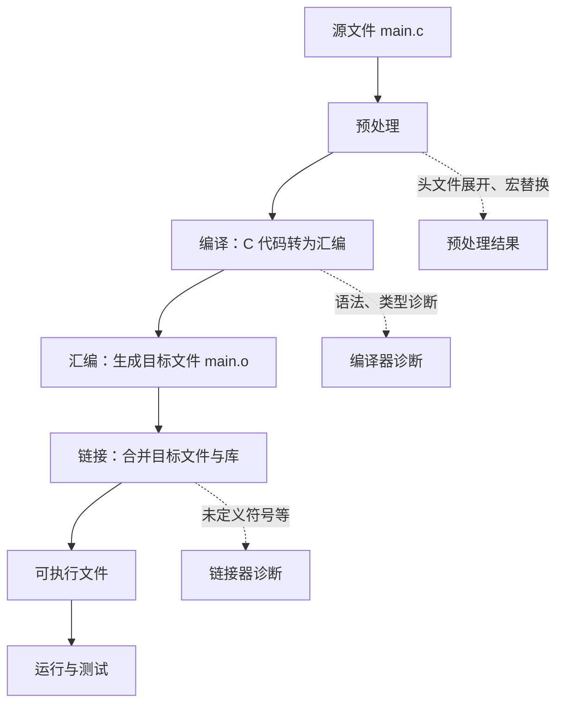
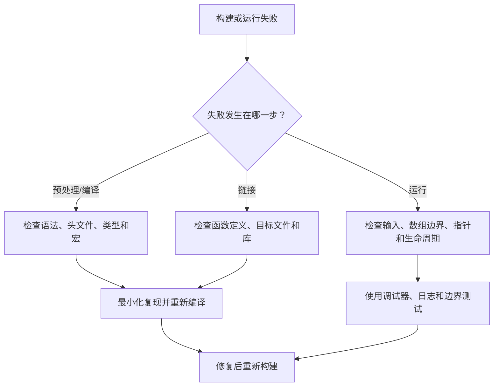

# 01｜环境准备与编译流程

## 学习目标

完成本节后，应能独立创建、编译、运行一个 C 程序；能区分编译错误、链接错误和运行时错误；能使用编译器警告发现常见问题。

## 1. 一个 C 程序经过哪些阶段？



- **预处理**：处理 `#include`、`#define` 和条件编译。它不是完整的 C 语法检查阶段。
- **编译**：检查语法与类型约束，并将翻译单元转换为目标代码。
- **汇编**：把汇编指令转换为目标文件。
- **链接**：解析外部符号，将目标文件和库组合为可执行文件或库。
- **运行**：程序启动后才会发生输入输出、越界访问等运行时行为。

实际工具链可能把多个阶段合并调用；阶段概念仍有助于定位问题。

## 2. 最小可运行程序

```c
#include <stdio.h>

int main(void)
{
    puts("Hello, C!");
    return 0;
}
```

`int main(void)` 明确表示函数不接收参数；`return 0` 表示程序正常结束。标准输出函数 `puts` 会在输出末尾添加换行。

## 3. GCC 编译与诊断

```bash
gcc -std=c11 -Wall -Wextra -Wpedantic main.c -o main
./main
```

Windows 的 MinGW 环境通常可运行 `main.exe`；PowerShell 中可使用 `./main.exe`。若使用 Clang，将命令中的 `gcc` 换为 `clang`。

如果希望观察预处理输出或中间文件，可以按需使用：

```bash
gcc -std=c11 -E main.c -o main.i
gcc -std=c11 -S main.c -o main.s
gcc -std=c11 -c main.c -o main.o
gcc main.o -o main
```

## 4. 错误定位决策图



## 5. 常见问题

- **找不到头文件**：检查安装的编译器、包含目录和文件名大小写。
- **undefined reference / unresolved external**：通常是声明可见，但定义没有参与链接，或库链接顺序/配置有误。
- **把警告当成无关信息**：未初始化变量、隐式转换和格式说明符错误可能导致真实缺陷。
- **只在 IDE 中运行**：还应记录可复现的构建命令，避免依赖不透明的 IDE 配置。

## 6. 练习与验收

1. 编译并运行最小程序。
2. 故意把函数名拼错，观察编译器诊断；再调用一个已声明但未定义的函数，观察链接诊断。
3. 将程序拆成 `main.c` 与 `message.c`，练习分别编译后链接。
4. 写下预处理、编译、汇编、链接各自输入和输出的文件类型。

**验收标准：** 能解释四个构建阶段；能根据错误信息判断大致阶段；能用命令行重新构建项目。
