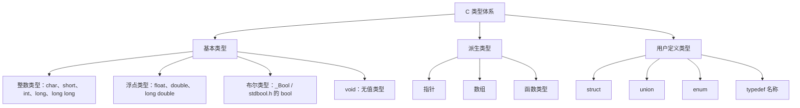
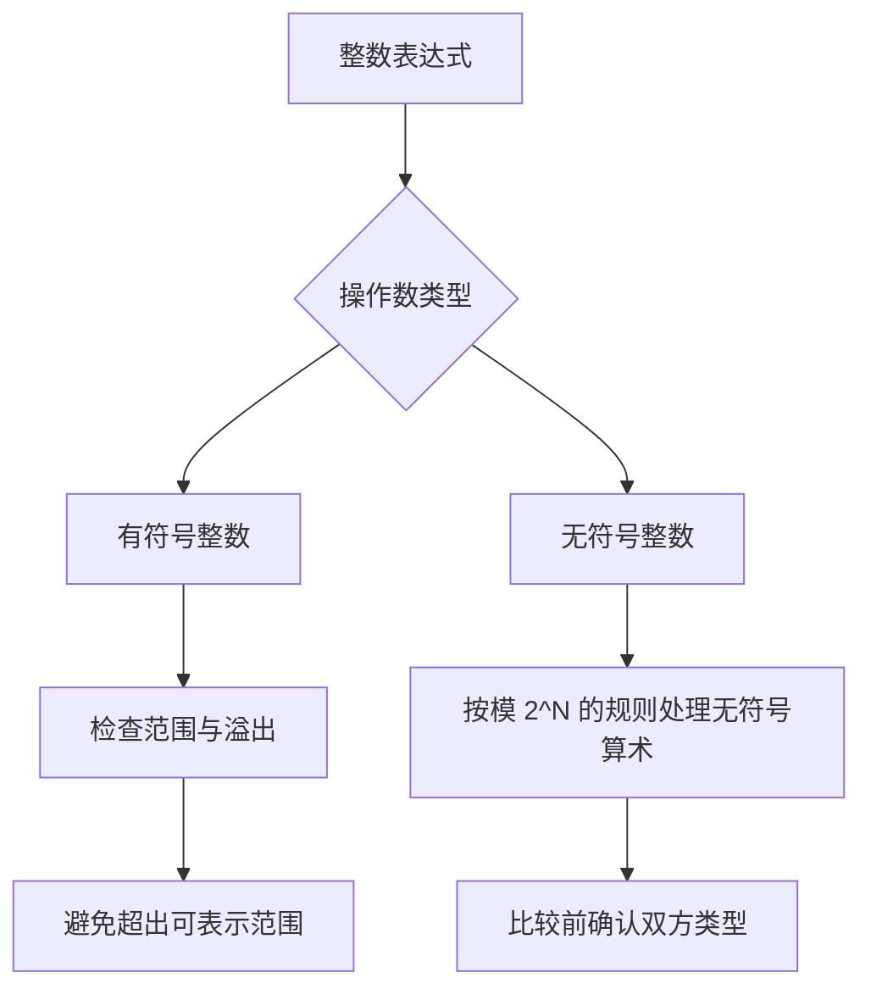

# 02｜基本数据类型

## 学习目标

理解 C 类型描述的对象表示与可执行操作；会使用 `sizeof`、`<limits.h>`、`<stdint.h>`；能避免格式说明符不匹配和有符号整数溢出等问题。

## 1. 类型体系概览



注意：`typedef` 为已有类型建立别名，并不会创建一种全新的、与原类型不兼容的类型。

## 2. 类型大小与取值范围

C 标准规定了类型之间的部分关系，但并不保证所有平台上的字节数都相同。使用 `sizeof(type)` 查看当前实现中的大小；使用 `<limits.h>` 查看整数类型范围。

```c
#include <limits.h>
#include <stdint.h>
#include <stdio.h>

int main(void)
{
    printf("sizeof(char) = %zu\n", sizeof(char));
    printf("sizeof(int) = %zu\n", sizeof(int));
    printf("INT_MIN = %d, INT_MAX = %d\n", INT_MIN, INT_MAX);

    int32_t counter = 100;
    printf("counter = %d\n", (int)counter);
    return 0;
}
```

- `sizeof` 的结果类型是 `size_t`，打印时使用 `%zu`。
- `char` 恰好占一个 C 字节，但一个 C 字节不必在所有实现上都是 8 位。
- 需要明确宽度的整数优先考虑 `intN_t` 等定宽类型（若实现提供）；也可以使用 `uint_leastN_t` 等最小宽度类型。
- 不要仅凭经验假设 `int` 一定是 32 位。

## 3. 有符号、无符号与转换



- 有符号整数运算结果超出可表示范围时，行为未定义；不能依赖回绕结果。
- 无符号整数运算按其范围进行模运算，常见于位掩码和计数器，但混合有符号/无符号比较仍可能产生意外结果。
- 整数除法向零截断，例如 `-7 / 3` 的结果为 `-2`。
- 对负数进行位移、对移位量越界的移位，以及有符号算术右移等场景，要依据标准规则谨慎处理。

## 4. 格式说明符与类型必须匹配

| 数据类型/表达式 | 常见格式说明符 | 提醒 |
|---|---|---|
| `int` | `%d` | 与实参类型匹配 |
| `unsigned int` | `%u` | 不要用 `%d` 代替 |
| `long` | `%ld` | 平台上大小可能不同 |
| `long long` | `%lld` | 注意长度修饰符 |
| `double`（printf） | `%f` | 可变参数中 `float` 会提升为 `double` |
| `size_t` | `%zu` | 用于 `sizeof` 结果 |
| 指针 | `%p` | 通常将指针转换为 `(void *)` |

## 5. 类型选择建议

- 普通计数和索引：根据范围使用合适的整数类型；数组长度与 `sizeof` 结果常使用 `size_t`。
- 协议字段、寄存器映射：明确位宽时考虑定宽整数类型，并检查端序与对齐。
- 浮点测量：选择精度与性能满足需求的类型；不要直接用 `==` 判断一般浮点计算结果是否相等。
- 布尔状态：C99 起可使用 `_Bool`；包含 `<stdbool.h>` 后可使用 `bool`、`true`、`false`。

## 6. 练习与验收

1. 输出本机 `sizeof(char/int/long/long long/float/double/void *)`。
2. 使用 `INT_MIN` 和 `INT_MAX` 解释本机 `int` 范围，不要通过溢出实验推断范围。
3. 比较一个负数与一个无符号整数，先预测转换结果，再用编译器警告验证。
4. 为传感器原始值设计变量类型，并说明范围、单位和溢出策略。

**验收标准：** 能解释类型大小不完全固定的原因；能正确匹配格式说明符；能识别有符号溢出与混合类型比较的风险。
