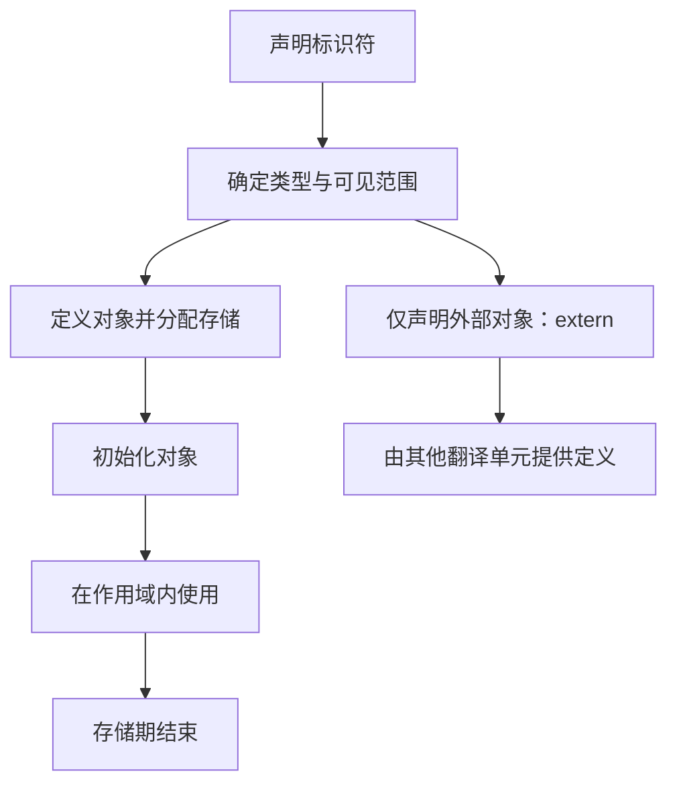
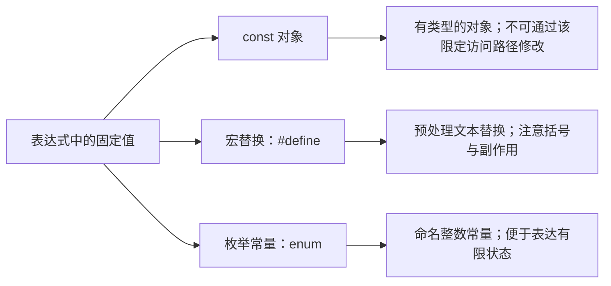
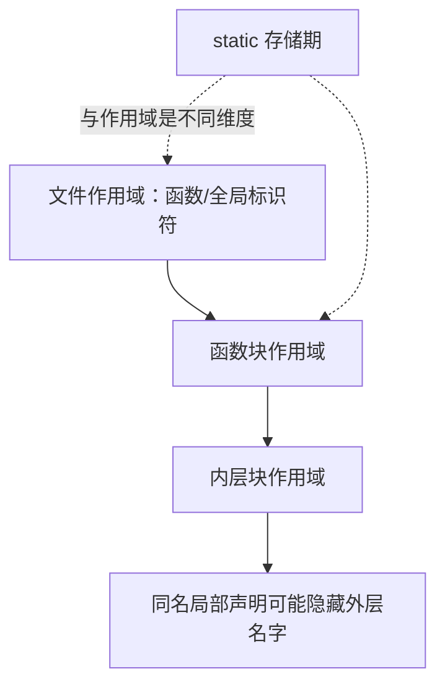

# 03｜变量、常量与作用域

## 学习目标

区分标识符、对象、值、作用域、存储期和链接属性；理解 `const`、`#define`、`static`、`extern` 的不同用途。

## 1. 从声明到对象生命周期



- **声明**告诉编译器标识符的类型和属性；**定义**通常会创建对象或提供函数实体的定义。
- **作用域**回答名字在源代码的哪些位置可见。
- **存储期**回答对象的存储持续多久：自动、静态、线程或分配存储期。
- **链接属性**决定不同作用域/翻译单元中的同名标识符是否指向同一实体。

## 2. 初始化与赋值

```c
int global_count;          /* 文件作用域对象：静态存储期，零初始化 */
static int module_state;   /* 文件作用域内部链接 */
extern int shared_count;   /* 声明外部定义 */

int main(void)
{
    int count = 3;         /* 自动存储期，显式初始化 */
    count = 4;             /* 赋值：修改已有对象的值 */
    const int limit = 10;  /* 通过此标识符不可修改该对象 */
    (void)limit;
    return count == 4 ? 0 : 1;
}
```

未显式初始化的自动存储期局部对象不会自动保证为零；读取其不确定值可能导致未定义行为。具有静态存储期的对象会在程序启动阶段进行零初始化。

## 3. const、宏和枚举常量



- `const int limit = 10;` 是只读对象，不等同于 C++ 中的编译期常量表达式。
- `#define SIZE (10U)` 是预处理替换，不创建变量，也没有普通对象的类型检查。
- `enum State { STATE_IDLE, STATE_BUSY };` 适合表示一组相关状态。
- 对宏参数加括号：`#define SQUARE(x) ((x) * (x))`；即使如此，`SQUARE(i++)` 仍会重复求值，不应这样使用。

## 4. static 与 extern

- **函数内部的 `static` 局部对象**：作用域仍局限于该块，但生命周期贯穿整个程序运行。
- **文件作用域的 `static` 对象或函数**：具有内部链接，其他翻译单元不能通过外部链接直接引用。
- **`extern`**常用于声明在其他位置定义的外部对象或函数；应确保整个程序只有符合规则的定义。
- **普通文件作用域对象**通常具有外部链接（除非另有规则），因此头文件中不要随意放置非 `static` 的对象定义。

## 5. 作用域示意



## 6. 练习与验收

1. 写一个函数，使用局部 `static` 计数，并连续调用三次观察输出。
2. 将一个模块拆分为 `module.h`、`module.c`、`main.c`，区分声明和定义。
3. 将一组状态从魔法数字改为 `enum`。
4. 找出宏中的缺少括号与重复求值风险，并改写为函数或安全表达式。

**验收标准：** 能说明作用域与存储期的区别；能解释 `const`、`#define`、`static`、`extern` 的不同；能避免在头文件中造成多重定义。
