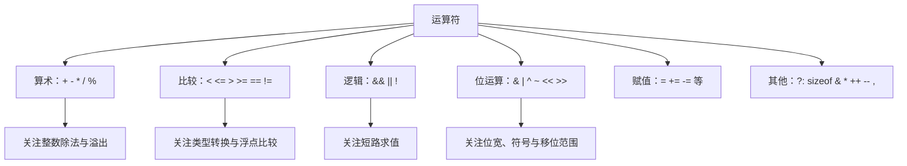

# 04｜运算符与表达式

## 学习目标

掌握常见运算符、整数提升与类型转换；理解优先级和结合性不代表求值顺序；能正确使用短路求值、位掩码和条件运算符。

## 1. 运算符分组



## 2. 优先级、结合性与求值顺序

优先级决定表达式如何分组，结合性决定同优先级运算符如何分组；两者都不等于所有操作数的实际求值顺序。

```c
int result = 2 + 3 * 4;       /* 结果为 14 */
int grouped = (2 + 3) * 4;    /* 结果为 20 */
```

复杂表达式优先拆成多条语句。避免在同一完整表达式中对同一标量对象进行互相冲突且无序的修改，例如不要写 `i = i++ + 1;`。

## 3. 短路求值

```c
if (ptr != NULL && ptr->value > 0) {
    /* 只有 ptr 非空时，才会计算右侧条件 */
}
```

- `A && B`：若 A 为假，B 不求值。
- `A || B`：若 A 为真，B 不求值。
- `&` 与 `|` 是位运算，不具备逻辑运算符的短路语义。
- 短路可用于保护右侧访问，但前提是左侧条件确实排除了风险。

## 4. 位掩码：嵌入式常用模式

```c
#include <stdint.h>

#define BIT_U32(n) (UINT32_C(1) << (n))

uint32_t set_bit(uint32_t reg, unsigned int bit)
{
    if (bit >= 32U) {
        return reg; /* 示例策略：非法位号时不修改 */
    }
    return reg | BIT_U32(bit);
}

uint32_t clear_bit(uint32_t reg, unsigned int bit)
{
    if (bit >= 32U) {
        return reg;
    }
    return reg & ~BIT_U32(bit);
}
```

实际工程中要确保移位量小于左操作数的位宽，并根据接口约定处理非法位号。对硬件寄存器的读改写还需考虑寄存器语义、并发访问和芯片手册，不可只套用普通 RAM 的假设。

## 5. 常见陷阱

- `if (flags & MASK == 0)` 会因优先级导致误读；应写成 `if ((flags & MASK) == 0U)`。
- `&&` 是逻辑与，`&` 是按位与。
- `^ ` 是按位异或，不是乘方。
- 无符号值参与比较时，负数可能转换为很大的无符号数。
- `x << n` 的 `n` 必须在合法范围内；左移前还要确认操作数类型和结果是否可表示。
- 浮点数通常使用误差容限比较，例如判断 `fabs(a - b) < epsilon`，并根据量纲和算法选择容差。

## 6. 练习与验收

1. 对同一表达式添加括号，解释结果变化。
2. 使用 `&&` 安全检查指针，再对比错误的 `&` 写法。
3. 用位掩码完成置位、清位、翻转和测试指定 bit。
4. 设计有符号与无符号混合的比较案例，开启编译器警告并解释转换规则。

**验收标准：** 能区分优先级、结合性与求值顺序；能解释短路求值；能安全地构造常见位掩码操作。
