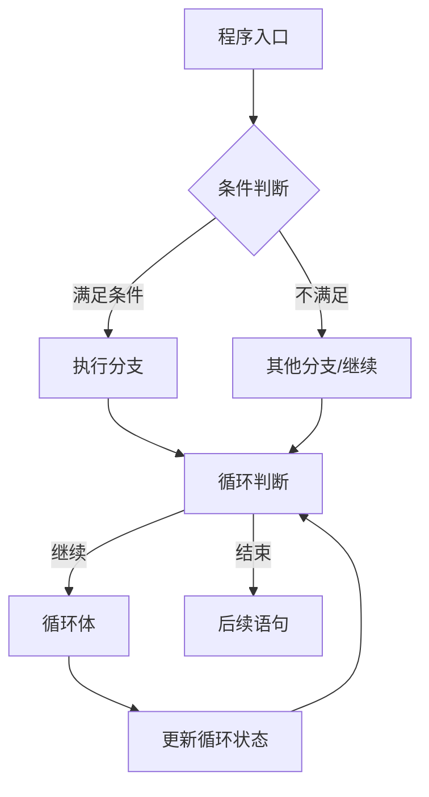
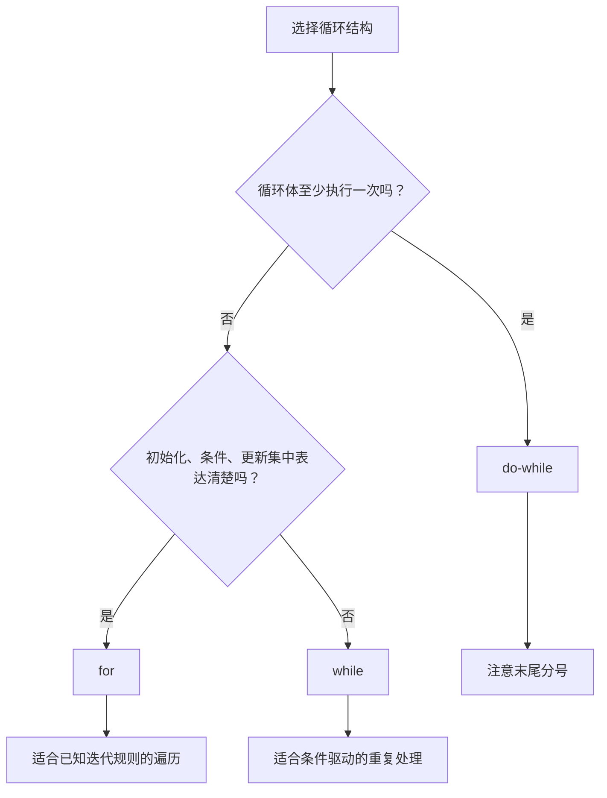
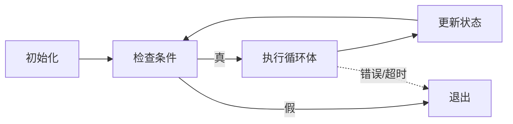

# 05｜分支与循环

## 学习目标

能根据业务条件选择 `if` 或 `switch`；掌握 `for`、`while`、`do-while` 的适用场景；能证明循环会终止，并覆盖边界条件。

## 1. 控制流总览



## 2. if 与 switch

```c
if (temperature < -40) {
    puts("超出示例下限");
} else if (temperature > 125) {
    puts("超出示例上限");
} else {
    puts("处于示例范围");
}
```

- `if` 适合范围判断、复合条件和不连续逻辑。
- `switch` 适合对整数类型、枚举值等进行离散分支选择。
- 每个 `case` 默认会继续执行后续标签中的语句；需要用 `break`、`return` 等明确结束，若刻意贯穿应加注释。
- 不要把浮点数直接用于 `switch` 的控制表达式。

## 3. 三类循环怎么选？



```c
for (size_t i = 0U; i < count; ++i) {
    process(items[i]);
}

while (has_input()) {
    read_next();
}

do {
    status = read_status();
} while (status == STATUS_PENDING);
```

示例中的 `size_t` 适合表示对象数量或数组索引；使用前仍需确认 `count` 与数组实际长度一致。

## 4. 设计可终止的循环

每个循环都应明确：
1. **初始状态**：计数器或条件从哪里开始？
2. **继续条件**：什么情况下还要执行？
3. **状态更新**：每次迭代什么发生变化？
4. **终止条件**：是否一定能走到退出路径？
5. **异常路径**：输入失败、设备超时或数据无效时怎么办？



在嵌入式轮询中，不能只写无期限等待而不评估系统需求。若接口可能永不就绪，应根据设计加入超时、错误码或明确说明这是有意的永久循环。

## 5. break、continue 与嵌套循环

- `break` 结束最近一层循环或 `switch`。
- `continue` 跳过当前迭代剩余语句，进入下一次循环判断/更新。
- 嵌套循环中的 `break` 不会自动退出所有外层循环；可使用返回值、标志变量或抽取函数表达退出意图。
- 避免依靠复杂的多层跳转控制业务流程。

## 6. 练习与验收

1. 写一个菜单程序，处理未知菜单项和输入失败。
2. 用 `for` 统计数组中的最小值、最大值和平均值，测试空数组策略。
3. 将一个有可能永不结束的轮询改为带超时的状态检查。
4. 为嵌套循环设计提前退出逻辑，并解释为何选择标志变量或函数返回。

**验收标准：** 能选用合适的分支和循环；能解释每个循环的终止条件；能覆盖空输入、边界值、错误输入与超时路径。
