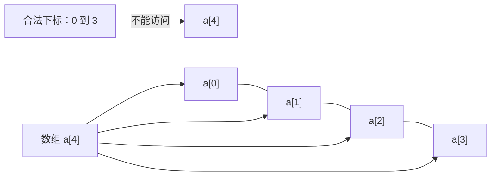
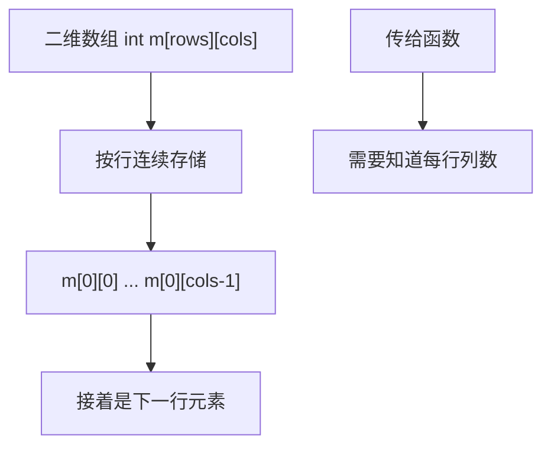

# 07｜数组与边界

## 学习目标

理解数组元素连续存储、下标范围和数组长度计算；能正确处理空数组策略、越界风险以及数组作为函数参数时的类型变化。

## 1. 数组的内存与索引



C 数组不自动保存长度，也不会在运行时自动检查下标。对长度为 `n` 的数组，合法元素下标是 `0` 到 `n - 1`（仅当 `n > 0` 时）。越界访问会导致未定义行为。

## 2. 长度计算与函数参数

```c
#include <stddef.h>

#define ARRAY_LEN(a) (sizeof(a) / sizeof((a)[0]))

static int sum_array(const int *values, size_t count, long long *sum)
{
    if (sum == NULL || (count > 0U && values == NULL)) {
        return 0;
    }

    *sum = 0;
    for (size_t i = 0U; i < count; ++i) {
        *sum += values[i];
    }
    return 1;
}
```

- `ARRAY_LEN` 仅适用于当前作用域中真正的数组表达式；数组作为函数参数时会调整为指针，不能再用该宏获得原数组长度。
- 将数组传入函数时，通常要同时传入元素数量。
- `count == 0` 时函数如何处理，应在接口契约中明确。
- 对可能超过 `long long` 范围的累加仍需设计溢出策略。

## 3. 多维数组



二维数组不是“指针的指针”。例如 `int m[3][4]` 的元素类型是 `int`，每行是一个含 4 个 `int` 的数组。函数形参可以写为 `int m[][4]` 或 `int (*m)[4]`，列数必须匹配。

## 4. 常见边界错误

- 使用 `i <= count` 遍历长度为 `count` 的数组；通常应使用 `i < count`。
- 对空数组或零长度数据执行 `values[0]`。
- 将字节数误当成元素个数。
- 把指针参数当作仍保留数组长度的数组。
- 计算 `count * sizeof(element)` 时没有检查乘法溢出。

## 5. 练习与验收

1. 编写查找最大值函数，明确空数组时的返回策略。
2. 为数组求和函数补充空指针、零长度和最大长度测试。
3. 创建二维矩阵并写一个接收固定列数矩阵的函数。
4. 故意制造一次越界缺陷，在可用环境中使用 AddressSanitizer 观察诊断。

**验收标准：** 能正确计算数组长度；能解释数组参数调整规则；能为每个数组接口明确长度、空输入和越界策略。
