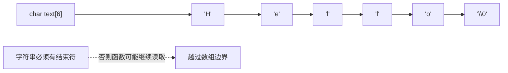

# 08｜字符串与字符处理

## 学习目标

理解 C 字符串是以空字符结束的字符序列；会检查缓冲区容量；能正确使用标准库字符串函数与字符分类函数。

## 1. 字符数组与字符串



`char text[] = "Hello";` 会为 5 个可见字符和结尾的 `'\0'` 分配空间。若写成 `char text[5] = "Hello";`，数组里没有额外空间容纳结束符，因此它不是可直接传给要求 C 字符串的函数的有效零终止字符串。

## 2. 容量与复制

```c
#include <stdio.h>
#include <string.h>

int main(void)
{
    char destination[16];
    const char source[] = "sensor";

    if (sizeof(source) <= sizeof(destination)) {
        memcpy(destination, source, sizeof(source)); /* 包括终止符 */
        puts(destination);
    }
    return 0;
}
```

对于动态输入，先验证长度再复制；不要认为 `strncpy` 总会自动补充结束符。若目标是将输入限制在缓冲区内，可用明确的长度参数、返回值和终止符策略实现接口。

## 3. 常用函数与契约

- `strlen(s)`：计算终止符之前的字符数，不包括 `'\0'`；传入参数必须是有效的零终止字符串。
- `strcmp(a, b)`：按字典序比较两个字符串，结果小于、等于或大于零；不要假设只返回 -1、0、1。
- `strchr(s, ch)`：查找字符；返回指针或 `NULL`。
- `memcpy(dst, src, n)`：复制指定字节数，源和目标区域不得重叠。
- `memmove(dst, src, n)`：允许源和目标区域重叠。
- `snprintf(dst, size, ...)`：限制写入容量；检查返回值以判断是否发生截断。

## 4. 字符分类与安全转换

```c
#include <ctype.h>

int is_ascii_digit(int ch)
{
    return isdigit((unsigned char)ch) != 0;
}
```

传给 `isdigit`、`isspace`、`tolower` 等函数的参数必须是 `EOF` 或可表示为 `unsigned char` 的值。若直接传入可能为负的有符号 `char`，可能产生未定义行为。对 UTF-8 文本，单个字节不一定等于一个完整字符，不能简单地把字节分类函数当作 Unicode 字符处理器。

## 5. 输入处理建议

- 交互式程序优先考虑 `fgets` 读取一行，再解析并检查范围。
- `scanf("%s", buffer)` 若没有宽度限制可能造成缓冲区溢出。
- 使用 `fgets` 后检查是否读到换行；行过长时要明确是拒绝、截断还是清空剩余输入。
- 对数字解析检查空输入、尾随字符、范围错误和转换失败。

## 6. 练习与验收

1. 写一个安全的字符串长度与复制练习，明确容量参数。
2. 使用 `snprintf` 拼接传感器标识和测量值，并检查截断。
3. 解析一行整数输入，拒绝空行、尾随非法字符和超范围值。
4. 用带高位字节的输入验证字符分类函数参数转换。

**验收标准：** 能解释终止符作用；能根据容量选择复制方式；能检查输入解析结果并避免字符分类函数的负值陷阱。
