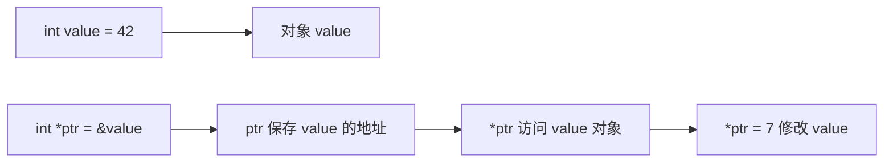
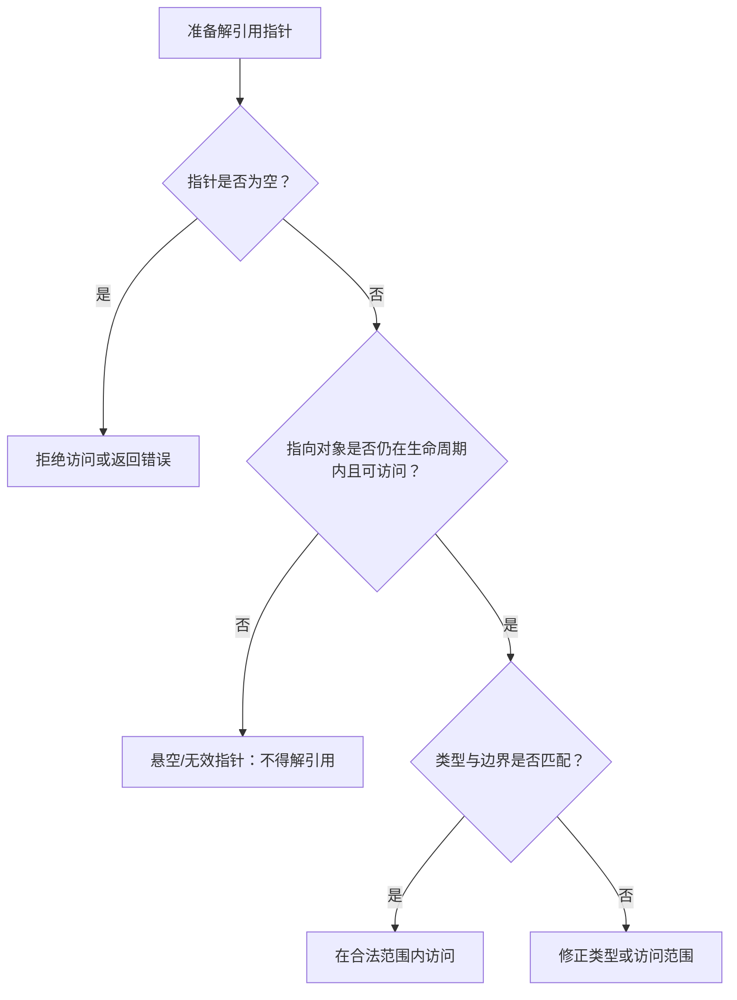
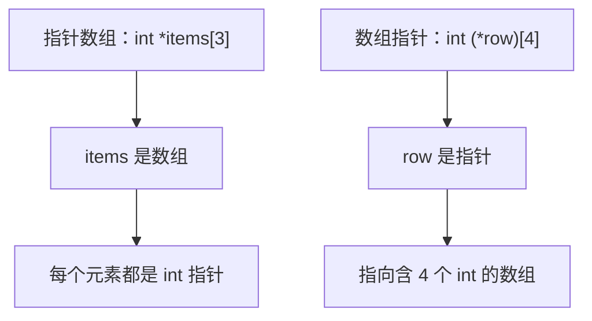

# 09｜指针与地址

## 学习目标

理解指针对象保存地址值；能正确使用取地址和解引用；区分数组指针与指针数组；掌握空指针、有效期和指针运算边界。

## 1. 指针的基本关系



```c
int value = 42;
int *ptr = &value;
*ptr = 7;
/* 此时 value 为 7 */
```

- `&value` 取得对象地址。
- `int *ptr` 声明指向 `int` 的指针对象。
- `*ptr` 是通过指针访问所指对象。
- 指针类型影响解引用类型和指针算术步长；不要随意强制转换来掩盖类型错误。

## 2. 空指针与有效性



检查 `ptr != NULL` 只能排除空指针，不能证明非空指针仍然有效。指针可能悬空、越界、未正确对齐或指向不兼容类型的对象。

## 3. 指针算术

对指向数组元素的指针，只能在同一数组对象内移动，或移动到数组末尾后一位的位置；末尾后一位的指针可以用于比较和循环结束判断，但不能解引用。

```c
int values[] = {10, 20, 30};
int *begin = values;
int *end = values + (sizeof(values) / sizeof(values[0]));

for (int *p = begin; p != end; ++p) {
    /* p 指向有效元素 */
}
```

## 4. 指针数组与数组指针



- `int *items[3]`：3 个指针组成的数组。
- `int (*row)[4]`：指向含 4 个 `int` 元素的数组的指针。
- 括号会改变声明含义。阅读复杂声明时，可从标识符出发，结合括号和运算符优先级解析。

## 5. const 与指针

- `const int *p`：不能通过 `p` 修改所指的 `int`。
- `int *const p`：指针本身不能改指向，但可通过它修改所指对象（若对象本身可修改）。
- `const int *const p`：指针本身和通过它访问的对象都不能经由该路径修改。
- `const` 限定访问路径，不代表其他合法别名绝不可能修改对象。

## 6. 练习与验收

1. 编写通过指针交换两个整数的函数。
2. 用指针遍历数组，并说明为什么不能解引用末尾后一位指针。
3. 声明一个指针数组和一个数组指针，分别打印 `sizeof` 并解释。
4. 画出 `const int *p` 与 `int *const p` 的区别。

**验收标准：** 能解释取地址、解引用、空指针和悬空指针；能正确解析常见指针声明；能遵守数组指针运算边界。
