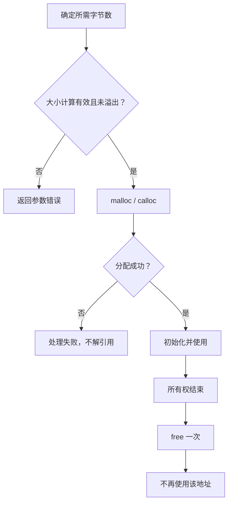

# 10｜动态内存管理

## 学习目标

理解动态分配对象的生命周期；能正确使用 `malloc`、`calloc`、`realloc`、`free`；建立明确的所有权与失败处理规则。

## 1. 动态内存生命周期



## 2. malloc 与 calloc

```c
#include <stdint.h>
#include <stdlib.h>

int *create_values(size_t count)
{
    if (count == 0U || count > SIZE_MAX / sizeof(int)) {
        return NULL;
    }

    int *values = malloc(count * sizeof(*values));
    if (values == NULL) {
        return NULL;
    }

    for (size_t i = 0U; i < count; ++i) {
        values[i] = 0;
    }
    return values;
}
```

上例需要包含 `<stddef.h>` 以提供 `size_t`（某些其他头文件也可能间接定义，但应显式包含所需声明）。`malloc` 分配的存储内容未初始化；`calloc` 将分配区域的每个字节置零，但对复杂对象的语义初始化仍应按类型要求处理。

## 3. realloc 的安全模式

```c
#include <stddef.h>
#include <stdint.h>
#include <stdlib.h>

enum ResizeStatus {
    RESIZE_OK,
    RESIZE_INVALID_SIZE,
    RESIZE_NO_MEMORY
};

static enum ResizeStatus resize_values(int **values, size_t new_count)
{
    if (values == NULL || new_count > SIZE_MAX / sizeof(**values)) {
        return RESIZE_INVALID_SIZE;
    }

    if (new_count == 0U) {
        free(*values);
        *values = NULL;
        return RESIZE_OK;
    }

    int *tmp = realloc(*values, new_count * sizeof(**values));
    if (tmp == NULL) {
        return RESIZE_NO_MEMORY; /* 原内存仍然有效 */
    }

    *values = tmp;
    return RESIZE_OK;
}
```

该示例把零长度请求定义为释放并清空指针；调用方必须保证 `values` 指向一个可写的指针对象，且 `*values` 为 `NULL` 或此前由兼容的动态分配函数返回。不要直接写 `values = realloc(values, size)`，否则失败时可能丢失原指针并造成内存泄漏。

## 4. 所有权规则


- 每块动态分配内存应有清晰所有者。
- 同一块内存不能被重复释放。
- 释放后所有指向该块内存的别名都不能再解引用。
- 函数接口要说明返回的指针由谁释放、是否允许传入空指针、失败时返回什么。
- 动态内存并非总是优于静态或自动存储；在实时嵌入式系统中要评估碎片、确定性和分配失败风险。

## 5. 常见缺陷

- 内存泄漏：所有者丢失了唯一可释放地址。
- 越界访问：申请了 N 个元素，却访问第 N 个元素。
- 使用后释放：`free(p)` 后仍读取 `*p`。
- 重复释放：同一分配被释放多次。
- 未初始化读取：读取 `malloc` 后未写入的内容。
- 分配大小乘法溢出：导致实际分配字节数小于预期。
- 资源释放不完整：错误分支忘记释放先前成功申请的资源。

## 6. 练习与验收

1. 编写动态整数数组创建/销毁函数，明确所有权。
2. 将数组扩容代码改为临时指针模式，并测试分配失败路径。
3. 为申请数量和元素大小添加溢出检查。
4. 使用 AddressSanitizer 或 Valgrind（若环境支持）检查越界、泄漏和释放后使用。

**验收标准：** 能处理分配失败；能说明每个指针的所有权；能避免泄漏、重复释放、越界与释放后使用。
