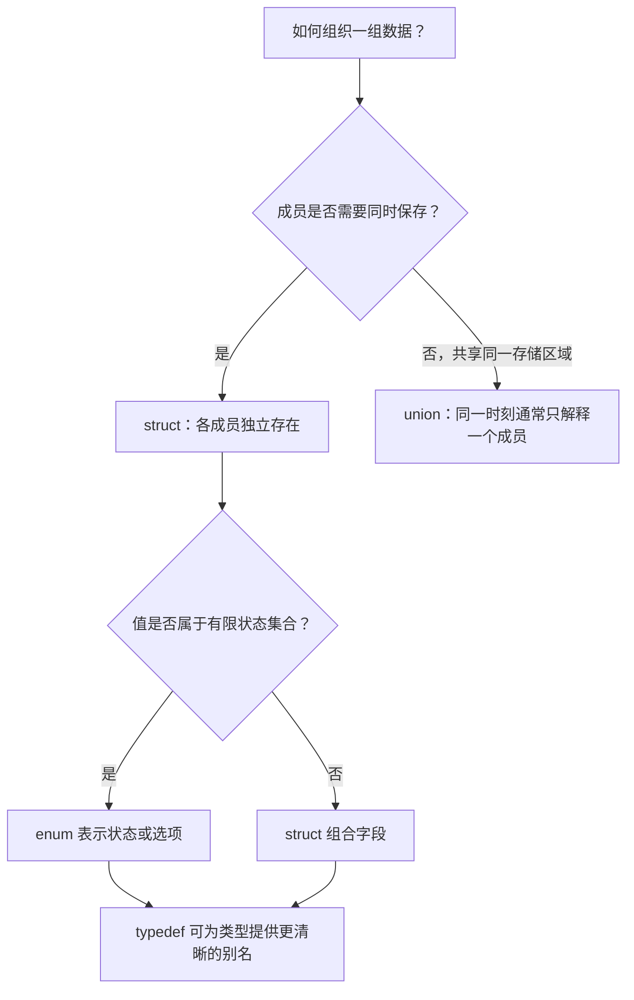

# 11｜结构体、联合体、枚举与类型别名

## 学习目标

能用 `struct` 建模相关数据，用 `enum` 表达有限状态，用 `union` 表达共享存储；理解成员对齐与填充，并谨慎使用位域。

## 1. 选择合适的自定义类型



## 2. struct：把相关字段组合起来

```c
#include <stdint.h>

typedef struct {
    uint16_t id;
    uint8_t status;
    int32_t value;
} SensorSample;

static void reset_sample(SensorSample *sample)
{
    if (sample == 0) {
        return;
    }
    sample->id = 0U;
    sample->status = 0U;
    sample->value = 0;
}
```

- `.` 用于结构体对象成员访问，`->` 用于结构体指针成员访问。
- 结构体赋值会按成员复制其值；若成员含指针，复制指针并不会复制其指向的动态资源。
- `sizeof(SensorSample)` 可能大于各成员大小之和，因为实现可以插入填充字节。

## 3. 对齐与填充


不要为了“节省几个字节”随意重排公开协议结构。结构体布局可能受 ABI、编译器选项和目标平台影响；跨设备通信、文件格式或网络协议应显式序列化字段，并处理端序、字段宽度和校验。

## 4. enum：表达有限状态

```c
typedef enum {
    SENSOR_STATE_INIT = 0,
    SENSOR_STATE_READY,
    SENSOR_STATE_ERROR
} SensorState;
```

枚举常量适合替代难以理解的魔法数字。若枚举值会写入外部协议或硬件寄存器，应显式指定需要的数值并检查底层表示和转换，不要假设所有实现的枚举类型大小都相同。

## 5. union：共享存储的解释方式

```c
typedef union {
    uint32_t raw;
    uint8_t bytes[4];
} RawWord;
```

联合体的大小足以容纳其最大成员（并满足对齐要求）。读取哪个成员、对象表示如何解释，必须依据 C 标准规则和具体应用约束；不要把联合体当作无条件、跨平台的序列化工具。对字节序敏感的场景，应显式移位与掩码解码。

## 6. 位域注意事项

位域可用于表达受限宽度字段，但可分配顺序、存储单元和跨边界布局存在实现定义或未指定的细节。它们通常不适合作为可移植的网络报文或硬件寄存器布局契约。协议字段优先使用定宽整数和掩码操作。

## 7. 练习与验收

1. 定义传感器采样结构体，包含 ID、状态、原始值和有效标志。
2. 比较不同成员排列下的 `sizeof`，记录本机结果并解释填充。
3. 用枚举重构一个状态机，明确每个状态允许的转换。
4. 将 32 位原始数据解码成协议字段，不依赖结构体强制转换或位域布局。

**验收标准：** 能区分 struct 和 union；能解释对齐填充；能用 enum 表达状态；能识别位域与结构体布局的可移植性限制。
