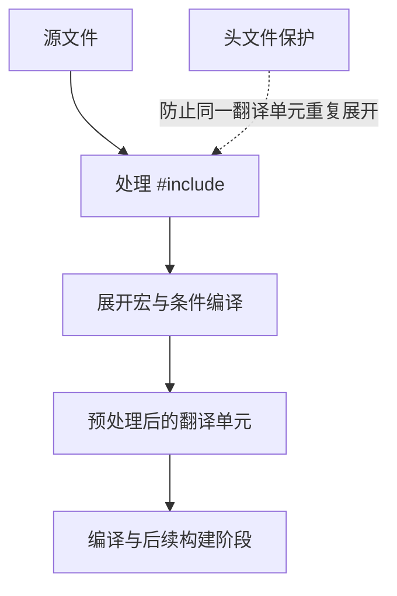
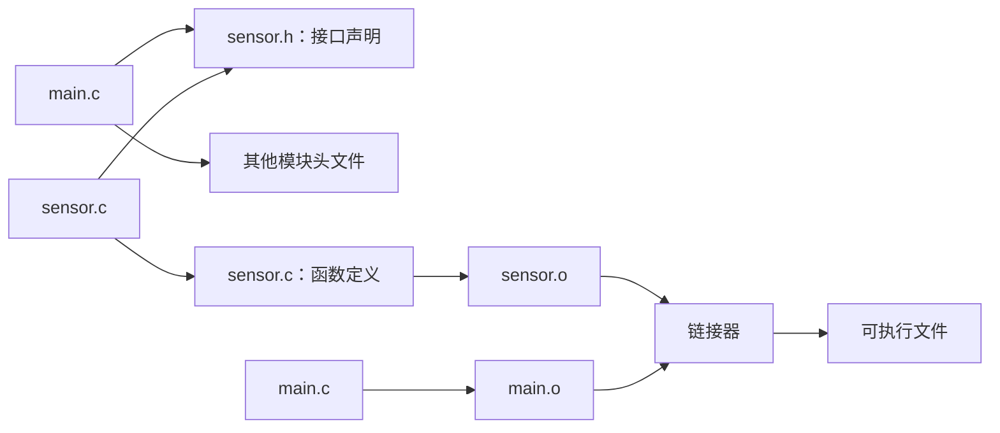

# 12｜预处理器与头文件

## 学习目标

理解 `#include`、`#define`、条件编译与头文件保护；能设计稳定的模块接口，并避免宏重复求值和头文件多重定义。

## 1. 预处理发生在编译之前



## 2. 头文件保护

```c
#ifndef SENSOR_H
#define SENSOR_H

#include <stdint.h>

typedef struct {
    uint16_t id;
    int32_t value;
} SensorSample;

int sensor_read(SensorSample *out);

#endif /* SENSOR_H */
```

头文件保护避免一个头文件在同一翻译单元内被重复包含。它不能解决所有跨文件多重定义问题：普通外部对象的定义应放在一个 `.c` 文件中，而头文件通常放声明和类型定义。

## 3. 声明与定义分离

```c
/* sensor.h */
#ifndef SENSOR_H
#define SENSOR_H
int sensor_init(void);
#endif

/* sensor.c */
#include "sensor.h"
int sensor_init(void)
{
    /* 实际初始化逻辑 */
    return 0;
}
```

调用方包含头文件即可检查接口类型；链接时必须把提供函数定义的目标文件或库加入构建。若头文件中直接定义普通外部链接的全局对象，多个源文件包含它时可能产生多重定义。

## 4. 宏的正确使用

```c
#define ARRAY_COUNT(a) (sizeof(a) / sizeof((a)[0]))
#define CLAMP_MIN(value, min_value) (((value) < (min_value)) ? (min_value) : (value))
```

- 宏参数和整个表达式都应适当加括号。
- 宏参数可能被展开或求值多次；不要将带副作用的表达式传入多次使用的宏。
- `ARRAY_COUNT` 只适用于当前作用域里的真实数组，不适用于已经调整为指针的函数参数。
- 对需要类型检查、单次求值或调试能力的逻辑，优先使用函数。

## 5. 条件编译

```c
#ifdef DEBUG
    /* 仅调试构建启用的诊断 */
#endif

#if defined(PLATFORM_A)
    /* 平台 A 实现 */
#elif defined(PLATFORM_B)
    /* 平台 B 实现 */
#else
    #error "Unsupported platform"
#endif
```

条件编译适合平台差异和可选诊断，但应限制分支数量并保证每种受支持配置都能构建。宏名应有模块前缀，避免与系统头文件或其他模块冲突。

## 6. 头文件依赖关系



尽量让头文件自包含：直接包含它自身声明所需的标准头文件；避免无必要地包含大型依赖；通过前置声明减少循环依赖，但只有在类型使用场景允许时才适用。

## 7. 练习与验收

1. 为传感器模块拆分头文件与源文件。
2. 创建两个源文件都包含的头文件，验证声明与定义放置不当导致的问题。
3. 写一个存在重复求值风险的宏，并改为安全函数。
4. 为调试日志添加条件编译开关，并确保关闭日志时仍可正常构建。

**验收标准：** 能解释预处理和编译的关系；能正确使用头文件保护；能区分声明和定义；能识别宏的重复求值风险。
