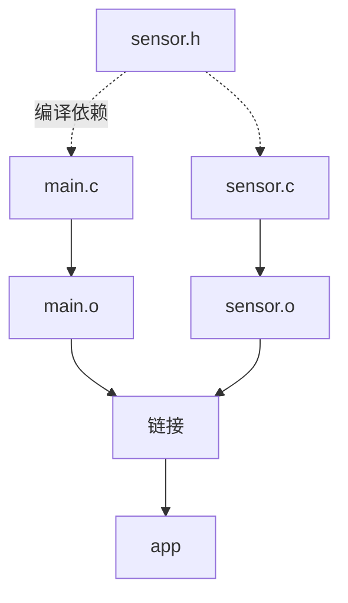
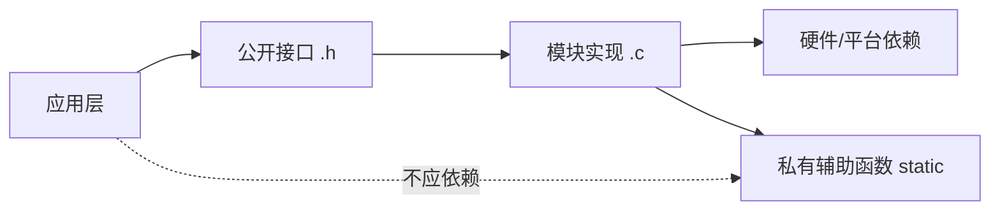

# 13｜编译、链接与模块化

## 学习目标

能把多文件程序组织为模块；理解翻译单元、目标文件、外部符号和库；会用 Makefile 描述依赖并生成可重复构建。

## 1. 多文件构建流水线



每个 `.c` 文件通常独立预处理和编译成目标文件；链接器再解析跨翻译单元的外部符号。头文件变更可能要求重新编译所有依赖它的源文件。

## 2. 一个最小模块

```c
/* sensor.h */
#ifndef SENSOR_H
#define SENSOR_H
int sensor_get_value(void);
#endif

/* sensor.c */
#include "sensor.h"
int sensor_get_value(void)
{
    return 42; /* 教学占位值 */
}

/* main.c */
#include <stdio.h>
#include "sensor.h"
int main(void)
{
    printf("%d\n", sensor_get_value());
    return 0;
}
```

把以上内容分别保存为三个文件后，可执行：

```bash
gcc -std=c11 -Wall -Wextra -Wpedantic -c sensor.c -o sensor.o
gcc -std=c11 -Wall -Wextra -Wpedantic -c main.c -o main.o
gcc main.o sensor.o -o app
```

## 3. 符号与链接错误

- **编译错误**：当前翻译单元语法或类型检查失败。
- **未定义引用**：声明可见，但链接阶段没有找到对应定义，或所需库未参与链接。
- **多重定义**：多个目标文件提供了不符合规则的同名外部定义。
- **内部链接**：文件作用域的 `static` 函数或对象通常只在本翻译单元内部可见。
- **外部链接**：允许符合规则的声明在不同翻译单元引用同一实体。

## 4. Makefile 构建图

```make
CC      ?= gcc
CFLAGS  ?= -std=c11 -Wall -Wextra -Wpedantic
TARGET  := app
OBJS    := main.o sensor.o

$(TARGET): $(OBJS)
	$(CC) $(OBJS) -o $@

main.o: main.c sensor.h
	$(CC) $(CFLAGS) -c main.c -o $@

sensor.o: sensor.c sensor.h
	$(CC) $(CFLAGS) -c sensor.c -o $@

.PHONY: clean
clean:
	rm -f $(OBJS) $(TARGET)
```

Makefile 的命令行必须以 Tab 开头。此示例适用于常见 Unix-like shell；Windows 原生环境的清理命令可能需要调整。大型工程可用自动生成的依赖文件，避免遗漏间接头文件依赖。

## 5. 模块边界如何设计？



公开接口只暴露调用方需要知道的内容；内部辅助函数尽量使用 `static`；头文件避免暴露不必要的内部状态。模块之间通过清晰的输入、输出、错误码和生命周期契约协作。

## 6. 练习与验收

1. 将一个单文件程序拆分成至少两个模块。
2. 分别制造未定义引用和多重定义错误，阅读诊断信息。
3. 编写 Makefile，并验证修改头文件后相关对象文件会重建。
4. 找出可以改为 `static` 的私有函数，减少符号暴露。

**验收标准：** 能独立编译并链接多文件项目；能区分常见链接错误；能设计清晰的模块接口。
