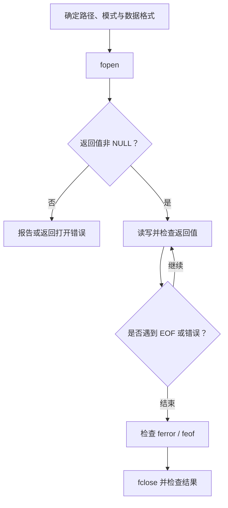
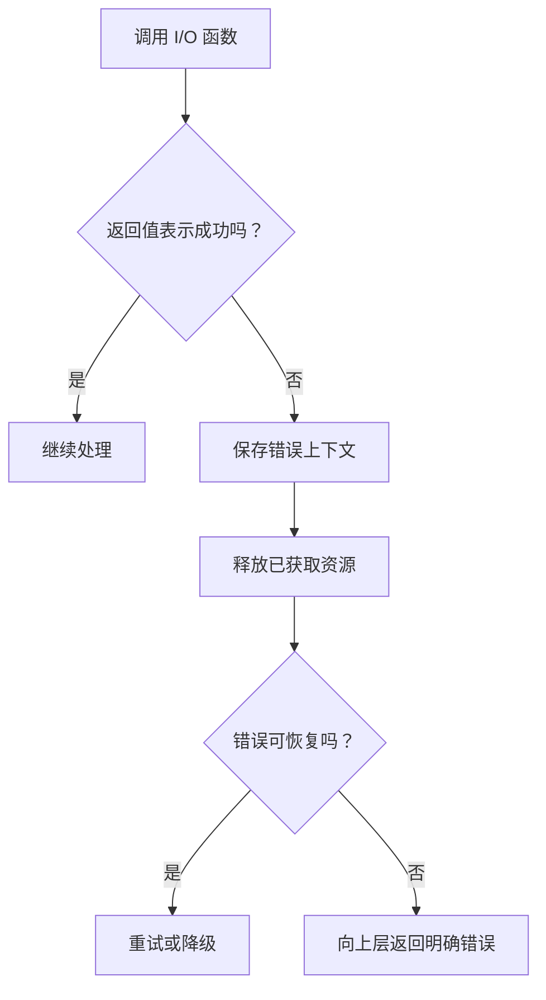

# 14｜文件输入输出与错误处理

## 学习目标

掌握文件打开、读写、关闭的基本流程；能检查标准库返回值；理解文本/二进制模式、缓冲和错误处理。

## 1. 文件操作生命周期



## 2. 安全写入文本文件

```c
#include <stddef.h>
#include <stdio.h>

int write_report(const char *path, int value)
{
    if (path == NULL) {
        return -1;
    }

    FILE *fp = fopen(path, "w");
    if (fp == NULL) {
        return -2;
    }

    int failed = fprintf(fp, "value=%d\n", value) < 0;
    if (fclose(fp) != 0) {
        failed = 1;
    }
    return failed ? -3 : 0;
}
```

真实代码需要包含提供 `NULL` 定义的头文件（例如 `<stddef.h>`）；也可以在这个示例中直接增加该头文件。返回码应在模块接口中定义清楚，必要时记录平台错误信息。

## 3. 文本与二进制模式

- `"r"`：读取已存在文件；`"w"`：创建或截断写入；`"a"`：追加写入。
- `"rb"`、`"wb"`：以二进制模式打开，适合处理原始字节数据。
- 文本模式与二进制模式的差异可能随平台而异，尤其是换行转换。
- `fread` 和 `fwrite` 的返回值是成功读写的元素数量，不是必然等于字节数；应结合元素大小与实际返回值判断。
- 读取结构体原始字节并不自动产生可移植文件格式，结构体填充、端序和版本变化都可能影响兼容性。

## 4. 读取循环与错误判断

```c
#include <stdio.h>

int count_lines(FILE *fp, size_t *line_count)
{
    if (fp == NULL || line_count == NULL) {
        return -1;
    }

    size_t count = 0U;
    int ch;
    while ((ch = fgetc(fp)) != EOF) {
        if (ch == '\n') {
            ++count;
        }
    }

    if (ferror(fp)) {
        return -2;
    }
    *line_count = count;
    return 0;
}
```

该函数统计换行符数量，不等同于所有文本定义下的逻辑行数；若文件最后一行没有换行符，仍需要根据业务规则决定如何计数。对于需要区分读到 EOF 和读取失败的循环，应在循环后检查 `ferror`。

## 5. 错误处理策略



错误处理不应只打印一句信息后继续使用无效数据。要明确哪些错误可以重试、重试次数、是否允许部分写入，以及关闭文件和释放其他资源的路径。

## 6. 练习与验收

1. 写一个将结构化数据输出为文本报告的函数，检查每个写入结果。
2. 读取一个不存在的文件，确认失败路径不会解引用空的 `FILE *`。
3. 使用 `fread` 读取定长记录，并处理不完整尾记录。
4. 模拟写入失败或磁盘空间不足的场景，设计资源清理流程。

**验收标准：** 能检查打开、读写、关闭结果；能区分 EOF 和 I/O 错误；能设计明确的资源清理与错误传播策略。
