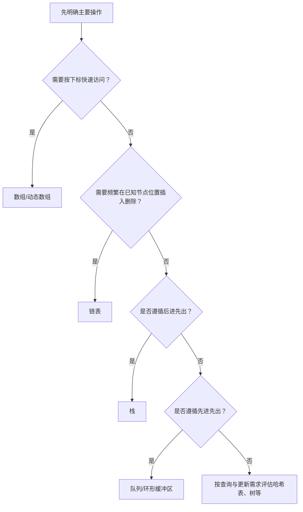
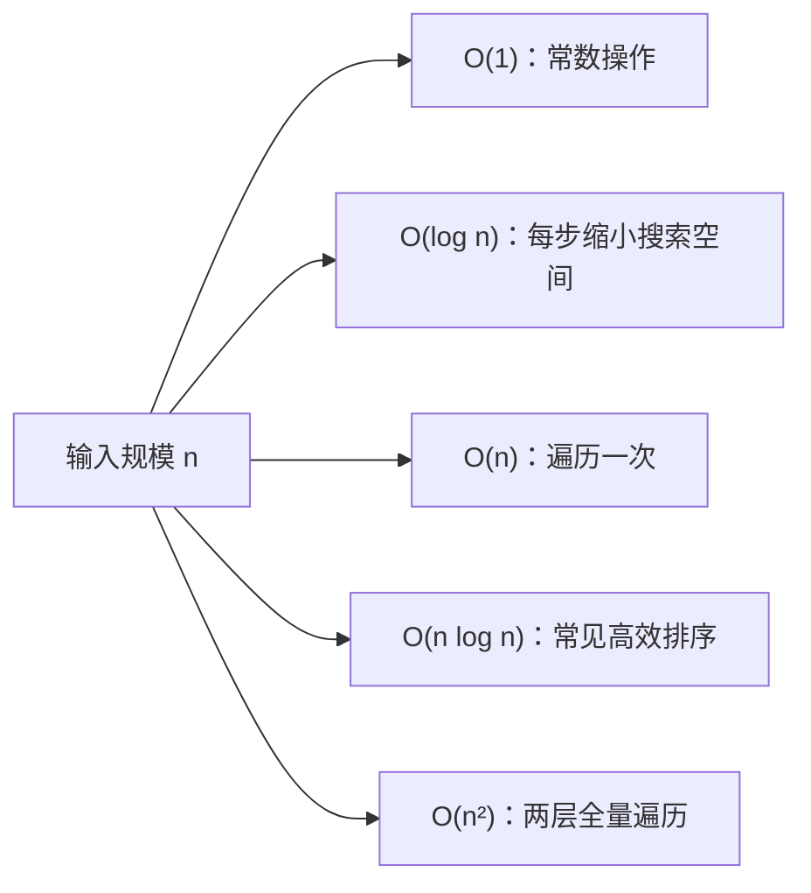

# 15｜数据结构与复杂度入门

## 学习目标

理解常见数据结构的用途和基本操作成本；能选择数组、链表、栈、队列或哈希表；掌握时间复杂度与空间复杂度的初步分析方法。

## 1. 根据操作选择结构



结构选择依赖访问模式、内存预算、实时性和实现复杂度，不应只凭某个操作的理论复杂度决定。

## 2. 常见结构对比

| 结构 | 适合场景 | 典型特征 |
|---|---|---|
| 数组 | 索引访问、连续数据 | 下标访问 O(1)，中间插入通常需移动元素 |
| 链表 | 节点数量变化、已知节点位置插入/删除 | 查找通常 O(n)，需维护指针和生命周期 |
| 栈 | 调用路径、撤销、解析 | 后进先出，压入/弹出通常 O(1) |
| 队列 | 任务排队、消息缓冲 | 先进先出；环形队列可避免每次搬移元素 |
| 哈希表 | 按键查询 | 平均查询常为 O(1)，碰撞严重时可能退化 |
| 二叉搜索树 | 有序查询与更新 | 平衡树操作通常 O(log n)，普通树可能退化 |

## 3. 时间复杂度直觉



复杂度描述输入规模增长时的渐近趋势，不直接等同于实际运行时间。嵌入式系统还需考虑常数开销、缓存、分配行为、最坏执行时间和内存峰值。

## 4. 环形缓冲区的索引思路

容量为正数的环形缓冲区通常维护读索引、写索引和占用量或满/空标志。每次推进索引时需绕回容量范围内。

```c
#include <stddef.h>

static size_t next_index(size_t index, size_t capacity)
{
    if (capacity == 0U) {
        return 0U; /* 调用方仍需把零容量视为无效配置 */
    }
    ++index;
    return index == capacity ? 0U : index;
}
```

此函数假设输入索引满足 `index < capacity`；工程实现应在接口边界验证这个不变量。多生产者/多消费者或中断与主循环并发访问时，还需要同步和内存可见性设计，不能只依赖索引绕回逻辑。

## 5. 练习与验收

1. 分别用数组和链表实现简单整数集合，比较查找和插入成本。
2. 用数组实现栈，处理栈满、栈空和容量为零的情况。
3. 实现环形队列，明确如何区分满和空。
4. 估算双层循环、二分查找和线性查找的复杂度，并说明适用前提。

**验收标准：** 能根据主要操作选择数据结构；能分析常见操作复杂度；能为缓冲区明确容量、满空状态和并发约束。
