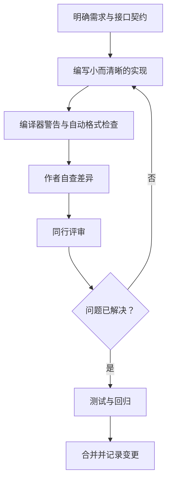

# 31. 代码规范、命名与代码评审

## 学习目标

- 建立一致的命名、格式和函数组织规则。
- 让代码表达意图，减少评审者需要猜测的隐含前提。
- 用可执行的检查清单发现风险，而不是只讨论个人风格。

## 工程流程



## 命名原则

- 名称表达含义和单位：优先使用 `timeout_ms`，而不是 `t`。
- 函数名体现动作；谓词函数明确表示真假条件，例如 `is_frame_valid()`。
- 一个函数聚焦一个主要职责；复杂逻辑拆成可命名的步骤。
- 宏参数避免重复求值副作用；简单常量优先使用有类型的常量或枚举。
- 注释解释“为什么”和约束条件，不要逐行翻译代码。

## 示例

```c
#include <stdbool.h>
#include <stddef.h>
#include <stdint.h>

#define SENSOR_MAX_RAW_VALUE UINT16_C(4095)

static bool sensor_raw_is_valid(uint16_t raw)
{
    return raw <= SENSOR_MAX_RAW_VALUE;
}

bool sensor_convert(uint16_t raw, uint32_t *millivolts)
{
    if ((millivolts == NULL) || !sensor_raw_is_valid(raw)) {
        return false;
    }

    /* 参考电压为 3300 mV；先提升位宽，避免中间乘法溢出。 */
    *millivolts = ((uint32_t)raw * UINT32_C(3300)) /
                  SENSOR_MAX_RAW_VALUE;
    return true;
}
```

该例还需要包含 `<stddef.h>` 才能使用 `NULL`。实际工程应按接口契约明确输出参数失败时是否保持原值。

## 评审检查清单

- [ ] 输入范围、空指针和返回值是否处理？
- [ ] 所有权、生命周期、单位和并发前提是否明确？
- [ ] 整数提升、溢出、移位和数组边界是否安全？
- [ ] 是否引入不必要的全局状态、复制或阻塞？
- [ ] 测试覆盖正常、边界、非法和故障路径？
- [ ] 变更是否只做与需求相关的事？

## 练习与验收

挑选一个已有 C 函数，写出它的前置条件、后置条件和失败语义，再进行一次自我代码评审。验收标准：每条意见都能对应到具体风险、规则或测试，而非“我习惯这样写”。
