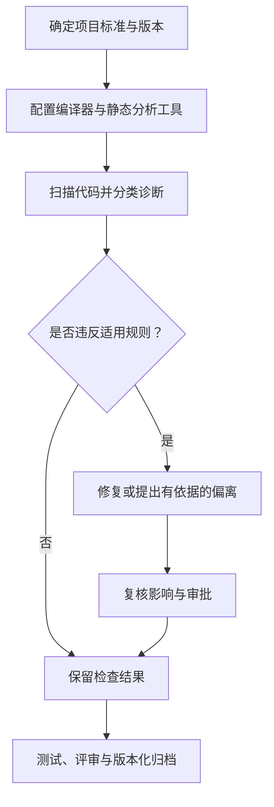

# 32. MISRA C 基础与常见风险

## 学习目标

理解 MISRA C 是面向安全、可靠和可维护 C 代码的一套编码指南；它帮助约束高风险语言特性，但**遵循指南不等于系统已经安全，也不自动代表获得认证**。项目必须明确适用版本、规则集、工具和偏离审批流程。

## 从规则到证据



## 常见高风险写法

### 1. 无符号与有符号混合比较

```c
#include <stdbool.h>
#include <stddef.h>

bool index_is_valid(size_t index, size_t length)
{
    return index < length;
}
```

索引与长度尽量使用同一套无符号类型。不要通过把负数强制转换成 `size_t` 来“修复”比较；应在转换前验证输入的合法范围。

### 2. 宏的副作用

```c
#define SQUARE(x) ((x) * (x))

/* 错误示范：SQUARE(i++) 会多次修改 i。 */
```

优先使用带明确类型的静态内联函数，避免宏重复求值。宏仍适用于条件编译和部分编译期场景，但应限制副作用。

### 3. 指针与对象生命周期

不得解引用空指针、已释放指针、越界指针或指向生命周期已结束对象的指针。不要把结构体原始内存直接当作可移植的外部协议格式。

### 4. 隐式转换与算术

对窄化、符号转换、移位宽度和算术边界保持显式意识。强制类型转换只改变表达式类型，不会自动证明数值在目标类型范围内。

## 工程落地步骤

1. 阅读项目适用的 MISRA 版本及规则说明，不能仅依赖二手摘要。
2. 将规则映射到编译器警告、静态分析和代码评审。
3. 每条偏离记录原因、风险评估、补偿措施、批准人和复审条件。
4. 将检查配置纳入版本控制和持续集成，防止规则无意中漂移。
5. 把工具告警与测试、架构分析和系统安全活动结合起来。

## 练习与验收

找出项目中 5 处隐式转换、宏副作用或指针生命周期风险，说明潜在后果、修复方法以及对应测试。验收时必须区分“工具未报告问题”和“已证明不存在问题”。
