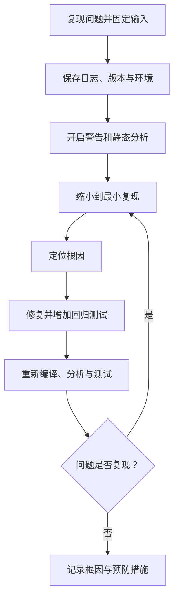

# 33. 静态分析、编译器警告与缺陷定位

## 学习目标

- 将编译器警告视为反馈信号，而不是简单关闭的噪声。
- 区分编译错误、警告、静态分析告警和运行时故障。
- 建立可重复的缺陷定位与修复验证流程。

## 缺陷处理闭环



## 推荐编译命令

```sh
cc -std=c11 -Wall -Wextra -Wpedantic -Wconversion -Wshadow \
   -Wstrict-prototypes -Wmissing-prototypes -g source.c -o app
```

不同编译器支持的选项不同；逐项启用并理解告警含义。不要为了得到“零告警”而盲目强制转换、隐藏诊断或全局关闭规则。

## 典型缺陷：返回值被忽略

```c
#include <errno.h>
#include <stdio.h>

int read_first_line(const char *path)
{
    FILE *fp = fopen(path, "r");
    if (fp == NULL) {
        return errno != 0 ? errno : 1;
    }

    int ch = fgetc(fp);
    int close_result = fclose(fp);

    if ((ch == EOF) || (close_result != 0)) {
        return 1;
    }
    return 0;
}
```

这里的接口只示范检查打开、读取和关闭结果。真实实现应明确 EOF 与读取错误的区别（读取后检查 `ferror(fp)`），并定义错误码映射策略。

## 定位策略

- 先复现，再改代码；记录输入、构建参数、编译器版本和提交版本。
- 通过二分、日志或调试器缩小范围，避免一次改动多个无关因素。
- 检查边界值、错误路径、生命周期和整数转换。
- 对内存错误可在主机环境使用 AddressSanitizer/UndefinedBehaviorSanitizer（工具链支持时）。
- 静态分析结果需要分类和复核；工具可能存在误报，也可能漏报。

## 练习与验收

为一个小模块建立独立构建命令，启用警告并运行静态分析。提交一份缺陷记录：复现步骤、根因、修复差异、回归用例和未覆盖风险。
