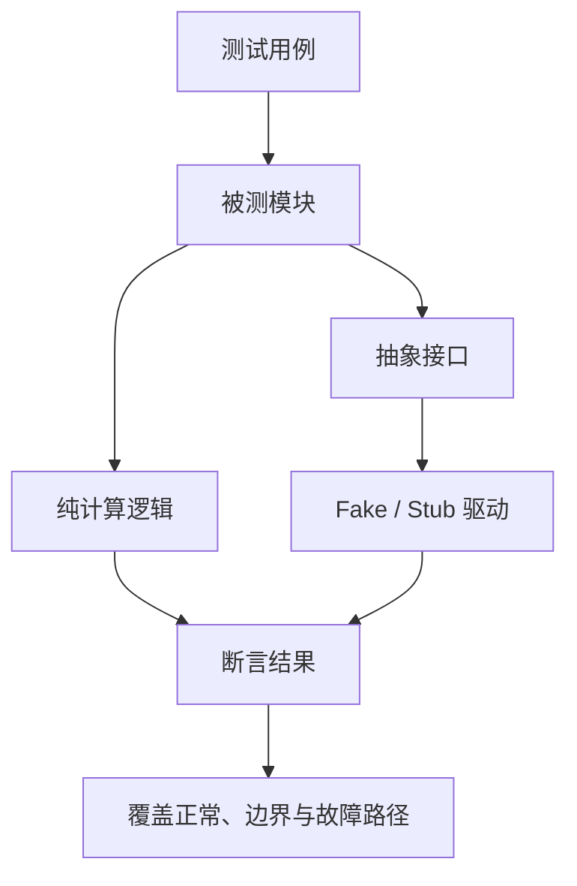

# 34. 单元测试框架、测试替身与覆盖率

## 学习目标

将业务逻辑与硬件依赖隔离，理解 Fake、Stub、Mock 的用途，并正确解读覆盖率指标。覆盖率是测试充分性的线索，不是正确性的证明。

## 测试结构



## 可独立测试的纯函数

```c
#include <stdbool.h>
#include <stddef.h>
#include <stdint.h>

bool scale_adc_to_mv(uint16_t raw,
                     uint16_t full_scale,
                     uint32_t reference_mv,
                     uint32_t *result)
{
    if ((result == 0) || (full_scale == 0U) || (raw > full_scale)) {
        return false;
    }

    *result = (uint32_t)(((uint64_t)raw * reference_mv) / full_scale);
    return true;
}
```

示例使用固定宽度类型；中间乘法使用 uint64_t，避免 uint16_t 原始值与 uint32_t 参考电压相乘时发生 32 位溢出；目标平台仍需确认支持 uint64_t 运算。生产代码也可用 `NULL` 替代 `0`，并包含 `<stddef.h>`。

## 最小测试思路

```c
#include <assert.h>
#include <stdint.h>

int main(void)
{
    uint32_t mv = 0U;

    assert(scale_adc_to_mv(0U, 4095U, 3300U, &mv));
    assert(mv == 0U);

    assert(scale_adc_to_mv(4095U, 4095U, 3300U, &mv));
    assert(mv == 3300U);

    assert(!scale_adc_to_mv(4096U, 4095U, 3300U, &mv));
    assert(!scale_adc_to_mv(0U, 0U, 3300U, &mv));
    assert(!scale_adc_to_mv(0U, 4095U, 3300U, 0));
    return 0;
}
```

将函数与测试放在同一翻译单元，或在测试构建中链接对应实现。注意：标准 `assert` 在定义 `NDEBUG` 时会被禁用，测试构建不能无意间关闭断言。

## 测试替身

- **Stub**：提供预设响应，例如固定返回一次 ADC 读取失败。
- **Fake**：用简化实现模拟依赖，例如内存中的 EEPROM。
- **Mock**：记录调用及参数，用于验证交互约束。
- 硬件寄存器、时钟和中断通常通过平台接口隔离；主机测试替身不能替代真实目标板验证。

## 覆盖率与验收

至少覆盖正常值、最小值、最大值、越界值、空指针、依赖失败和重复调用。语句/分支覆盖率有助于发现未执行路径，但不能证明所有输入都正确。安全关键项目应按其标准定义覆盖率目标和独立评审要求。

练习：为一个传感器转换模块注入驱动失败、无效原始值和超时，确保每条失败路径都有可观察的结果。
