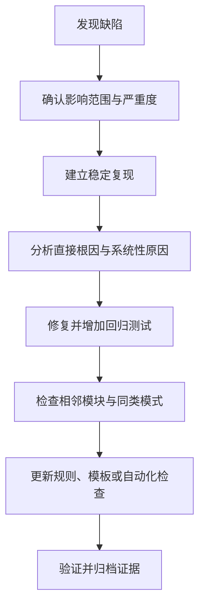

# 35. 代码审查清单、缺陷复盘与回归验证

## 学习目标

把评审从“看起来没问题”转化为可追踪的风险检查，并在修复缺陷后避免同类问题再次出现。

## 从缺陷到预防

## 代码审查清单

### 正确性
- [ ] 输入、输出、返回值和错误码是否有明确契约？
- [ ] 数组索引、长度、空指针和对象生命周期是否安全？
- [ ] 有符号/无符号转换、移位、乘加和定点缩放是否有范围证明？
- [ ] 超时与计数器回绕处理是否正确？
- [ ] 所有资源是否在每条路径上正确释放或关闭？

### 嵌入式约束
- [ ] ISR 与主循环共享数据时是否使用平台认可的同步方式？
- [ ] 是否错误地把 `volatile` 当作原子性或线程同步保证？
- [ ] 寄存器读写是否遵循芯片手册中的访问宽度、读清零和写 1 清零语义？
- [ ] 是否存在不可控阻塞、动态分配或不受限循环？
- [ ] 单位、量程、精度、溢出和故障降级是否明确？

### 可维护性与证据
- [ ] 模块边界和依赖是否清晰？
- [ ] 是否新增正常、边界、异常和回归测试？
- [ ] 构建、静态分析和测试结果是否可复现？
- [ ] 评审意见是否关闭，偏离是否有记录和批准？

## 缺陷复盘模板

每个重要缺陷记录：
1. **现象**：用户或系统观察到了什么。
2. **条件**：版本、配置、输入和触发时序。
3. **影响**：功能、安全、数据和交付范围。
4. **直接根因**：具体代码或设计机制为何失败。
5. **系统性原因**：为何评审、测试或流程没有提前发现。
6. **修复与回归**：代码变更、测试用例、执行结果。
7. **预防措施**：新增规则、静态检查、接口约束或监控。
8. **残余风险**：尚未验证的目标平台和边界条件。

## 练习与验收

选一个已修复的缺陷，新增可自动运行的回归测试，再搜索仓库中相同的危险模式。验收标准：不仅修复触发点，还能说明影响范围、验证证据与后续预防措施。
