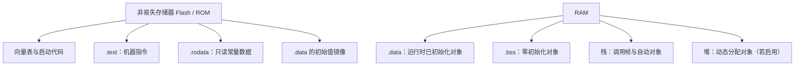

# 36. 嵌入式内存分区与对象生命周期

## 学习目标

- 区分代码、只读数据、已初始化数据、零初始化数据、堆和栈等常见区域。
- 从 C 语言对象的存储期与生命周期理解“变量放在哪里”。
- 能结合编译器输出、链接脚本和 map 文件验证实际布局，而不是依赖固定假设。

## 常见启动后内存布局



该图是常见嵌入式布局的概念图。实际芯片可能有多块 RAM、TCM、缓存、专用段或无堆配置；段名和位置由工具链及链接脚本决定。

## C 语言视角：存储期不等于固定物理地址

- **自动存储期**：常见于函数内非 `static` 局部对象，生命周期通常随代码块进入和退出；编译器可将对象放在寄存器或优化掉。
- **静态存储期**：文件作用域对象和带 `static` 的对象，生命周期覆盖整个程序执行期。
- **分配存储期**：由 `malloc` 等函数管理，直到释放；是否在嵌入式项目启用取决于系统约束。
- **线程存储期**：C11 的 `_Thread_local`，是否适用取决于工具链和运行时支持。

```c
#include <stdint.h>

static uint32_t boot_count;             /* 静态存储期，通常进入 .bss */
static const uint16_t calibration[3] = {100U, 200U, 300U};

void process_sample(void)
{
    uint32_t temporary = 0U;            /* 自动存储期，常见于栈或寄存器 */
    static uint32_t call_count;         /* 静态存储期，不随函数返回消失 */
    temporary += calibration[0];
    call_count++;
    boot_count += temporary;
}
```

对象被放入哪个段是实现和链接配置的结果。即使是 `const` 对象，也不应假设它一定在 Flash；应查看目标平台的编译与链接规则。

## 常见问题

- 大型局部数组可能耗尽任务栈；RTOS 中每个任务通常有独立栈。
- 未初始化的自动局部变量不能直接读取；静态存储期对象在 C 语言层面会进行零初始化。
- 动态分配可能带来碎片、失败和不可预测的耗时。
- 指针的地址看似有效，不代表对象仍在生命周期内。
- DMA、缓存和多核共享内存还涉及平台规定的缓存一致性与内存屏障，不能仅靠 C 类型推断。

## 练习与验收

定义一个静态数组、一个局部数组和一个动态分配对象，分别说明它们的生命周期、释放方式和失败风险。用目标工具链生成 map 文件，定位静态对象所在的段，并记录栈大小的配置来源。
