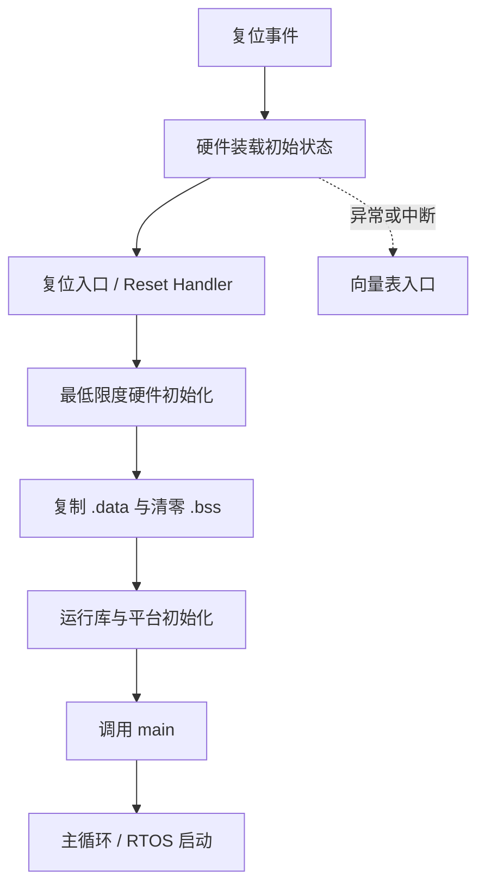

# 37. 启动文件、向量表与 C 运行环境

## 学习目标
理解复位后 CPU 如何进入启动代码、准备运行环境，再调用 C 的 main。异常入口、向量表和 ABI 依赖具体 MCU、编译器与平台。

## 启动链路

## 需要读懂的文件
- 启动汇编或启动 C 文件：复位入口、向量表、栈指针和早期初始化。
- 链接脚本或 scatter file：代码、数据和向量表放置位置。
- 芯片头文件：寄存器定义和中断号。
- 编译器/ABI 文档：调用约定、栈对齐、异常处理和运行库要求。
- map 文件：最终链接地址、符号和段占用。

## 应用层不应假定的事
- 不同平台不一定通过相同函数名进入启动流程。
- 向量表不一定固定在同一地址；部分芯片支持重定位，部分受启动模式约束。
- 运行库尚未初始化时，不应调用依赖标准 I/O、动态内存或静态状态的代码。
- ISR 的声明形式、返回机制和可调用函数限制均由工具链与平台定义。

## 启动代码检查清单
1. 复位入口地址与向量表是否匹配芯片启动配置？
2. 栈顶是否位于有效、对齐且可访问的 RAM？
3. .data 的装载地址、运行地址和复制长度是否正确？
4. .bss 清零边界是否正确？
5. 时钟、看门狗和外部存储器初始化顺序是否满足硬件要求？
6. 中断是否在驱动和共享数据准备完成后才开放？
7. 失败路径是否有安全停机、复位或诊断策略？

## 调试建议
在复位入口、数据初始化完成处和 main 入口设置断点。检查 PC、SP、链接符号、RAM 内容及启动原因寄存器。若程序未到达 main，先缩小到启动链路。

## 练习与验收
选用目标板工程，画出从复位到 main 的实际调用路径，并标明每一步由硬件、启动文件、运行库还是应用代码负责。以真实启动文件和 map 文件作为证据。
