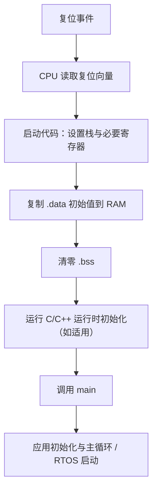

# 37. 启动流程、复位向量与运行时初始化

## 学习目标

理解从复位到 `main()` 的典型路径，知道哪些步骤由芯片、启动汇编、C 运行时和应用代码负责。

## 典型启动链路



这是通用概念流程。实际顺序、向量表格式、时钟配置、ECC RAM 初始化、缓存、FPU、看门狗和安全启动步骤都依赖芯片、ABI、编译器及启动包。

## 为什么需要初始化 .data 与 .bss

```c
#include <stdint.h>

uint32_t g_sample_count;                 /* 通常位于 .bss */
uint32_t g_startup_magic = UINT32_C(7);  /* 通常位于 .data */

int main(void)
{
    /* 进入 main 前，C 运行时应按目标实现完成静态对象初始化。 */
    if (g_startup_magic != UINT32_C(7)) {
        for (;;) { /* 目标项目定义的安全故障处理 */ }
    }

    for (;;) {
        /* 应用主循环 */
    }
}
```

不要把上述示例直接当作完整启动程序：复位向量和启动代码通常是芯片/工具链相关的汇编或专用 C 代码，不能只靠 `main.c` 实现。

## 调试启动问题的顺序

1. 核对芯片型号、内存映射、启动模式和向量表地址。
2. 在复位入口设置断点，检查 PC、SP 和关键状态寄存器。
3. 单步观察 RAM 初始化和 C 运行时初始化是否执行。
4. 检查链接脚本中的加载地址（LMA）和运行地址（VMA）是否匹配启动代码。
5. 若未进入 `main`，检查异常向量、时钟/安全配置、内存 ECC、看门狗和启动镜像布局。
6. 若进入 `main` 后异常，再检查全局初始化依赖、栈大小、早期中断和外设访问时序。

## 易错点

- 认为复位后 RAM 一定是零值；除 C 运行时规定初始化的对象外，硬件 RAM 上电内容不能随意假设。
- 修改链接脚本却没有同步启动代码中的段复制/清零表。
- 在时钟、栈或内存控制器尚未准备好时访问依赖它们的资源。
- 在初始化完成前使能中断，导致 ISR 访问未就绪对象。
- 把某一芯片的启动流程直接移植到另一芯片。

## 练习与验收

在实际工程中标出复位入口、栈初始化、`.data` 复制、`.bss` 清零和 `main` 的调用位置。验收时用调试器观察至少一个全局零初始化变量和一个带初值变量在进入 `main` 前后的值。
