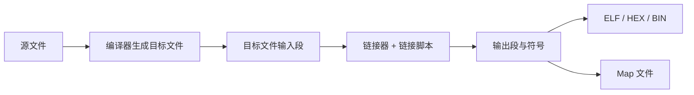

# 38. GNU 链接脚本、段布局与地址分配

## 学习目标

- 理解链接脚本如何把输入段映射到目标内存区域。
- 区分运行地址 VMA 与加载地址 LMA。
- 能识别段放置、对齐、保留区和内存溢出问题。

## 从源文件到内存布局



以下示例只展示 GNU ld 链接脚本的核心概念，不是可直接烧录的芯片脚本。地址、向量表、堆栈、保留区、段名和启动符号必须按目标芯片与工具链调整。

## 最小概念示例

```ld
/* 示例：内存地址仅用于说明，不能直接用于真实硬件。 */
MEMORY
{
    FLASH (rx)  : ORIGIN = 0x08000000, LENGTH = 256K
    RAM   (rwx) : ORIGIN = 0x20000000, LENGTH = 64K
}

SECTIONS
{
    .text :
    {
        KEEP(*(.isr_vector))
        *(.text*)
        *(.rodata*)
    } > FLASH

    .data :
    {
        __data_start__ = .;
        *(.data*)
        __data_end__ = .;
    } > RAM AT > FLASH

    __data_load__ = LOADADDR(.data);

    .bss (NOLOAD) :
    {
        __bss_start__ = .;
        *(.bss*)
        *(COMMON)
        __bss_end__ = .;
    } > RAM
}
```

说明：
- `MEMORY` 定义可用内存区域及属性。
- `SECTIONS` 定义输入段如何组合成输出段。
- `> RAM AT > FLASH` 表示 `.data` 的运行地址位于 RAM，而初始镜像存放于 FLASH。
- `LOADADDR(.data)` 获取加载地址；启动代码必须按约定将初始值复制到运行地址。
- `NOLOAD` 表示该段通常不需要在输出镜像中保存初始化内容；它不自动执行清零。
- `KEEP` 可避免某些链接垃圾回收场景下移除关键输入段。

## 链接检查重点

- 内存区域长度与芯片真实容量是否一致。
- 向量表是否位于启动配置要求的地址。
- `.data` 的 LMA/VMA 是否与启动初始化代码匹配。
- `.bss`、堆、栈、DMA 缓冲区和保留内存是否重叠。
- 对齐、段属性和输出文件格式是否满足烧录与执行要求。
- 链接器是否报告溢出；不要用扩大 MEMORY 长度的方式掩盖真实超限。

## 练习与验收

用一个最小裸机工程查看现有链接脚本，画出 FLASH 与 RAM 区域。为每个输出段标出起始地址、结束地址、大小和加载/运行地址。修改前先备份并通过链接检查，不能仅凭脚本语法正确就认定镜像可运行。
