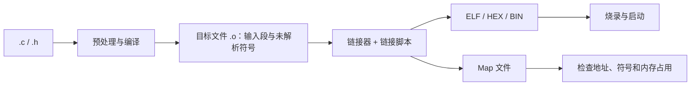

# 38. 链接脚本、段布局与地址映射

## 学习目标
- 理解目标文件与链接阶段的地址分配。
- 读懂内存区域、输入段、输出段和符号定义。
- 在不破坏启动约定的前提下规划代码、常量和 RAM 数据。

## 从源代码到地址


## 链接脚本常见概念
- **内存区域**：描述 Flash、RAM、专用 SRAM、外设窗口等可放置区域及属性。
- **输入段**：目标文件产生的代码/数据段，例如 .text、.rodata、.data、.bss。
- **输出段**：链接脚本将输入段收集并放到指定地址或内存区域。
- **符号**：链接脚本可定义起止地址，供启动代码复制或清零内存使用。
- **装载地址与运行地址**：数据可能存放在 Flash 镜像中，启动时复制到 RAM。

## 概念性 GNU ld 片段
```ld
MEMORY
{
    FLASH (rx)  : ORIGIN = 0x08000000, LENGTH = 512K
    RAM   (rwx) : ORIGIN = 0x20000000, LENGTH = 128K
}

SECTIONS
{
    .text :
    {
        *(.isr_vector)
        *(.text*)
        *(.rodata*)
    } > FLASH

    .data :
    {
        __data_start__ = .;
        *(.data*)
        __data_end__ = .;
    } > RAM AT > FLASH

    .bss (NOLOAD) :
    {
        __bss_start__ = .;
        *(.bss*)
        *(COMMON)
        __bss_end__ = .;
    } > RAM
}
```

这是讲解概念的片段，不是通用可烧录脚本。真实工程还需按芯片补充入口、向量表、栈/堆边界、异常段、特殊 RAM、对齐约束和启动代码所需符号。示例地址仅为示意。

## 修改前后的验证
1. 确认芯片实际存储器容量、地址和保留区。
2. 找出启动代码引用的段符号并备份当前配置。
3. 检查链接器告警、重叠地址和溢出报告。
4. 对照 map 文件核对段起止地址与大小。
5. 检查生成映像格式和烧录偏移。
6. 在目标板验证复位、初始化、异常和关键功能。

## 易错点
- 把 RAM 运行地址误当作固件映像中的装载地址。
- 移动向量表却未同步配置硬件寄存器或启动选项。
- 段增长后超出区域边界。
- 删除启动代码仍依赖的符号或段。
- 仅看 HEX/BIN 文件大小而不检查 RAM 占用。

## 练习与验收
在现有工程中找出 Flash、RAM、向量表、.data 和 .bss 的定义位置。修改前后比较 map，说明每项地址和大小变化的原因。
