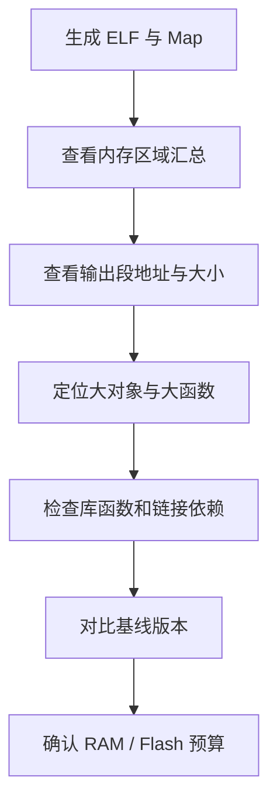

# 39. Map 文件、符号表与内存占用分析

## 学习目标
使用 map 文件回答：代码和数据放在哪里、哪个模块占用最多空间、为什么修改后内存占用变化。

## 分析路径


## 常见字段
- **地址**：符号或段在链接映像中的地址。
- **大小**：符号或段占用的字节数；具体列格式依工具链而异。
- **输入对象**：指出贡献该段的目标文件或库。
- **被丢弃段信息**：帮助判断链接依赖和垃圾回收行为。
- **内存区域汇总**：核对各区域是否接近或超过容量。

map 文件格式由链接器决定，不能假设所有工具链的列名和统计口径相同。

## 排查 RAM 增长
1. 对比两个版本的段汇总和符号差异。
2. 检查新增的全局数组、静态缓存和对齐填充。
3. 查看是否意外引入 printf 浮点格式、格式化库或大型运行库。
4. 检查链接时优化、未使用段回收和库选择设置。
5. 核实栈、堆和 DMA 缓冲区是否计入链接器报告；部分峰值使用量需要运行时测量。

## 代码层面的内存预算
```c
#include <stdint.h>

#define RX_BUFFER_SIZE 256U
#define TX_BUFFER_SIZE 128U

static uint8_t rx_buffer[RX_BUFFER_SIZE];
static uint8_t tx_buffer[TX_BUFFER_SIZE];
```

这两个数组的有效载荷大小合计为 384 字节；实际 RAM 占用还可能包含对齐、其他静态对象及布局开销。栈峰值与动态堆峰值不能仅由这段代码推算。

## 建立可比较的基线
每次发布至少保存：
- 编译器版本与完整构建选项；
- 链接脚本/配置版本；
- Flash 与 RAM 段汇总；
- 大型符号清单；
- 栈使用分析结果（若工具支持）；
- 变化原因与预算余量。

## 练习与验收
对一个版本做基线记录，再新增一个 1 KiB 静态缓冲区，重新构建并比较 map。验收：定位增长的符号与段，并解释链接器报告无法直接说明的运行时栈峰值。
