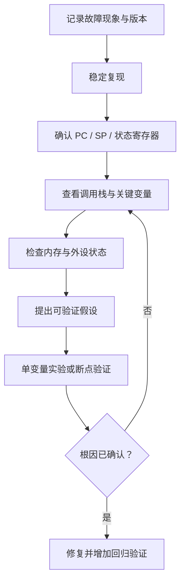

# 40. 调试器、断点、寄存器与故障定位

## 学习目标
建立从现象到证据的调试流程，掌握断点、单步、调用栈、寄存器和内存窗口。具体命令依赖 IDE、调试器、目标 CPU 与探针。

## 调试闭环

## 常用调试手段
- **断点**：暂停在关键入口、状态转换或错误分支。
- **数据观察点**：硬件支持时监视变量/地址访问；数量、对齐和可观察范围有限制。
- **单步执行**：观察控制流，但单步可能改变实时行为。
- **调用栈**：查看调用链；优化构建、栈损坏或异常上下文可能使其不完整。
- **寄存器窗口**：查看 PC、SP、状态寄存器及 CPU 专用寄存器。
- **内存窗口**：核对缓冲区、栈、向量表或寄存器映射；读取外设寄存器可能有副作用，必须遵循芯片手册。

## 典型症状与排查方向
| 症状 | 优先检查 |
|---|---|
| 未进入 main | 复位入口、向量表、栈指针、.data/.bss 初始化、时钟与运行库 |
| 进入异常处理 | 故障状态寄存器、PC/LR、访问地址、堆栈内容 |
| 变量值异常 | 生命周期、越界写、竞态、优化级别与调试信息 |
| 只在优化构建失败 | 未定义行为、未初始化读取、时序假设、数据竞争 |
| 偶发超时 | 中断延迟、临界区、阻塞调用、计时器回绕 |
| 下载后无法运行 | 映像地址、启动模式、看门狗、时钟与链接配置 |

## 调试纪律
1. 每次实验只改变一个关键变量。
2. 保存故障现场、寄存器值、构建版本和输入条件。
3. 不要把调试器显示的变量值当作绝对事实：优化可能移除或重排变量，硬件寄存器读取也可能有副作用。
4. 修改代码后用回归测试复核；时序问题还要在接近真实条件下验证。
5. 生产固件应有不依赖调试器的错误记录与安全恢复策略。

## 练习与验收
在开发板上对一个可控故障设置断点，记录 PC、SP、调用栈和相关变量。验收：写出从症状到根因的证据链，并附上修复后的回归结果，而不是只记录“重新下载后正常”。
