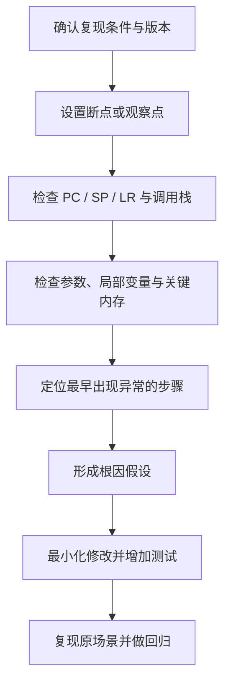

# 40. 调试器、断点、寄存器与故障现场分析

## 学习目标

- 建立可重复的调试步骤，避免依靠猜测修改代码。
- 理解断点、单步、调用栈、寄存器和内存观察的用途。
- 记录异常现场，并区分软件逻辑错误、硬件访问错误和启动配置问题。

## 调试闭环



## 常用调试手段

- **断点**：停在特定指令或源代码位置。硬件断点数量可能有限；优化构建下源代码行与指令不一定一一对应。
- **单步执行**：逐条指令或逐行观察状态。单步可能改变实时系统时序。
- **调用栈**：查看当前调用链；栈损坏或优化可能使回溯不完整。
- **观察点**：在变量或地址变化时停止，支持情况依赖调试器和目标硬件。
- **寄存器窗口**：检查 PC、SP、状态寄存器、异常状态寄存器及外设寄存器。寄存器含义必须以对应内核和芯片手册为准。
- **内存窗口**：核对对象地址、长度、对齐和访问权限；对读清零或有副作用的 MMIO 寄存器，不要随意读取。

## C 代码示例：保留故障上下文

```c
#include <stdint.h>

typedef struct
{
    uint32_t fault_code;
    uint32_t program_counter;
    uint32_t stack_pointer;
} fault_record_t;

static volatile fault_record_t g_fault_record;

void record_fault(uint32_t code, uint32_t pc, uint32_t sp)
{
    g_fault_record.fault_code = code;
    g_fault_record.program_counter = pc;
    g_fault_record.stack_pointer = sp;
}
```

该结构只演示保存字段。真实故障处理需由目标架构的异常入口正确提取寄存器，并确认记录区的保留策略、写入原子性、缓存和复位行为。单独使用 `volatile` 不保证多字段原子更新、跨核同步或掉电持久性。

## 故障现场检查清单

1. 记录芯片型号、软件版本、构建配置、输入和复现步骤。
2. 保存 PC、SP、LR（若架构存在）、状态寄存器和异常原因寄存器。
3. 检查调用栈是否有效，返回地址是否位于合理的可执行区域。
4. 对照 map 文件确认 PC 对应的函数和地址。
5. 检查栈边界、指针值、数组长度、对象生命周期和内存保护状态。
6. 对 MMIO 访问先查芯片手册，避免调试读取本身清除状态或触发副作用。
7. 修复后增加回归测试；硬件相关问题还需目标板和压力条件验证。

## 练习与验收

为一个可复现的异常创建故障记录模板，至少保存版本、PC、SP、调用栈、异常状态和复现步骤。验收时能从 PC 对应到 map/符号表中的函数，并解释下一步如何验证根因。
