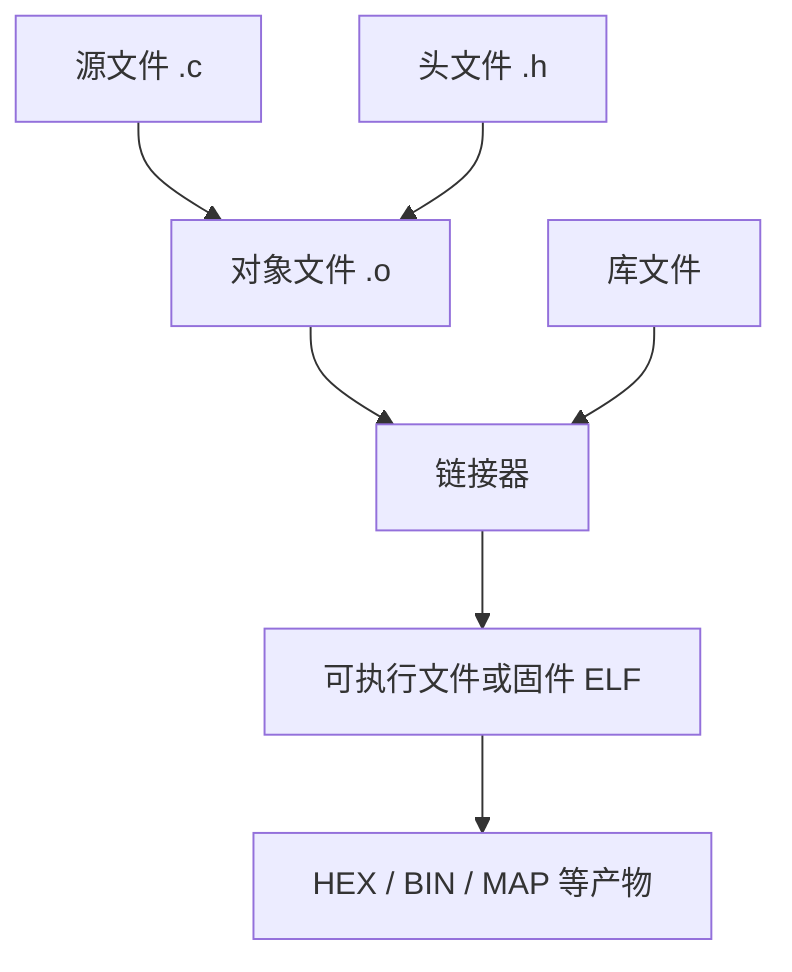
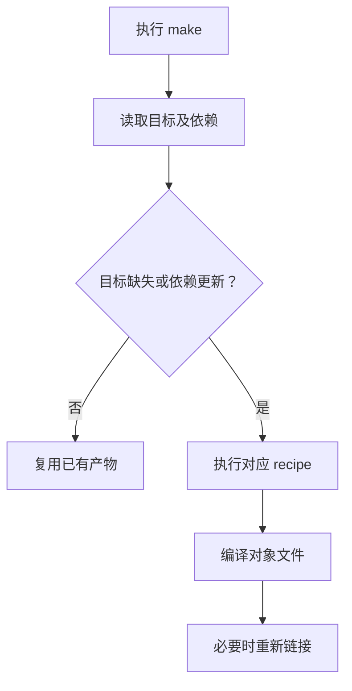

# 41｜Makefile 依赖关系、增量构建与多目录工程

## 学习目标

- 能解释 target、prerequisite、recipe 的关系，读懂依赖图。
- 使用自动变量、模式规则和自动头文件依赖，减少重复编译。
- 将源文件、头文件、对象文件和最终产物分目录管理。
- 让构建失败时立即停止，并区分构建产物与源文件。

## 构建关系图



## 1. Makefile 的基本结构

```makefile
app: main.o sensor.o
	$(CC) $(LDFLAGS) -o $@ $^ $(LDLIBS)

main.o: main.c sensor.h
	$(CC) $(CPPFLAGS) $(CFLAGS) -c $< -o $@

sensor.o: sensor.c sensor.h
	$(CC) $(CPPFLAGS) $(CFLAGS) -c $< -o $@

.PHONY: clean
clean:
	$(RM) app main.o sensor.o
```

- target：要生成的目标，例如 `app` 或 `main.o`。
- prerequisites：目标依赖的文件；依赖更新后，Make 判断目标是否需要重建。
- recipe：生成目标的命令。命令行开头必须是 **Tab**，不是空格。
- `$@` 表示当前目标，`$<` 表示第一个依赖，`$^` 表示所有依赖（去重）。
- `$(CC)`、`$(CFLAGS)` 等变量让编译器和选项可配置。

## 2. 使用模式规则与自动依赖

多目录项目可以采用下面的通用模板。将 `SRC` 中的文件替换为项目实际源文件：

```makefile
CC       ?= cc
CPPFLAGS += -Iinclude
CFLAGS   += -std=c11 -Wall -Wextra -Wpedantic -O2
LDFLAGS  ?=
LDLIBS   ?=

SRC := src/main.c src/sensor.c
OBJ := $(patsubst src/%.c,build/%.o,$(SRC))
DEP := $(OBJ:.o=.d)
TARGET := build/app

.PHONY: all clean
all: $(TARGET)

$(TARGET): $(OBJ)
	$(CC) $(LDFLAGS) -o $@ $^ $(LDLIBS)

build/%.o: src/%.c
	mkdir -p build
	$(CC) $(CPPFLAGS) $(CFLAGS) -MMD -MP -MF $(@:.o=.d) -c $< -o $@

-include $(DEP)

clean:
	$(RM) -r build
```

`-MMD` 生成用户头文件依赖，`-MP` 为头文件生成空目标，避免删除或重命名头文件时出现部分依赖错误。依赖文件通过 `-include` 引入；首次构建时文件尚不存在也不会立即失败。

> 此模板适用于类 Unix shell 环境。Windows 原生命令行、路径分隔符和 `mkdir` 行为可能不同；可在 MSYS2、MinGW 或其他受支持环境中调整。

## 3. 增量构建是怎样发生的



增量构建的前提是依赖声明完整。若 `main.c` 包含 `config.h`，却没有声明或自动生成该依赖，修改头文件后可能不会重编译受影响对象文件。

## 4. 常见问题

- **目标总是重建**：检查是否误把文件目标写成了 `.PHONY`，或生成规则是否每次更新依赖。
- **修改头文件未重编译**：启用 `-MMD -MP` 或明确列出头文件依赖。
- **链接时报未定义引用**：检查实现文件是否参与编译、目标文件是否参与链接，以及库的链接顺序。
- **并行构建失败**：避免多个 recipe 同时写同一个文件；让每个输出有唯一规则。
- **清理误删源文件**：`clean` 只应删除构建目录和生成物，不要使用范围过大的删除命令。
- **编译选项不一致**：预处理宏、头文件路径等通常放在 `CPPFLAGS`，编译选项放在 `CFLAGS`，链接选项放在 `LDFLAGS`，库放在 `LDLIBS`。

## 5. 练习与验收

1. 把两个源文件组织成 `src/` 与 `include/` 目录，产物统一放入 `build/`。
2. 首次执行 `make` 后再次执行，观察第二次是否跳过无须重建的目标。
3. 修改一个头文件，确认依赖它的对象文件被重编译。
4. 执行 `make clean`，确认源文件不受影响。
5. 尝试并行构建，并确保所有生成文件只有一个明确的写入规则。

**验收标准：** 能解释依赖图，能从干净目录构建成功，修改头文件后能正确增量编译，并且清理操作不会删除源码。