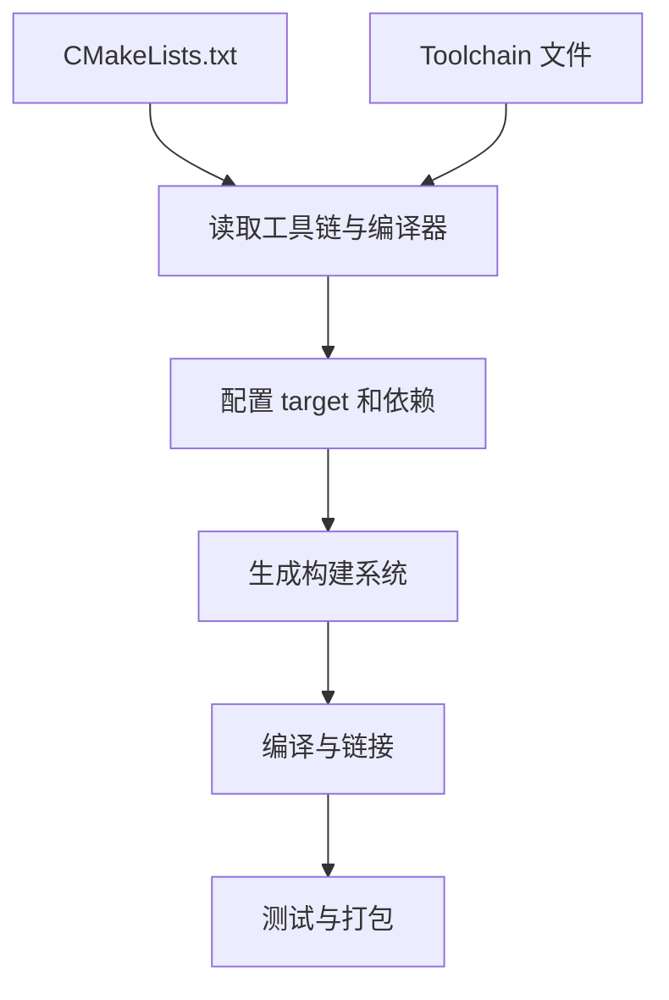
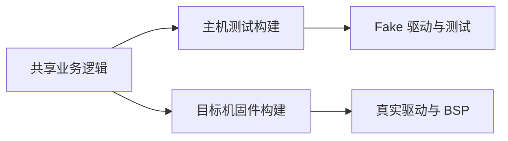

# 42｜CMake 工程组织与交叉编译工具链

## 学习目标

- 使用 target-based CMake 描述库、可执行文件和依赖。
- 将头文件路径、编译特性和编译选项绑定到具体 target。
- 理解交叉编译工具链文件的作用与传入时机。
- 将配置阶段、构建阶段和测试阶段分开诊断。

## 工程配置流程



## 1. 推荐的目录结构

```text
project/
├── CMakeLists.txt
├── include/
│   └── sensor.h
├── src/
│   ├── main.c
│   └── sensor.c
├── tests/
│   └── test_sensor.c
└── cmake/
    └── toolchains/
        └── arm-gcc.cmake
```

## 2. 基于 target 的 CMakeLists.txt

```cmake
cmake_minimum_required(VERSION 3.20)
project(EmbeddedC LANGUAGES C)

add_library(sensor STATIC
    src/sensor.c
)

target_include_directories(sensor
    PUBLIC
        ${CMAKE_CURRENT_SOURCE_DIR}/include
)

target_compile_features(sensor PUBLIC c_std_11)

add_executable(app src/main.c)
target_link_libraries(app PRIVATE sensor)

if(CMAKE_C_COMPILER_ID MATCHES "GNU|Clang")
    target_compile_options(sensor PRIVATE
        -Wall -Wextra -Wpedantic
    )
    target_compile_options(app PRIVATE
        -Wall -Wextra -Wpedantic
    )
endif()
```

- `add_library` 描述可复用模块；`add_executable` 描述最终程序。
- `target_link_libraries` 传递目标之间的依赖。
- `PUBLIC` 表示当前 target 自己使用，并向消费者传播；`PRIVATE` 只作用于当前 target；`INTERFACE` 只传播给消费者。
- 使用 `target_include_directories` 管理头文件路径，避免全局设置污染其他模块。
- 编译器专属选项要按编译器 ID 或项目工具链条件添加，不能假设所有编译器都支持 GCC 参数。

## 3. 交叉编译工具链文件

示例仅展示配置结构，编译器名称和 sysroot 必须替换成实际工具链提供的值：

```cmake
# cmake/toolchains/arm-gcc.cmake
set(CMAKE_SYSTEM_NAME Generic)
set(CMAKE_SYSTEM_PROCESSOR arm)

set(CMAKE_C_COMPILER arm-none-eabi-gcc)
set(CMAKE_AR arm-none-eabi-ar)
set(CMAKE_RANLIB arm-none-eabi-ranlib)

# 若工具链提供 sysroot，再按其实际安装位置设置：
# set(CMAKE_SYSROOT "/path/to/actual/sysroot")

set(CMAKE_TRY_COMPILE_TARGET_TYPE STATIC_LIBRARY)
```

配置时通过命令行传入工具链文件：

```sh
cmake -S . -B build-arm \
  -DCMAKE_TOOLCHAIN_FILE=cmake/toolchains/arm-gcc.cmake
cmake --build build-arm --parallel
```

**关键点：** 工具链文件应在第一次配置时通过 `-DCMAKE_TOOLCHAIN_FILE=...` 指定；CMake 在执行 `project()` 初始化语言与编译器时就需要它。更换编译器或工具链时，使用新的构建目录，避免旧缓存残留。

## 4. 本机与目标机分离



同一套纯 C 业务逻辑可以被不同构建目标复用；硬件寄存器、启动文件、链接脚本和 BSP 则通常属于目标机专用配置。不要把主机可执行文件与 MCU 固件混为同一种产物。

## 5. 易错点

- 先运行普通 CMake 配置，再临时更换编译器，可能继续使用缓存中的旧编译器。
- `CMAKE_SYSTEM_NAME Generic` 不是所有交叉编译环境的固定答案；根据目标平台和工具链文档选择。
- 裸机项目通常还需要启动文件、链接脚本、架构选项和链接库；仅设置编译器并不等于固件可运行。
- 交叉编译能成功链接，不代表目标板上的时钟、内存、外设和启动流程正确。
- 不要将绝对 SDK 路径写死在公共配置中；优先使用可配置变量或工具链环境。

## 6. 练习与验收

1. 把一个模块抽成静态库，并让应用通过 `target_link_libraries` 使用。
2. 分别建立主机和目标机的独立构建目录。
3. 检查配置输出，确认实际使用的 C 编译器和工具链文件。
4. 为编译器支持的警告选项添加条件配置。
5. 记录固件额外需要的启动文件、链接脚本和平台库。

**验收标准：** 能从干净构建目录完成配置与构建，能解释 target 属性的传播范围，并能说明交叉编译与目标板验证的区别。