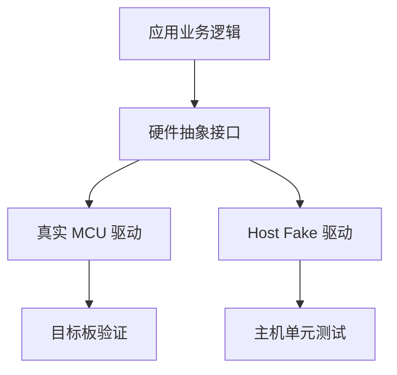

# 43｜主机端测试与 Fake 驱动构建

## 学习目标

- 将业务逻辑与 ADC、定时器、EEPROM 等硬件依赖分离。
- 使用 Fake 实现可预测的硬件接口，在 PC 上覆盖边界和故障路径。
- 理解 Fake、Stub、Mock 的常见用途，不把主机测试误当作硬件验收。
- 让测试可重复、可自动运行，并避免依赖真实时间和真实外设状态。

## 架构关系



## 1. 先定义接口，而不是在业务逻辑中直接访问寄存器

```c
/* sensor_port.h */
#ifndef SENSOR_PORT_H
#define SENSOR_PORT_H

#include <stdint.h>

typedef enum {
    SENSOR_PORT_OK = 0,
    SENSOR_PORT_ERROR
} sensor_port_status_t;

sensor_port_status_t sensor_port_read_adc(uint16_t *raw);
uint32_t sensor_port_get_tick_ms(void);

#endif
```

业务模块只依赖接口：

```c
/* sensor_logic.h */
#ifndef SENSOR_LOGIC_H
#define SENSOR_LOGIC_H

#include <stdint.h>
#include "sensor_port.h"

typedef struct {
    uint16_t last_raw;
    uint8_t valid;
} sensor_state_t;

sensor_port_status_t sensor_update(sensor_state_t *state);

#endif
```

```c
/* sensor_logic.c */
#include "sensor_logic.h"

sensor_port_status_t sensor_update(sensor_state_t *state)
{
    uint16_t raw;

    if (state == 0) {
        return SENSOR_PORT_ERROR;
    }

    if (sensor_port_read_adc(&raw) != SENSOR_PORT_OK) {
        state->valid = 0U;
        return SENSOR_PORT_ERROR;
    }

    state->last_raw = raw;
    state->valid = 1U;
    return SENSOR_PORT_OK;
}
```

这个示例为了展示接口边界，省略了项目级错误码设计。实际项目中可区分参数错误、硬件超时、校准失败等原因。

## 2. 在主机测试中提供 Fake

测试构建时，用单独的实现替代真实驱动。以下 Fake 可由测试控制返回值：

```c
/* tests/fake_sensor_port.c */
#include "sensor_port.h"

static uint16_t fake_adc_value;
static sensor_port_status_t fake_adc_status = SENSOR_PORT_OK;
static uint32_t fake_tick_ms;

void fake_sensor_set_adc(uint16_t value,
                         sensor_port_status_t status)
{
    fake_adc_value = value;
    fake_adc_status = status;
}

void fake_sensor_set_tick(uint32_t tick)
{
    fake_tick_ms = tick;
}

sensor_port_status_t sensor_port_read_adc(uint16_t *raw)
{
    if (raw == 0) {
        return SENSOR_PORT_ERROR;
    }
    if (fake_adc_status != SENSOR_PORT_OK) {
        return fake_adc_status;
    }

    *raw = fake_adc_value;
    return SENSOR_PORT_OK;
}

uint32_t sensor_port_get_tick_ms(void)
{
    return fake_tick_ms;
}
```

测试控制函数应放在测试专用头文件中，避免生产接口意外暴露。主机测试目标链接 `sensor_logic.c` 和 Fake，不要同时链接真实驱动实现，否则会出现重复定义或误用硬件。

## 3. 测试矩阵

| 场景 | Fake 设置 | 预期结果 |
|---|---|---|
| 正常采样 | 返回有效 ADC 值 | 状态更新，valid 为 1 |
| 驱动失败 | 返回错误码 | 状态标记无效，错误向上传递 |
| 空指针 | 传入空状态指针 | 返回错误，不解引用 |
| 边界采样 | 0、满量程及阈值附近 | 输出符合规格定义 |
| 超时逻辑 | 固定 tick，推进到截止点 | 状态机按超时规则转移 |

测试值要来自接口规格和需求边界，不要随意把某个示例数值当作所有传感器的通用限制。

## 4. Stub、Fake、Mock 的区别

- **Stub**：提供简单固定响应，适合隔离尚未实现或不关注内部行为的依赖。
- **Fake**：提供轻量但可工作的替代实现，例如内存版 EEPROM 或可控制的虚拟时钟。
- **Mock**：记录调用并验证交互，例如检查失败时是否请求重试。具体术语在不同测试框架中可能略有差异。

## 5. 易错点

- 主机测试通过不代表中断优先级、DMA、缓存一致性、电气时序或寄存器配置正确。
- Fake 应可控且确定，不应依赖真实网络、真实系统时间或外部硬件。
- 不要在生产代码中为了测试随意加入全局可变开关；优先使用接口替换和独立构建目标。
- 若业务逻辑依赖 tick 回绕，应使用无符号时间差等经验证的写法，并测试回绕边界。
- Fake 与真实驱动必须遵循同一接口契约，错误码、单位和调用约束保持一致。

## 6. 练习与验收

1. 为 ADC 接口建立 Fake，可注入正常值和驱动错误。
2. 为超时逻辑建立可手动推进的虚拟 tick。
3. 为 EEPROM 建立内存版 Fake，测试读写边界和掉电场景模型。
4. 将主机测试目标与固件目标分开构建。
5. 列出必须在目标板完成的验证项目，例如启动、时序、中断、外设通信与资源占用。

**验收标准：** 核心逻辑可以在没有 MCU 的 PC 环境运行测试；正常、边界和错误路径可重复验证；测试结论明确区分主机验证与目标板验证。