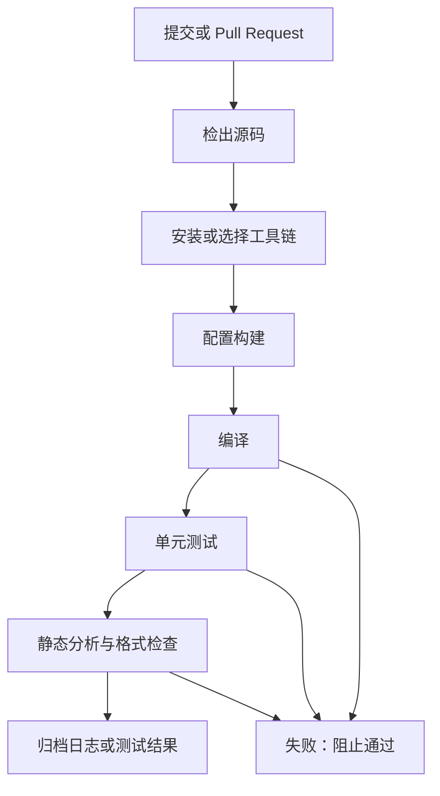

# 44｜持续集成：自动编译、静态分析与单元测试

## 学习目标

- 理解 CI 在提交、合并请求和发布流程中的作用。
- 将构建、测试、静态分析拆成可定位的步骤。
- 使用 GitHub Actions 对可在主机运行的 C 项目执行自动检查。
- 让失败的命令返回非零状态，使流水线真正失败，而不是只打印错误。

## CI 流程图



## 1. 先定义 CI 的检查策略

建议从以下检查开始，按项目实际能力逐步增加：

1. **编译警告**：启用项目支持的警告选项，并逐步收敛警告数量。
2. **单元测试**：运行不依赖真实 MCU 的主机测试。
3. **静态分析**：可选用 GCC/Clang 诊断、Cppcheck 或项目批准的分析器。
4. **格式检查**：仅在项目已有格式规范时执行，避免无意中大规模改写历史文件。
5. **目标机构建**：若 CI 环境有正式交叉工具链，再增加固件构建步骤。
6. **产物归档**：保存日志、测试报告和需要审查的构建产物。

## 2. GitHub Actions 工作流模板

下面是**模板而不是已验证的仓库工作流**。它假设项目根目录有 CMakeLists.txt，并且配置了可运行的 CTest 测试；只有满足这些条件时才适合直接启用。当前仓库结构若不满足，应先调整命令，不要让 CI 因路径假设而失效。

```yaml
name: C quality checks

on:
  push:
  pull_request:
  workflow_dispatch:

permissions:
  contents: read

jobs:
  host-build-test:
    runs-on: ubuntu-latest
    steps:
      - name: Checkout
        uses: actions/checkout@v4

      - name: Install build tools
        run: |
          sudo apt-get update
          sudo apt-get install --yes cmake ninja-build gcc

      - name: Configure
        run: cmake -S . -B build -G Ninja -DCMAKE_BUILD_TYPE=Debug

      - name: Build
        run: cmake --build build --parallel

      - name: Test
        run: ctest --test-dir build --output-on-failure
```

如果项目使用 Makefile 而非 CMake，可将配置和构建步骤替换为项目实际目标，例如 `make clean all`。不要同时保留无效的 CMake 步骤和 Make 步骤；CI 命令必须与仓库真实工程结构一致。

## 3. 静态分析如何加入

在确认项目可由对应工具分析后，可增加独立步骤：

```yaml
      - name: Install static analyzer
        run: sudo apt-get install --yes cppcheck

      - name: Run Cppcheck
        run: cppcheck --enable=warning,style,performance,portability --error-exitcode=1 -I include src
```

路径 `include` 和 `src` 仅是示例。实际使用时应替换成仓库中的源码目录，并为第三方代码、生成代码和平台专用文件设置合理边界。分析结果应人工分级，不能把所有告警都自动视为真实缺陷，也不应无说明地屏蔽全部告警。

## 4. 让结果可追踪


每次失败都应能回答：哪个提交、哪个命令、哪个工具版本、哪段日志、哪个测试用例。必要时保存编译器版本和配置参数，避免只留下“CI failed”这样的模糊结论。

## 5. 易错点

- 工作流 YAML 语法正确，不代表命令路径、构建目标和测试配置正确。
- 单元测试必须通过非零退出码报告失败，否则流水线可能错误显示绿色。
- 不要把需要硬件的测试伪装成普通主机测试；对硬件在环测试应单独标识环境和前置条件。
- 第三方 Actions 的版本和权限应按组织安全要求管理；使用最小必要权限。
- 不要声称工作流已经运行通过，除非确实检查了对应的 Actions 运行记录。

## 6. 练习与验收

1. 在本地执行与 CI 相同的构建和测试命令。
2. 故意制造一个编译错误，确认流水线失败。
3. 故意让一个测试断言失败，确认测试步骤返回非零。
4. 加入静态分析并检查路径、规则与告警处理。
5. 记录如何从失败的运行记录定位到具体提交和日志。

**验收标准：** 同一组命令可在本地与 CI 环境复现；编译、测试或分析失败时流水线会失败；所有路径和构建目标都对应实际工程。