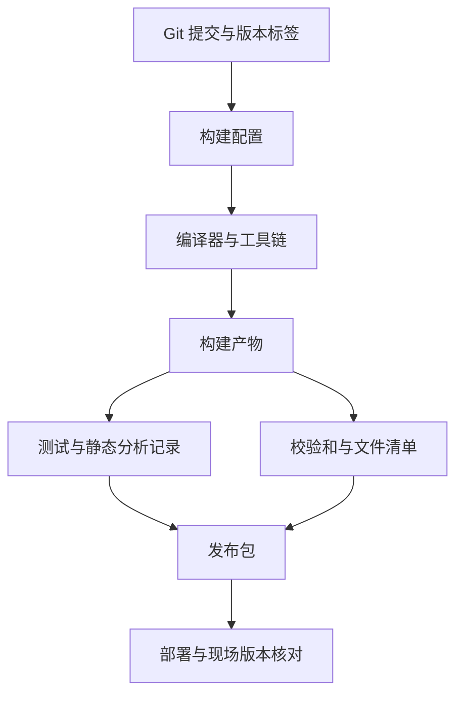
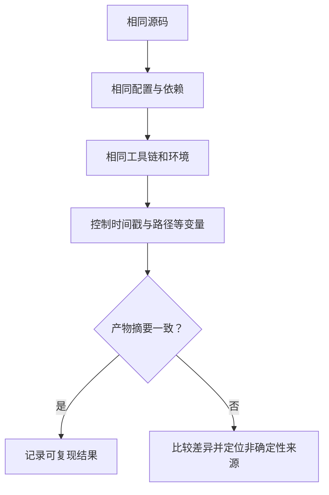

# 45｜工程发布：版本、构建产物与可追溯性

## 学习目标

- 区分源码版本、构建配置、工具链版本和最终产物。
- 建立发布清单，记录固件、符号文件、Map 文件、日志和校验和。
- 理解版本标签、构建元数据与可追溯性的关系。
- 知道可复现构建的目标与限制，不把“同一源码”直接等同于“字节完全相同的产物”。

## 从源码到发布包



## 1. 一个发布包应包含什么

按项目要求选择，常见内容包括：

| 文件或记录 | 用途 |
|---|---|
| ELF / AXF 等带符号文件 | 调试、符号定位和故障分析 |
| HEX / BIN 等可烧录文件 | 下载到目标设备 |
| MAP 文件 | 查看段布局、符号地址与内存占用 |
| 构建日志 | 回溯编译器诊断和链接过程 |
| 测试报告 | 记录测试范围、结果和未覆盖项 |
| 版本清单 | 记录提交 SHA、标签、配置与工具链 |
| SHA-256 校验和 | 检查文件传输或归档后的完整性 |
| 第三方组件清单 / SBOM | 在供应链管理要求下追踪依赖 |

发布包内容应按项目安全策略管理。调试符号、路径信息和内部日志可能包含敏感信息，不应默认对外公开。

## 2. 记录构建元数据

可将以下信息放入文本清单或随构建产物保存的元数据文件：

```text
Product: ExampleECU
Version: 1.4.0
GitCommit: <full-commit-sha>
BuildProfile: Release
Compiler: <compiler-name-and-version>
Toolchain: <toolchain-version>
Configuration: <configuration-id>
BuildTimeUTC: <timestamp>
TestReport: <report-filename>
Firmware: firmware.bin
Symbols: firmware.elf
MapFile: firmware.map
```

尖括号内容是占位符，发布时应替换成真实值。构建时间可以帮助追溯，但如果直接嵌入产物，时间戳可能导致不同构建的二进制不完全相同。应区分“描述本次构建的外部元数据”和“参与二进制生成的编译输入”。

## 3. 计算校验和

在支持 SHA-256 的环境中，可对发布文件计算摘要：

```sh
sha256sum firmware.bin firmware.elf firmware.map > SHA256SUMS.txt
```

在支持该命令的环境中，可使用下面的方式校验：

```sh
sha256sum --check SHA256SUMS.txt
```

校验和能发现文件内容变化，但本身不证明发布者身份或文件来源可信。需要真实性保证时，应使用受控发布流程、签名和权限管理，并保护签名密钥。

## 4. 版本号与发布纪律

可使用语义化版本作为通用参考：

- MAJOR：不兼容的接口或行为变更。
- MINOR：向后兼容的功能增加。
- PATCH：向后兼容的缺陷修复。

嵌入式产品也可能采用 OEM、项目或供应链规定的版本规则，应优先遵守产品正式规范。不要仅凭版本号推断固件兼容性；兼容性仍需由接口、配置、硬件版本和测试结果支撑。

建议每个发布版本都能追溯到：

1. 精确的 Git 提交和标签。
2. 受控的编译器、链接器与工具链版本。
3. 构建参数、宏定义、链接脚本和配置文件。
4. 自动化测试与目标板测试结果。
5. 发布产物的文件清单与校验和。
6. 已知问题、偏离项和批准记录。

## 5. 可复现构建的边界



要实现字节级可复现，除了源码一致，还需要控制工具链、依赖版本、构建参数、文件路径、时间戳、归档顺序等影响因素。不同工具链或构建环境可能产生差异；应先明确可复现的范围和验收方法，再声称达到目标。

## 6. 易错点

- 只归档 BIN 而不保留符号文件和 Map，可能让现场故障难以追溯。
- 只记录“版本 1.4.0”，不记录源码 SHA 和配置，无法唯一定位源代码状态。
- 校验和不等于数字签名，也不能单独证明产物可信。
- 重新构建后产物不同，不一定意味着源码变化；需比较编译器、参数、时间戳和输入依赖。
- 发布前必须确认实际测试结果，不要把“构建成功”写成“产品验证通过”。

## 7. 练习与验收

1. 为一个练习程序生成版本清单，包含提交 SHA、工具链和构建配置。
2. 归档 ELF、可烧录文件、Map、构建日志和测试报告。
3. 生成 SHA-256 校验和，并在复制文件后验证。
4. 对两个独立构建的产物计算摘要，记录是否一致及差异原因。
5. 写一份发布检查清单，明确谁批准、谁构建、谁验证以及如何回滚。

**验收标准：** 发布产物可以追溯到具体源码、配置与工具链；文件完整性可校验；测试范围与已知限制有记录；不会将构建成功夸大为完整产品验证。