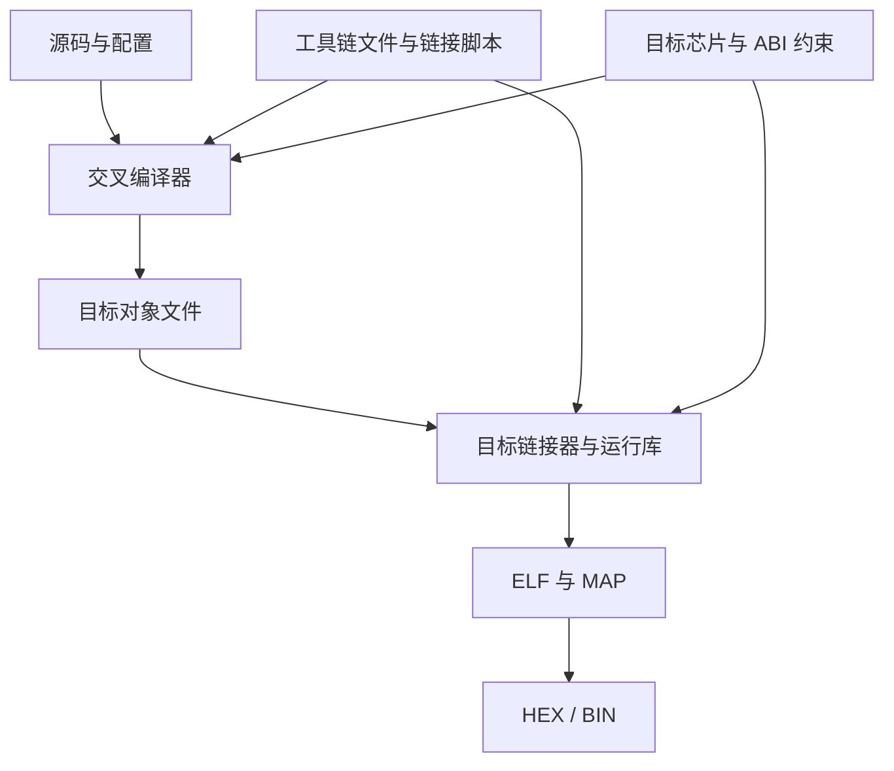

# 46｜交叉编译与多工具链工程实践

## 学习目标

- 区分构建主机、目标平台和交叉编译器。
- 管理编译器、头文件、链接器、运行库和目标 ABI 的一致性。
- 为不同 MCU 或不同工具链建立隔离的构建配置。
- 从编译命令、预定义宏和产物信息确认实际工具链。

## 工具链关系图



## 1. 三个容易混淆的概念

- **构建主机（host）**：运行编译工具的机器，例如 Windows 或 Linux PC。
- **目标平台（target）**：最终运行程序的处理器和运行环境，例如某个 ARM Cortex-M MCU。
- **交叉编译器**：运行在构建主机上，但生成目标平台机器码的编译器。

工具链不仅是一个 GCC 可执行文件，还包括 assembler、linker、标准头文件、运行库、调试工具以及目标 ABI 约定。

## 2. 检查实际工具链

在类 Unix shell 中，先确认命令路径和版本：

```sh
arm-none-eabi-gcc --version
arm-none-eabi-gcc -dumpmachine
arm-none-eabi-gcc -print-search-dirs
arm-none-eabi-gcc -print-file-name=libgcc.a
```

如果工程使用供应商定制工具链，应使用其实际命令名称。以上命令只是 GNU Arm Embedded 工具链的示例。

可以通过编译器输出预定义宏，辅助确认目标配置：

```sh
arm-none-eabi-gcc -dM -E - < /dev/null
```

宏列表应结合编译器手册解释；不要仅凭某一个宏就认定整个芯片配置正确。

## 3. 多工具链工程的配置隔离

建议为每套工具链使用独立构建目录：

```text
build/
├── host-debug/
├── arm-gcc-release/
└── vendor-toolchain-release/
```

CMake 项目可以分别配置：

```sh
cmake -S . -B build/host-debug -DCMAKE_BUILD_TYPE=Debug
cmake -S . -B build/arm-gcc-release \
  -DCMAKE_TOOLCHAIN_FILE=cmake/toolchains/arm-gcc.cmake
```

更换编译器、目标架构或工具链版本时，不建议复用原有缓存目录。新目录有助于避免旧的编译器路径、探测结果和配置选项残留。

## 4. ABI 与链接一致性

以下项目应彼此匹配：

- CPU 架构、指令集和浮点 ABI 选项。
- 对象文件与库的目标格式和 ABI。
- C/C++ 混合工程中的名称修饰与调用约定。
- 启动文件、链接脚本、运行库和目标芯片内存布局。
- 编译器版本、供应商补丁和运行库版本。

链接成功并不保证程序一定能启动。错误的启动代码、时钟配置、内存布局或外设初始化仍可能导致运行失败。

## 5. 易错点

- 把主机编译器当成目标编译器，生成了无法在 MCU 上运行的程序。
- 混用不同 ABI 或浮点调用约定生成的库。
- 使用了工具链自带的默认链接脚本，却没有核对目标芯片的 Flash/RAM 布局。
- 把绝对路径和本机环境变量写死在项目配置里。
- 只检查编译成功，没有检查 ELF 架构、段布局和目标板运行结果。

## 6. 练习与验收

1. 记录主机系统、交叉编译器完整版本、目标三元组和运行库路径。
2. 使用两套独立构建目录构建同一份纯 C 模块。
3. 保存完整编译和链接命令，比较目标选项的差异。
4. 检查 ELF、MAP 和目标文件，确认架构与段布局符合预期。
5. 制定目标板验证清单，包括启动、内存、时钟、外设和中断。

**验收标准：** 能说明构建主机与目标平台的区别，能追踪实际工具链及关键选项，并能解释为什么“链接成功”不等于“目标机运行正确”。