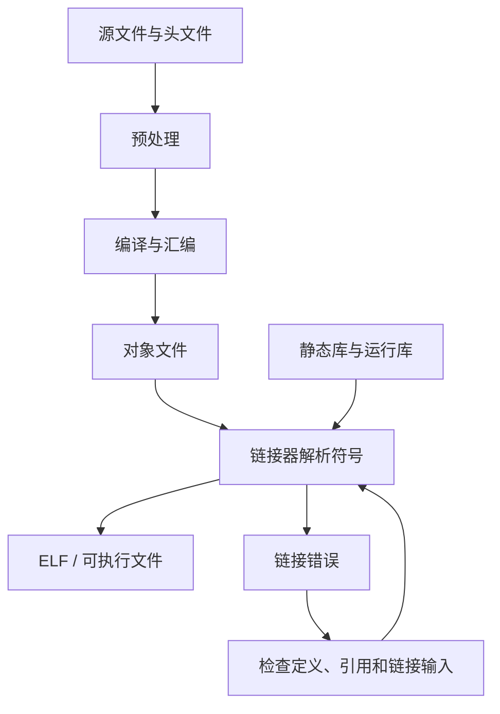

# 47｜链接错误与符号冲突定位

## 学习目标

- 区分编译阶段错误和链接阶段错误。
- 定位未定义引用、重复定义、缺失目标文件和库依赖问题。
- 使用符号表、链接 map 和链接器跟踪信息缩小范围。
- 建立从错误信息到源文件、声明和构建配置的排查顺序。

## 从源文件到可执行文件



## 1. 常见错误类型

### undefined reference / unresolved external

链接器看到了引用，但找不到匹配定义。常见原因：

- 实现文件没有加入构建目标。
- 函数声明和定义的名称、语言链接或签名不一致。
- 需要的库没有参与链接，或库搜索路径不正确。
- 条件编译使定义被排除。
- C/C++ 混合工程中缺少适当的 `extern "C"` 边界。

### multiple definition / duplicate symbol

同一个外部符号存在多个定义。常见原因：

- 在头文件中定义了非 `static inline` 的普通函数，多个源文件包含后重复定义。
- 在头文件中定义了非 `extern` 的全局对象。
- 同一实现文件被重复加入构建。
- 不同库都导出了同名强符号。

### undefined symbol in shared/static library

可能涉及链接顺序、依赖库遗漏、符号可见性或工具链 ABI 不一致。应根据具体链接器和平台文档确认，不能把所有此类问题都归结为同一个原因。

## 2. 最小的多文件示例

```c
/* calc.h */
#ifndef CALC_H
#define CALC_H

int calc_add(int a, int b);

#endif
```

```c
/* calc.c */
#include "calc.h"

int calc_add(int a, int b)
{
    return a + b;
}
```

```c
/* main.c */
#include <stdio.h>
#include "calc.h"

int main(void)
{
    printf("%d\n", calc_add(2, 3));
    return 0;
}
```

正确构建：

```sh
cc -std=c11 -Wall -Wextra -Wpedantic main.c calc.c -o app
```

若只编译 `main.c` 而未链接 `calc.c`，就会出现未定义引用。头文件只提供声明，不会自动把函数实现加入最终产物。

## 3. 逐层定位流程

1. **读完整错误行**：记录符号名、引用对象文件和报错位置。
2. **确认定义存在**：搜索函数或对象的实现，确认没有被条件编译排除。
3. **检查构建输入**：确认实现文件确实被编译，生成的对象文件确实参与链接。
4. **检查符号表**：使用目标工具链对应的 `nm`、`objdump` 或符号查看工具。
5. **检查库与顺序**：静态库的解析顺序可能影响结果；按具体链接器规则调整。
6. **检查 ABI 和语言边界**：确认目标架构、调用约定和 C/C++ 名称修饰一致。
7. **生成 MAP**：查看链接器最终纳入了哪些对象、库和符号。

GNU 工具链示例：

```sh
arm-none-eabi-nm -A build/*.o
arm-none-eabi-objdump -t build/module.o
```

命令中的文件路径需要替换为真实产物；不同工具链可能使用不同命令名称和选项。

## 4. 生成链接 map

GNU ld 工具链常见做法是在链接选项中增加：

```text
-Wl,-Map=build/app.map
```

map 文件可帮助检查输入对象、段分配、符号地址和内存占用。具体格式取决于链接器；不要把 GNU ld 的 map 格式假设为所有供应商工具链都完全相同。

## 5. 易错点

- 只在头文件里声明函数，就以为实现会自动参与链接。
- 通过在头文件里随意增加 `static` 来掩盖重复定义，结果造成每个源文件拥有独立副本。
- 修改源码后却链接旧对象文件，导致错误判断。
- 把库文件存在误认为库已被链接。
- 在 C/C++ 混合工程中忽略名称修饰和调用约定。
- 只看第一条错误，忽略前面更根本的编译或生成失败。

## 6. 练习与验收

1. 故意漏掉 `calc.c`，观察并解释未定义引用。
2. 故意在两个源文件中定义同名全局函数，观察重复定义错误。
3. 生成符号表和 map，追踪函数定义来自哪个对象文件。
4. 比较静态库被加入与未加入链接命令时的差异。
5. 为项目写一份链接故障排查清单。

**验收标准：** 能从链接器报错定位到符号和构建输入，能用符号表或 map 提供证据，而不是靠反复修改选项碰运气。