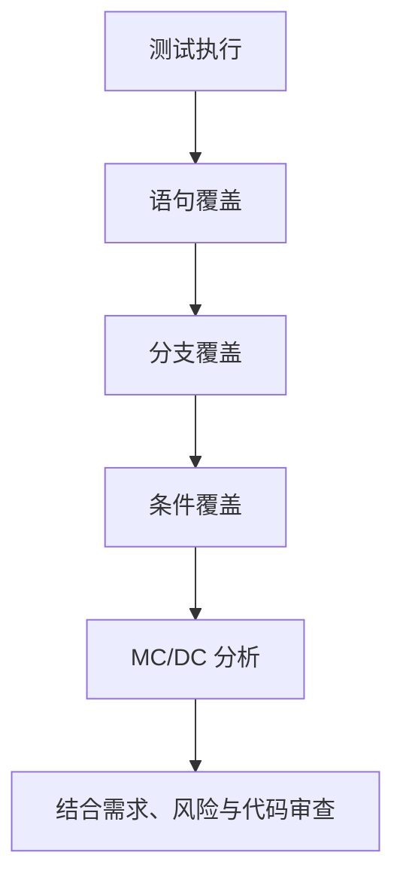

# 48｜单元测试覆盖率与 MC/DC 入门

## 学习目标

- 区分语句覆盖、分支覆盖、条件覆盖和 MC/DC。
- 理解覆盖率是测试充分性的证据之一，而不是软件正确性的证明。
- 为包含多个条件的安全相关逻辑设计可解释的测试用例。
- 认识覆盖率工具的插桩方式、构建配置和目标平台限制。

## 覆盖率层次概览



此图表示常见分析维度逐步深入，不代表 MC/DC 在所有程序中都严格包含或替代其他覆盖指标。实际覆盖定义以项目标准和工具说明为准。

## 1. 几种覆盖率

- **语句覆盖**：每条可执行语句是否至少执行一次。
- **分支覆盖**：每个判定结果或控制流分支是否都被走到。
- **条件覆盖**：每个布尔子条件是否分别取过真和假。
- **MC/DC（修改条件/判定覆盖）**：对判定中的每个独立条件，展示该条件单独改变时能够改变整个判定结果，同时控制其他条件，使其影响可被识别。具体判定规则需遵循项目采用的标准和工具定义。

覆盖率的分母可能受不可达代码、编译条件、异常路径和工具设置影响；报告中应明确范围和排除理由。

## 2. 示例：三个条件的判定

```c
#include <stdbool.h>

bool can_enable_output(bool power_ok,
                       bool sensor_ok,
                       bool no_fault)
{
    return power_ok && sensor_ok && no_fault;
}
```

对于这个简单的 AND 判定，以下测试可展示每个条件对最终判定结果的独立影响：

| 用例 | power_ok | sensor_ok | no_fault | 预期结果 |
|---|---:|---:|---:|---:|
| T1 | 真 | 真 | 真 | 真 |
| T2 | 假 | 真 | 真 | 假 |
| T3 | 真 | 假 | 真 | 假 |
| T4 | 真 | 真 | 假 | 假 |

- T1 与 T2 对比：只改变 `power_ok`，判定结果变化。
- T1 与 T3 对比：只改变 `sensor_ok`，判定结果变化。
- T1 与 T4 对比：只改变 `no_fault`，判定结果变化。

该例适用于展示简单判定的独立影响思路。真实项目中的复杂布尔表达式、短路求值、隐含条件和多个出口，需要根据适用标准及覆盖工具生成并审查测试对。

## 3. 如何设计覆盖率工作流

1. 确认测试需求和需要度量的源文件范围。
2. 选择工具支持的插桩或编译选项，并使用一致的编译配置。
3. 运行测试，确保失败用例能让测试进程返回非零状态。
4. 生成报告，检查未覆盖行、分支和判定。
5. 对未覆盖项分类：漏测、不可达、配置未启用、工具限制或经过批准的排除。
6. 为补充测试保存需求、用例、结果和版本之间的追溯关系。

覆盖率构建可能改变时序和内存占用，特别是在嵌入式目标上。必要时应使用主机端覆盖率构建分析逻辑，再结合目标机测试验证硬件相关行为。

## 4. 适用边界

- 覆盖率高并不保证断言正确、需求完整或测试预期合理。
- 语句覆盖无法证明每个分支和每个布尔条件都被有效测试。
- MC/DC 也不能代替需求追溯、边界分析、故障注入和代码审查。
- 具体覆盖目标应由适用的安全标准、项目计划和风险分析决定，不要随意宣称某个百分比适用于所有项目。
- 不可达代码的处理需要证据与批准，不应仅为提升百分比而删除或屏蔽报告。

## 5. 练习与验收

1. 为示例函数实现测试，覆盖全部真/假组合。
2. 对比语句覆盖和分支覆盖报告，解释差异。
3. 为项目中一个包含多个子条件的判定设计 MC/DC 测试对。
4. 检查每个测试是否有明确预期，而非只执行代码。
5. 为未覆盖项记录原因、风险和处置结论。

**验收标准：** 能解释不同覆盖指标的含义，能为每个条件设计独立影响测试，并能说明覆盖率报告的范围、限制和追溯要求。