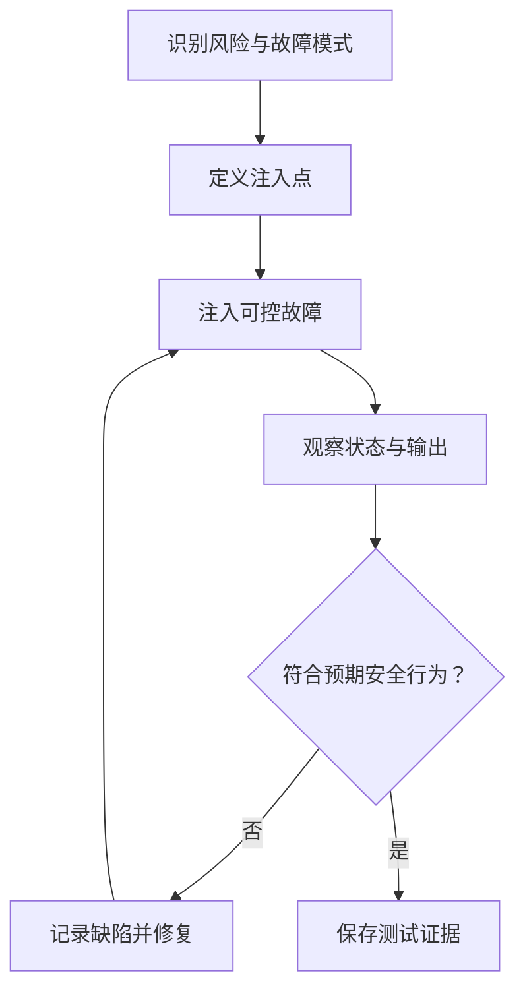
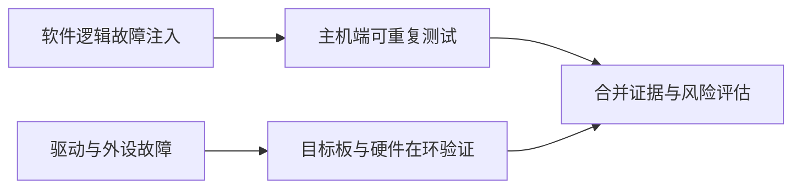

# 49｜嵌入式故障注入与鲁棒性测试

## 学习目标

- 将故障注入用于验证错误处理、超时和恢复逻辑。
- 覆盖传感器异常、通信丢包、资源不足和驱动失败等场景。
- 区分可控的软件模拟故障与真实硬件故障。
- 为每个故障场景定义触发条件、预期安全行为和恢复判据。

## 故障注入闭环

## 1. 故障场景矩阵

| 故障类型 | 注入方式 | 需要观察的行为 |
|---|---|---|
| 传感器读取失败 | Fake 驱动返回错误码 | 错误是否向上层传递，输出是否进入定义的降级状态 |
| 通信超时 | 延迟或不返回应答 | 超时是否生效，资源是否释放，重试是否受限 |
| 报文格式错误 | 截断、长度越界、非法枚举值 | 解析器是否拒绝输入，是否避免越界访问 |
| 存储写入失败 | Fake EEPROM 返回失败 | 是否报告错误，是否避免把未写入数据标记为成功 |
| 内存分配失败 | 测试替身使分配返回空指针 | 是否检查返回值，是否泄漏已取得资源 |
| 计时器回绕 | 将虚拟 tick 设在回绕附近 | 超时计算是否保持正确 |
| 重复或乱序事件 | 改变事件顺序 | 状态机是否拒绝非法转移或保持一致性 |

每个预期行为应来自需求、安全分析或接口契约，而不是测试人员临时猜测。

## 2. 优先在接口边界注入

适合主机测试的注入点包括：

- 驱动接口返回值。
- 可控制的虚拟时间源。
- 通信收发适配层。
- 存储读写接口。
- 内存分配包装接口。
- 状态机事件输入。

优先通过 Fake 或依赖注入实现可重复测试。不要为了测试而随意修改生产逻辑，也不要在产品版本中遗留可被非授权触发的危险测试开关。

## 3. 故障测试的基本约定

每个测试场景至少记录：

1. **前置状态**：初始状态、配置、输入和资源条件。
2. **注入方式**：在哪个接口、何时、注入什么故障。
3. **预期行为**：错误码、输出状态、重试次数、超时上限和资源清理。
4. **观察证据**：日志、状态转移、计数器、测试断言或目标机跟踪。
5. **恢复判据**：故障解除后是否允许恢复，恢复需要哪些条件。
6. **复位和清理**：确保下一个用例不受前一个故障影响。

## 4. 主机注入与目标板注入

主机端可以高效验证状态机和错误处理，但无法完整模拟电气噪声、总线物理层问题、DMA/缓存一致性、真实中断时序或芯片复位行为。涉及硬件安全与时序的场景需要按项目要求进行目标板或硬件在环验证。

## 5. 安全边界

- 故障注入只应在授权的开发、测试或受控实验环境进行。
- 对执行器、动力系统和其他可能造成伤害的输出，先明确隔离措施和安全状态，再执行测试。
- 不要在真实运行中的关键设备上随意注入断电、内存破坏或总线阻断故障。
- 生产固件中应避免暴露未经保护的故障注入接口。
- 测试日志可能包含敏感信息，应遵守项目数据管理规则。

## 6. 练习与验收

1. 为传感器模块注入读取失败、超时和超范围数据。
2. 为协议解析器输入截断报文、错误长度和未知消息类型。
3. 为非阻塞状态机测试时间回绕与重复事件。
4. 验证错误发生后资源释放、错误上报和恢复策略。
5. 将每个失败用例转化为自动回归测试。

**验收标准：** 每种注入都有明确的预期结果和安全边界；故障处理可重复验证；主机端与目标机验证范围清晰区分；发现的缺陷能够沉淀为回归用例。