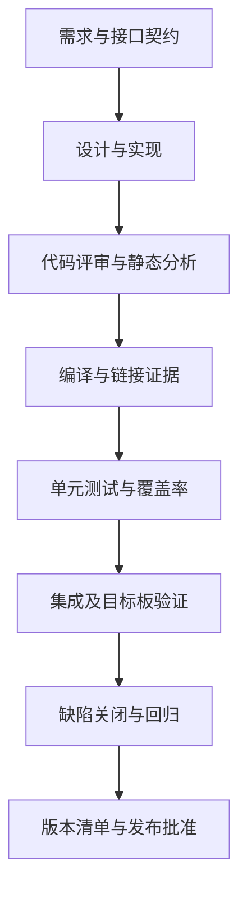
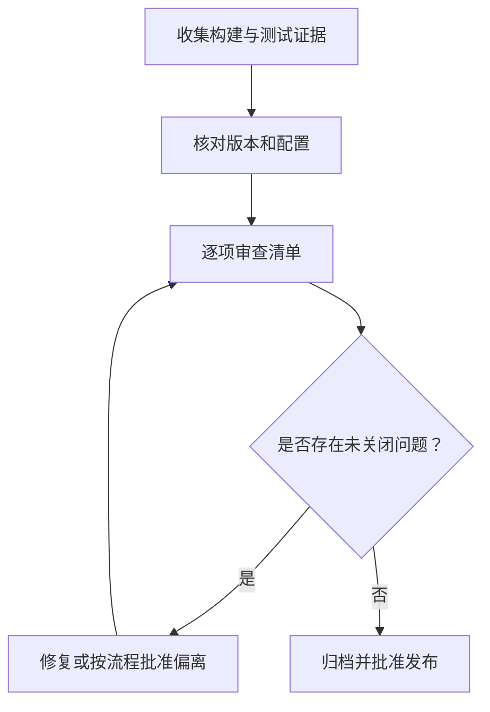

# 50｜汽车电子 C 工程交付检查清单

## 学习目标

- 把编码、构建、测试、集成和发布证据串成可审查的交付闭环。
- 区分代码质量证据、软件验证证据和产品级验证结论。
- 建立适合汽车电子软件模块的发布检查清单。
- 对未完成项、偏离项和已知问题保留明确记录。

## 交付证据链

## 1. 代码与接口

- [ ] 对外接口有明确的参数范围、单位、错误码和生命周期约定。
- [ ] 指针、缓冲区、长度、对象所有权和资源释放路径经过检查。
- [ ] 并发、中断共享数据和硬件寄存器访问遵循平台约束。
- [ ] 编码规则、命名、格式和评审要求有统一约定。
- [ ] 对规则偏离、第三方代码和生成代码有明确管理方式。

## 2. 构建与链接

- [ ] 编译器、链接器、运行库和工具链版本有记录。
- [ ] 构建配置、宏定义、目标架构选项和链接脚本受控。
- [ ] 从干净目录完成构建，构建步骤可重复执行。
- [ ] 编译器警告和链接告警经过分类处理。
- [ ] 保存 ELF/AXF、HEX/BIN、MAP 及必要的符号文件。
- [ ] 检查代码段、静态 RAM、栈和堆的预算与余量。
- [ ] 关键链接符号、段地址和启动初始化符合目标平台设计。

## 3. 测试与质量

- [ ] 单元测试覆盖正常、边界和错误路径。
- [ ] Fake/Mock 与真实驱动遵循相同接口契约。
- [ ] 静态分析结果经过审查，问题有处置记录。
- [ ] 覆盖率指标、统计范围和排除项有说明。
- [ ] 故障注入验证超时、驱动失败和异常恢复路径。
- [ ] 目标板验证覆盖主机测试无法证明的启动、时序和外设行为。
- [ ] 修复缺陷后执行相关回归测试。
- [ ] 测试报告能追溯到源码提交和构建配置。

## 4. 发布与可追溯性

- [ ] 发布版本与精确 Git commit/tag 对应。
- [ ] 构建环境、工具链、配置和依赖版本有记录。
- [ ] 发布产物文件名、版本和校验和已核对。
- [ ] 归档构建日志、测试报告、MAP 和必要的符号文件。
- [ ] 已知问题、未完成项和风险接受有明确记录与批准。
- [ ] 发布权限、签名、密钥和产物访问控制符合项目安全要求。
- [ ] 回滚、重新构建和现场版本核对流程可执行。

## 5. 交付状态不能只写“通过”

建议每项记录为以下状态之一：

| 状态 | 含义 |
|---|---|
| 通过 | 有证据表明检查满足要求 |
| 失败 | 检查不满足要求，需修复或处置 |
| 未执行 | 尚未运行，不得写成通过 |
| 不适用 | 需给出适用性理由 |
| 有条件接受 | 存在偏离，必须记录风险、批准人和限制 |

检查项的勾选必须基于实际证据。模板本身不是项目已经通过验证的证明。

## 6. 交付审查流程

## 7. 练习与验收

1. 为一个练习模块建立完整交付目录：源码版本、构建日志、测试报告、MAP 和校验和。
2. 选一个缺陷，展示从发现、修复、回归到关闭的证据链。
3. 为未执行的目标板测试明确标注限制，而不是勾选通过。
4. 模拟发布版本回滚，确认旧产物能被准确识别。
5. 将本清单裁剪成团队可执行的项目模板，并标注负责人和证据存放位置。

**验收标准：** 交付结论可追溯到实际证据；未执行项和偏离项不会被误报为通过；源码、构建配置、测试结果和发布产物之间有清晰关联。