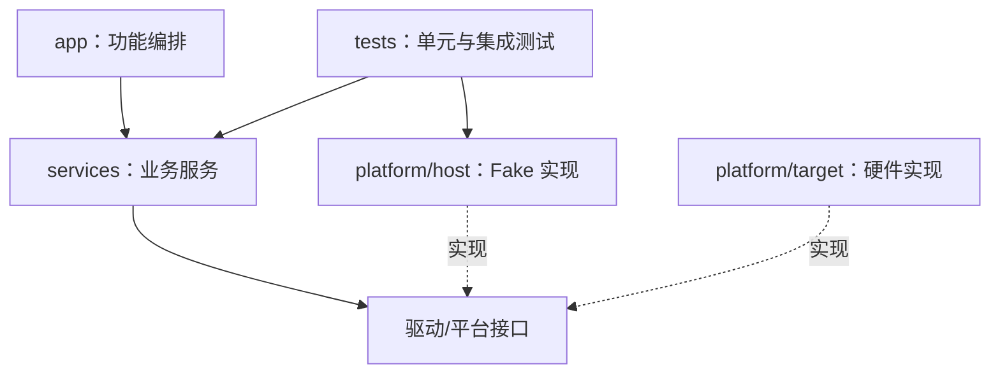

# 51｜汽车电子 C 项目目录结构与分层架构

## 学习目标

- 把应用逻辑、服务层、驱动适配和平台代码分开。
- 通过依赖方向降低硬件耦合，支持主机端测试与多工具链构建。
- 明确哪些模块可以依赖哪些模块，避免循环依赖。

## 1. 推荐目录

```text
automotive-c/
├── app/                 # 产品功能编排、顶层状态机
├── services/
│   ├── sensor_service/  # 采集调度、数据质量判断
│   └── fault_service/   # 故障状态与诊断事件
├── drivers/
│   └── sensor/          # 传感器驱动接口及实现
├── platform/
│   ├── host/            # 主机端 Fake 时钟、Fake 驱动
│   └── target/          # MCU、寄存器、启动和中断适配
├── include/             # 经审查的公共接口（按项目规模选择）
├── tests/
│   ├── unit/
│   └── integration/
├── config/              # 受控配置，不存放密钥
├── CMakeLists.txt
├── Makefile
└── README.md
```

不要为了目录看起来整齐而拆出没有独立职责的层。小项目可以合并目录，但应保留清晰的依赖边界。

## 2. 依赖方向



业务层调用稳定的接口，不直接访问 MCU 寄存器；目标平台实现接口，主机测试用 Fake 实现同一契约。虚线表示“实现接口”，并非业务代码依赖具体实现。

## 3. 接口示例

```c
#ifndef SENSOR_PORT_H
#define SENSOR_PORT_H

#include <stdint.h>

typedef enum {
    SENSOR_OK = 0,
    SENSOR_E_ARGUMENT,
    SENSOR_E_IO,
    SENSOR_E_TIMEOUT
} sensor_status_t;

/* 成功时写入 raw；失败时不得使用 raw 的旧值作为新样本。 */
sensor_status_t sensor_read_raw(uint16_t *raw);

#endif
```

接口约定应明确：输入输出参数、单位、错误码、调用上下文、超时、并发限制和数据有效期。仅有函数原型不等于完整契约。

## 4. 设计规则

1. **依赖朝稳定接口**：高层不包含芯片寄存器头文件。
2. **平台差异集中**：时钟、临界区、硬件访问放在平台适配层。
3. **避免隐式全局状态**：优先通过参数传递依赖；确需单例时记录生命周期。
4. **错误向上传递**：底层不要静默吞掉失败，也不要随意打印后假装成功。
5. **接口与实现分离**：公共头文件不暴露私有结构布局，除非这是明确的 ABI 要求。

## 5. 常见反模式

- 服务层直接写寄存器，导致主机端无法编译。
- 多个模块互相包含私有头文件，形成循环依赖。
- 错误码含义在各模块中不一致。
- Fake 实现与目标实现的行为契约不一致。
- 将生成文件、工具链路径和本机绝对路径混入公共源码。

## 6. 练习与验收

1. 为现有练习画出模块依赖图，标出每条依赖的理由。
2. 把一个直接访问硬件的业务函数改为依赖接口。
3. 为同一接口准备 Fake 和目标实现的函数清单。
4. 检查公共头文件能否被独立包含，是否存在循环依赖。

**验收标准：** 业务层可在不包含目标芯片头文件的情况下进行主机编译；平台差异集中在少数适配文件；每个接口都有错误语义和调用约束。
