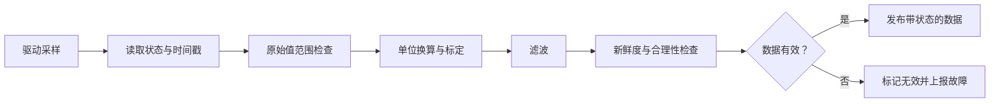

# 52｜传感器采集、滤波与数据质量管理

## 学习目标

- 区分原始采样、物理量换算、滤波和数据有效性判定。
- 为传感器数据建立范围、时间新鲜度和故障状态检查。
- 避免将“滤波后平滑”误认为“数据一定可信”。

## 1. 数据处理流水线



每个阶段都应能单独测试。不要把驱动读取、换算、滤波和故障决策全部塞进一个不可测试的函数。

## 2. 为数据附带状态

```c
#include <stdbool.h>
#include <stdint.h>

typedef enum {
    SENSOR_DATA_VALID = 0,
    SENSOR_DATA_NOT_INITIALIZED,
    SENSOR_DATA_OUT_OF_RANGE,
    SENSOR_DATA_STALE,
    SENSOR_DATA_IO_ERROR
} sensor_data_status_t;

typedef struct {
    int32_t value_milli_units;
    uint32_t sample_tick_ms;
    sensor_data_status_t status;
    bool valid;
} sensor_sample_t;
```

使用定点数时必须在接口中说明缩放因子、单位、有效范围和舍入方式。字段名中的单位后缀（例如 `_ms`、`_milli_units`）能减少误用，但不能替代接口文档。

## 3. 新鲜度检查与计时器回绕

对无符号 tick，若系统约定间隔不会达到计数器模数的一半，常见的回绕安全差值写法为：

```c
#include <stdbool.h>
#include <stdint.h>

bool sample_is_fresh(uint32_t now_ms,
                     uint32_t sample_ms,
                     uint32_t max_age_ms)
{
    return (uint32_t)(now_ms - sample_ms) <= max_age_ms;
}
```

该方法依赖明确的时间域约定：时间戳来自同一单调计数器，最大可比较间隔小于计数器完整回绕周期，并且 `max_age_ms` 本身在合理范围内。若系统可能停机、计数器复位或混用不同时间基准，应额外处理。

## 4. 滤波不是故障诊断的替代品

- **滑动平均**：实现简单，但引入延迟；窗口长度应与动态响应要求匹配。
- **一阶 IIR**：内存占用小，适合在线处理；定点实现需分析乘法范围和舍入。
- **中值滤波**：对孤立尖峰有帮助，但窗口与排序成本需评估。
- **限幅/变化率检查**：用于识别不合理跃变，阈值必须来自需求、传感器规格或标定依据。

应先判断样本是否可用，再决定是否参与滤波。不能让一个明显失效的样本污染滤波状态；对无效数据的保持、清零或降级策略要由需求定义。

## 5. 关键测试用例

| 场景 | 输入/条件 | 预期检查 |
|---|---|---|
| 正常值 | 标称范围内样本 | 状态有效，单位换算正确 |
| 最小/最大值 | 规格边界 | 边界规则与需求一致 |
| 越界值 | 小于最小值或大于最大值 | 标记无效或按需求降级 |
| 过期样本 | 年龄超过阈值 | 不作为新鲜数据发布 |
| 时间回绕 | tick 接近最大值后回到 0 | 差值计算符合时间域约定 |
| 读取失败 | 驱动返回错误 | 不误用旧样本冒充新样本 |
| 突变/尖峰 | 单个异常跳变 | 滤波与合理性检查行为可解释 |

## 6. 工程注意事项

- 采样周期、滤波延迟和任务调度延迟共同决定端到端响应时间。
- 物理量换算要检查乘法溢出、符号转换、除数为零和舍入偏差。
- 传感器断线、短路、冻结值和超范围是不同故障模式，不应简单合并。
- 无效数据应携带原因码或质量状态，不能只返回一个数值。
- 安全相关阈值和降级策略必须由系统需求与安全分析确定。

## 7. 练习与验收

1. 为采样数据添加时间戳、有效标志和原因码。
2. 实现范围检查和新鲜度检查，并覆盖 tick 回绕。
3. 对比滑动平均与一阶 IIR 的延迟和噪声抑制效果。
4. 模拟驱动失败，证明旧值不会被错误标记为新样本。

**验收标准：** 样本数值与质量状态同时发布；无效/过期数据不会被静默当作有效值；定点运算和时间差计算有边界测试。
