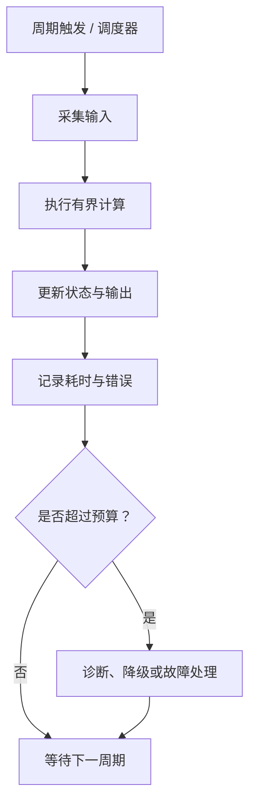

# 53｜周期任务调度与执行时间预算

## 学习目标

- 理解周期任务、采样周期、截止时间和执行时间预算的区别。
- 使用非阻塞状态机管理跨周期工作。
- 建立从任务周期到端到端响应时间的预算思路。

## 1. 任务时间概念

- **周期（period）**：任务计划启动之间的时间间隔。
- **执行时间（execution time）**：一次运行实际消耗的处理器时间。
- **截止时间（deadline）**：结果必须完成的最晚时刻。
- **抖动（jitter）**：实际启动时间相对计划时间的变化。
- **WCET**：在明确分析范围和假设下，任务最坏执行时间的上界估计；一次测量最大值不自动等于 WCET。

## 2. 周期任务工作流



ISR 中通常只做必要且有界的工作，例如确认中断、采样时间戳或投递事件；复杂解析、日志格式化和等待操作应移到可控的任务上下文。

## 3. 非阻塞状态机示例

```c
#include <stdbool.h>
#include <stddef.h>
#include <stdint.h>

typedef enum {
    JOB_IDLE = 0,
    JOB_WAITING,
    JOB_DONE,
    JOB_ERROR
} job_state_t;

typedef struct {
    job_state_t state;
    uint32_t start_ms;
    uint32_t timeout_ms;
} job_t;

/* now_ms 来自单调时钟；timeout_ms 必须小于计数器回绕周期。 */
void job_step(job_t *job, uint32_t now_ms, bool response_ready)
{
    if (job == NULL) {
        return;
    }

    switch (job->state) {
    case JOB_IDLE:
        job->start_ms = now_ms;
        job->state = JOB_WAITING;
        break;

    case JOB_WAITING:
        if (response_ready) {
            job->state = JOB_DONE;
        } else if ((uint32_t)(now_ms - job->start_ms) >= job->timeout_ms) {
            job->state = JOB_ERROR;
        }
        break;

    case JOB_DONE:
    case JOB_ERROR:
    default:
        /* 终态由上层显式复位，避免重复启动副作用。 */
        break;
    }
}
```

上例需要在文件顶部包含 `<stddef.h>` 以声明 `NULL`；在实际工程中应将其加入 include 列表。终态重启策略应由接口明确，不要依赖隐式复位。

## 4. 执行时间预算表

| 任务/阶段 | 周期或触发条件 | 预算 | 超预算处理 |
|---|---|---|---|
| 传感器采样 | 周期触发 | 按传感器时序要求分配 | 标记采样失败并诊断 |
| 数据处理 | 新样本到达 | 按算法复杂度评估 | 跳过非关键工作或按需求降级 |
| 通信解析 | 收到报文 | 按最大报文长度约束 | 拒绝超限输入 |
| 日志刷新 | 低优先级周期 | 限量处理 | 丢弃可丢弃日志并计数 |
| 故障处理 | 事件触发 | 必须有界 | 转入定义的安全处理流程 |

预算必须来自调度分析、目标机测量、静态分析或系统要求的组合证据。主机上的耗时测量不能直接证明目标 MCU 的最坏执行时间。

## 5. 常见问题

- 在周期任务中使用无上限循环等待硬件响应。
- 用延时函数阻塞其他有时限任务。
- 仅测平均执行时间，忽略最坏输入和中断干扰。
- 在 ISR 中调用不可重入函数或执行长时间日志操作。
- 以任务未崩溃作为调度满足要求的证明。

## 6. 练习与验收

1. 把一个阻塞等待流程改为每周期推进一步的状态机。
2. 为任务列出周期、截止时间、执行时间预算和超时策略。
3. 测量目标环境下的执行时间分布，并记录测量限制。
4. 模拟响应迟到、重复响应和计时器回绕。

**验收标准：** 周期任务每次执行有界；超时路径可测试；预算来源和超限行为明确；ISR 与任务上下文职责分离。
