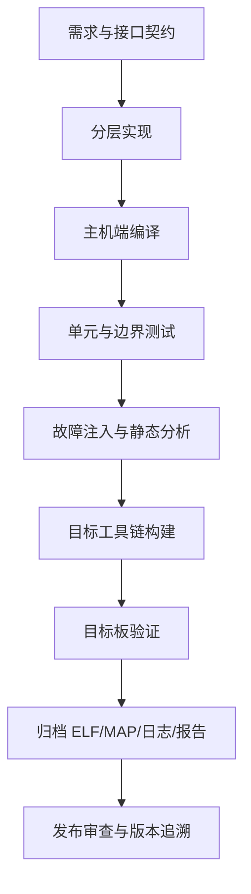

# 55｜综合项目：构建、测试与交付实战

## 学习目标

把前面关于分层架构、传感器数据、非阻塞任务、故障注入、测试和交付的知识整合为可复现的工程流程。

本节是项目蓝图，不代表仓库已包含完整目标板工程，也不声称任何未实际执行的编译或测试已经通过。

## 1. 项目范围

建议实现一个与硬件无关的传感器服务演示项目：

- 驱动接口：读取原始值并返回明确错误码。
- 服务层：范围检查、定点换算、数据时间戳与有效状态。
- 应用层：非阻塞状态机，根据数据质量决定正常、降级或故障状态。
- 主机测试：Fake 驱动、虚拟时间、正常/边界/故障用例。
- 目标适配：由具体 MCU 工程提供，不在主机演示中假设特定芯片寄存器。

## 2. 项目验证闭环



主机端测试与目标板验证互补：前者适合快速覆盖逻辑路径，后者验证真实工具链、启动、外设、时序和内存布局。

## 3. 最小目录结构

```text
automotive-c-demo/
├── include/
│   ├── sensor_port.h
│   └── sensor_service.h
├── src/
│   ├── sensor_service.c
│   └── app.c
├── platform/
│   └── host/
│       └── fake_sensor.c
├── tests/
│   └── test_sensor_service.c
├── CMakeLists.txt
├── Makefile
└── README.md
```

可根据项目规模调整目录；不要同时维护两套不一致的构建参数。Makefile 可作为简短入口，CMake 则负责目标、依赖和平台配置。

## 4. 主机端构建基线

GCC/Clang 可先使用以下警告基线，再按现有项目情况逐项收紧：

```sh
cc -std=c11 -Wall -Wextra -Wpedantic -Wconversion -Wshadow \
   -Iinclude src/sensor_service.c src/app.c platform/host/fake_sensor.c \
   -o build/automotive-c-demo
```

上面命令仅是目录与文件齐备后的示例；需根据实际入口、测试框架和平台文件调整。先保证干净构建，再将编译参数集中到构建系统中。

## 5. 测试层次

| 层次 | 主要目标 | 典型证据 |
|---|---|---|
| 单元测试 | 单个函数的边界和错误语义 | 断言结果、测试日志 |
| 模块集成测试 | 接口契约和错误传播 | Fake 驱动场景、调用序列 |
| 静态分析 | 发现潜在缺陷和规则偏离 | 工具版本、配置、结果处置 |
| 目标构建 | 目标 ABI、链接与段布局 | 编译日志、ELF、MAP |
| 目标板验证 | 启动、外设、时序与真实环境行为 | 测试记录、硬件配置、缺陷单 |

## 6. 发布产物清单

- 源码提交或标签、工具链和依赖版本。
- 构建配置、完整构建日志与可复现命令。
- 单元/集成测试结果及未执行项说明。
- 静态分析结果、偏离项和处置记录。
- 目标产物（如适用）：ELF/AXF、HEX/BIN、MAP、符号文件。
- 目标板测试记录、已知问题、版本号与校验和。
- 发布审批、回滚方案和产物存放位置。

不要将模板中的勾选项直接当作实际验证结果。每一项都要链接到对应证据。

## 7. 分阶段实施

1. **阶段 A：接口**——定义状态码、单位、数据有效期与输出参数约定。
2. **阶段 B：逻辑**——实现范围检查、换算、滤波和状态机。
3. **阶段 C：测试**——加入 Fake 驱动、虚拟时钟、边界与故障测试。
4. **阶段 D：质量**——启用编译器警告、静态分析和覆盖率统计。
5. **阶段 E：目标化**——接入具体工具链、启动代码、链接脚本和硬件驱动。
6. **阶段 F：交付**——归档版本、构建、测试、目标板验证和发布证据。

## 8. 最终验收

- [ ] 主机端可从干净目录重复构建。
- [ ] 正常、边界、非法输入和驱动故障均有测试。
- [ ] 业务逻辑不直接依赖 MCU 寄存器。
- [ ] 超时与周期处理不使用无上限阻塞等待。
- [ ] 静态分析问题和规则偏离均有记录。
- [ ] 目标构建与目标板验证范围被明确区分。
- [ ] 发布文件可追溯到源码版本、构建配置和测试报告。

**验收标准：** 项目不仅“能运行”，而且能够解释接口契约、验证范围、已知限制和交付证据。未执行的验证必须标记为未执行。
