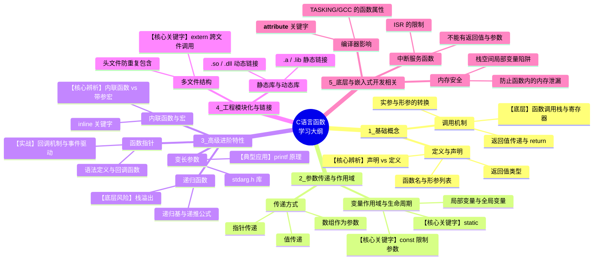

# 第六章 函数




程序把 starbar()原型置于 main()的前面。当然，也可以放在main()里面的声明变量处。放在哪个位置都可以。

```c
/*
 * This program prints a letterhead with a star bar, company name, address,
 * and a placeholder message.
 * @file lethead1.c
 * @brief Prints a letterhead with a star bar, company name, address, and a placeholder message.
 */

#include <stdio.h>

#define NAME "GIGATHINK, INC"
#define ADDRESS "123 Main Street"

#define PLACEHOLDER "Some Placeholder"

#define WIDTH   40


void starbar(void);

int main(void)
{
    starbar();
    printf("%s\n", NAME);
    printf("%s\n", ADDRESS);
    starbar();
    printf("%s\n", PLACEHOLDER);
    starbar();  

    return 0;
}

void starbar(void)
{
    for (int i = 0; i < WIDTH; i++)
    {
        putchar('*');
    }
    putchar('\n');
}
```