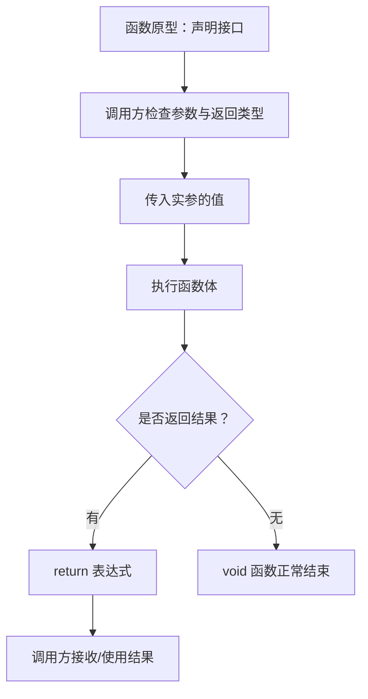
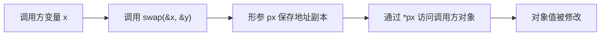
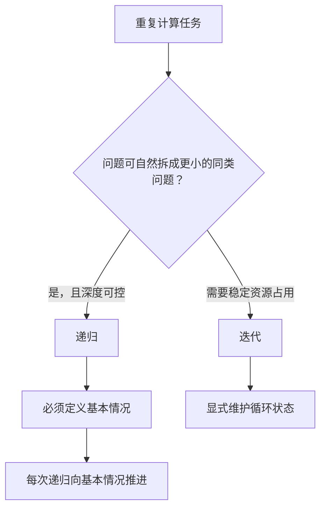

# 06｜函数与参数传递

## 学习目标

理解函数声明、定义、调用、返回值和参数传递；能通过函数拆分职责，并避免返回局部对象地址等生命周期错误。

## 1. 函数从声明到调用



```c
#include <stdbool.h>

static bool divide_int(int numerator, int denominator, int *result)
{
    if (denominator == 0 || result == NULL) {
        return false;
    }

    *result = numerator / denominator;
    return true;
}
```

此函数用返回值表示成功或失败，通过输出参数写入商。完整文件需要包含 `<stddef.h>` 或 `<stdio.h>` 等提供 `NULL` 定义的头文件之一；实际项目中应在接口注释里说明输出参数何时有效。

## 2. C 语言是按值传参

函数形参获得的是实参值的副本。若传入指针，复制的是指针值，因此可以通过它访问调用方对象，但这仍然是按值传参。



```c
static void swap_int(int *a, int *b)
{
    if (a == NULL || b == NULL) {
        return;
    }
    int temp = *a;
    *a = *b;
    *b = temp;
}
```

## 3. 作用域与局部对象生命周期

- 普通局部变量通常具有块作用域和自动存储期。
- 函数返回后，其自动存储期局部对象的生命周期结束。
- **不要返回局部变量的地址**，也不要把该地址保存给调用方使用。
- `static` 局部对象生命周期贯穿整个程序，但其名字仍只在声明它的块中可见。
- 函数原型应与定义的参数类型、返回类型一致；参数名可以不同。

## 4. 递归与迭代



递归要同时检查终止条件和最大调用深度。嵌入式场景常需评估栈空间，因此不能只因为递归代码更短就默认使用递归。

## 5. 练习与验收

1. 编写带错误状态的整数除法函数，测试除数为零。
2. 分别使用返回值、输出参数和结构体返回结果，比较接口可读性。
3. 写一个交换两个整数的函数，解释为何普通的 `swap(int a, int b)` 无法修改调用方变量。
4. 将递归求和改写为迭代，并比较终止条件和资源使用。

**验收标准：** 能解释 C 的按值传参；能正确使用指针形参修改调用方对象；能避免返回局部对象地址。
