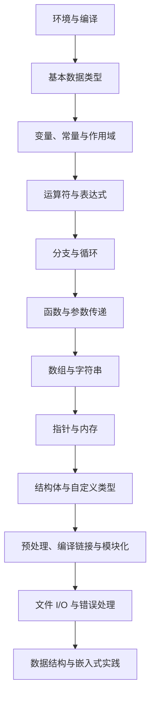
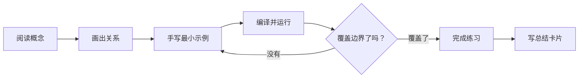

# C 语言细致小节学习手册

本目录按“概念拆解 → Mermaid 关系图 → 代码示例 → 易错点 → 练习与验收”逐节建设。内容以 C11 为基线，尽量与仓库已有章节和示例互相补充，而不是替代原有资料。

## 学习路径

## 分节导航

| 顺序 | 小节 | 本节目标 |
|---|---|---|
| 01 | [环境准备与编译流程](01-环境准备与编译流程.md) | 建立可重复编译、运行和定位问题的环境 |
| 02 | [基本数据类型](02-基本数据类型.md) | 理解类型、范围、格式说明符与整数转换 |
| 03 | [变量、常量与作用域](03-变量常量与作用域.md) | 区分对象、常量表达式、作用域和存储期 |
| 04 | [运算符与表达式](04-运算符与表达式.md) | 掌握优先级、短路求值、位运算和转换规则 |
| 05 | [分支与循环](05-分支与循环.md) | 写出边界清晰、不会意外死循环的控制逻辑 |
| 06 | [函数与参数传递](06-函数与参数传递.md) | 理解函数接口、按值传参、生命周期和递归 |
| 07 | [数组与边界](07-数组与边界.md) | 处理数组长度、参数调整和边界条件 |
| 08 | [字符串与字符处理](08-字符串与字符处理.md) | 安全处理零终止字符串、容量与字符分类 |
| 09 | [指针与地址](09-指针与地址.md) | 掌握地址、解引用、指针类型与有效范围 |
| 10 | [动态内存管理](10-动态内存管理.md) | 管理分配失败、所有权、释放和内存风险 |
| 11 | [结构体、联合体、枚举与类型别名](11-结构体联合体枚举与类型别名.md) | 组织复杂数据并理解对齐、填充和布局限制 |
| 12 | [预处理器与头文件](12-预处理器与头文件.md) | 掌握宏、条件编译、头文件保护和接口声明 |
| 13 | [编译、链接与模块化](13-编译链接与模块化.md) | 建立多文件项目、理解符号和 Makefile |
| 14 | [文件输入输出与错误处理](14-文件输入输出与错误处理.md) | 正确处理文件读写、返回值和资源清理 |
| 15 | [数据结构与复杂度入门](15-数据结构与复杂度入门.md) | 选择常见数据结构并分析操作复杂度 |
| 16 | [指针进阶与函数指针](16-指针进阶与函数指针.md) | 理解复杂声明、回调接口和函数指针约束 |
| 17 | [内存布局、对齐与未定义行为](17-内存布局对齐与未定义行为.md) | 识别对象布局、合法访问和常见未定义行为 |
| 18 | [volatile 与内存映射寄存器](18-volatile与内存映射寄存器.md) | 理解 volatile 的边界及硬件寄存器访问约束 |
| 19 | [环形缓冲区与中断/主循环协作](19-环形缓冲区与中断主循环协作.md) | 掌握队列逻辑并识别 ISR 并发同步要求 |
| 20 | [状态机、回调与模块化设计](20-状态机回调与模块化设计.md) | 组织状态转移、模块接口和可测试逻辑 |
| 21 | [位操作、寄存器字段与掩码设计](21-位操作寄存器字段与掩码设计.md) | 安全处理标志位、字段提取与寄存器语义 |
| 22 | [定点数、溢出与数值安全](22-定点数溢出与数值安全.md) | 规划单位、缩放、舍入和数值范围 |
| 23 | [驱动接口、硬件抽象与依赖隔离](23-驱动接口硬件抽象与依赖隔离.md) | 解耦业务逻辑与硬件实现，提升可测试性 |
| 24 | [错误码、断言、日志与故障诊断](24-错误码断言日志与故障诊断.md) | 统一错误语义、日志约束和故障处理路径 |
| 25 | [单元测试、边界测试与静态分析](25-单元测试边界测试与静态分析.md) | 建立主机测试、边界验证和静态检查流程 |
| 26 | [C 语言接口设计与 API 契约](26-C语言接口设计与API契约.md) | 明确参数、错误、所有权、生命周期和并发约束 |
| 27 | [编译期配置、条件编译与可移植性](27-编译期配置条件编译与可移植性.md) | 集中配置并隔离平台差异与编译器扩展 |
| 28 | [字节流、协议解析与序列化](28-字节流协议解析与序列化.md) | 安全解析报文长度、端序与字段边界 |
| 29 | [定时器、超时管理与非阻塞状态机](29-定时器超时管理与非阻塞状态机.md) | 处理超时、计时器回绕和非阻塞流程 |
| 30 | [嵌入式 C 综合项目：传感器采集与数据处理](30-嵌入式C综合项目传感器采集与数据处理.md) | 串联驱动抽象、定点换算、滤波、状态机与测试 |
| 31 | [代码规范、命名与代码评审](31-代码规范命名与代码评审.md) | 用一致规范和检查清单提升可读性与评审质量 |
| 32 | [MISRA C 基础与常见风险](32-MISRA-C基础与常见风险.md) | 认识编码指南、常见风险和偏离管理 |
| 33 | [静态分析、编译器警告与缺陷定位](33-静态分析编译器警告与缺陷定位.md) | 建立可复现的缺陷定位、诊断与回归闭环 |
| 34 | [单元测试框架、测试替身与覆盖率](34-单元测试框架测试替身与覆盖率.md) | 隔离依赖并覆盖正常、边界和故障路径 |
| 35 | [代码审查清单、缺陷复盘与回归验证](35-代码审查缺陷复盘与回归验证.md) | 将缺陷经验沉淀为测试、规则和预防措施 |

## 每节的完成标准

- 不只记语法：解释“为什么这样写”和“什么时候会出错”。
- 代码示例使用明确的类型、边界检查和错误处理。
- 编译建议：`gcc -std=c11 -Wall -Wextra -Wpedantic -Wconversion -Wshadow file.c -o app`。警告选项可按项目逐步启用。
- 每次练习至少测试一个正常输入、一个边界输入和一个非法输入。
- 本目录将逐节扩充；原有文档和代码继续保留。
