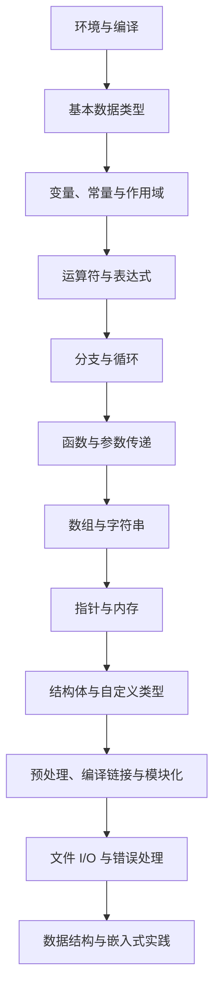
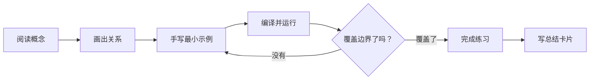

# C 语言细致小节学习手册

本目录按“概念拆解 → Mermaid 关系图 → 代码示例 → 易错点 → 练习与验收”逐节建设。内容以 C11 为基线，尽量与仓库已有章节和示例互相补充，而不是替代原有资料。

## 学习路径

## 分节导航

| 顺序 | 小节 | 本节目标 |
|---|---|---|
| 01 | [环境准备与编译流程](01-环境准备与编译流程.md) | 建立可重复编译、运行和定位问题的环境 |
| 02 | [基本数据类型](02-基本数据类型.md) | 理解类型、范围、格式说明符与整数转换 |
| 03 | [变量、常量与作用域](03-变量常量与作用域.md) | 区分对象、常量表达式、作用域和存储期 |
| 04 | [运算符与表达式](04-运算符与表达式.md) | 掌握优先级、短路求值、位运算和转换规则 |
| 05 | [分支与循环](05-分支与循环.md) | 写出边界清晰、不会意外死循环的控制逻辑 |

## 每节的完成标准

- 不只记语法：解释“为什么这样写”和“什么时候会出错”。
- 代码示例使用明确的类型、边界检查和错误处理。
- 编译建议：`gcc -std=c11 -Wall -Wextra -Wpedantic -Wconversion -Wshadow file.c -o app`。警告选项可按项目逐步启用。
- 每次练习至少测试一个正常输入、一个边界输入和一个非法输入。
- 本目录将逐节扩充；原有文档和代码继续保留。
