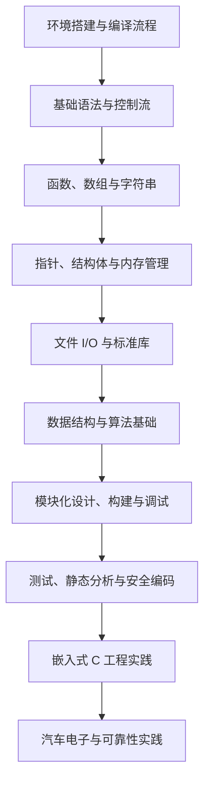
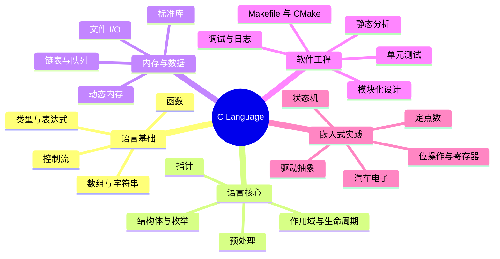
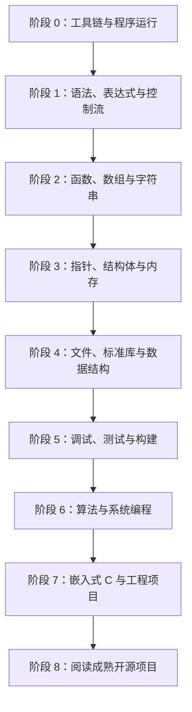
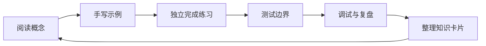

# C Programming · 从语言基础到工程实践

<p align="center">
  <strong>系统化 C 语言学习路线｜可运行示例｜工程化实践｜嵌入式与汽车电子</strong>
</p>

<p align="center">
  <a href="https://github.com/ilikui/C"></a>
  <a href="https://github.com/ilikui/C/stargazers"></a>
  <a href="https://github.com/ilikui/C/network/members"></a>
  <a href="https://github.com/ilikui/C/issues"></a>
  <a href="https://github.com/ilikui/C/blob/master/LICENSE"></a>
</p>

<p align="center">
  <em>Learn the language. Understand memory. Build reliable software.</em>
</p>

---

## 项目简介

本仓库是一套面向长期学习与工程实践的 **C 语言知识体系**，目标不止于记住语法，而是从编译运行、数据与控制流，逐步深入指针、内存模型、数据结构、调试测试、模块化设计，再进入嵌入式 C 与汽车电子工程。

仓库以中文讲解为主，强调**循序渐进、代码可运行、边界可验证、知识可复习**。既适合零基础建立完整知识框架，也适合有经验的开发者查漏补缺、复盘工程实践。

### 你可以在这里学到什么

- **语言基础**：类型、变量、运算符、分支循环、函数、数组与字符串。
- **核心机制**：指针、数组与指针关系、结构体、枚举、预处理、作用域与生命周期。
- **内存与数据结构**：动态内存、链表、栈、队列、复杂度与资源所有权。
- **工程能力**：多文件项目、头文件设计、Makefile、CMake、调试、单元测试与静态分析。
- **可靠性与安全**：输入校验、边界条件、错误处理、未定义行为与常见内存缺陷。
- **嵌入式与汽车电子**：位操作、定点数、状态机、驱动抽象、传感器数据处理与分层架构。

## 快速开始

### 1. 按路线学习

| 入口 | 适合人群 | 内容 |
| --- | --- | --- |
| [12 周系统学习计划](STUDY_PLAN.md) | 想要明确进度与目标的学习者 | 周计划、实践任务、验收标准 |
| [细致小节学习手册](Doc/细致小节/README.md) | 从基础开始逐节学习 | 分主题讲解、示例、易错点与练习 |
| [01–55 知识专题索引](Doc/Topics/README.md) | 希望系统查阅知识点 | 从编译基础到工程交付的专题导航 |
| [汽车电子 C 工程实战](examples/automotive_c_demo/README.md) | 想从语法走向项目实践 | 分层传感器服务、Fake 驱动、测试与构建 |
| [知识导图](ABasic/C语言知识点.xmind) | 需要先建立整体认知 | C 语言知识结构总览 |
| [学习文档](ABasic/CBasic.html) | 希望快速浏览旧版教程 | 现有 HTML 学习资料 |

### 2. 编译并运行第一个程序

创建 `hello.c`：

```c
#include <stdio.h>

int main(void)
{
    puts("Hello, C!");
    return 0;
}
```

使用 GCC 编译：

```bash
gcc -std=c11 -Wall -Wextra -Wpedantic -Wconversion -Wshadow hello.c -o hello
./hello
```

使用 Clang 时，将 `gcc` 替换为 `clang`。Windows 环境可以使用 MSYS2/MinGW-w64、Visual Studio Developer Command Prompt 或 WSL。初学阶段应先理解编译、链接、运行与错误信息，再逐步增加警告和分析选项。

## 学习路线图



| 阶段 | 学习重点 | 阶段成果 |
| --- | --- | --- |
| **01 · 入门** | 环境、类型、变量、运算符、控制流 | 能独立编写并解释小程序 |
| **02 · 基础扎实** | 函数、数组、字符串、作用域 | 能拆分问题并编写可复用函数 |
| **03 · 核心突破** | 指针、结构体、内存分配、预处理 | 能解释地址、生命周期与内存布局 |
| **04 · 数据与算法** | 链表、栈、队列、查找与排序 | 能实现数据结构并分析边界与复杂度 |
| **05 · 工程化** | 多文件、接口设计、构建、调试、测试 | 能交付可构建、可测试的小型项目 |
| **06 · 进阶实践** | 位操作、状态机、定点数、嵌入式分层 | 能设计具有清晰接口与故障处理的模块 |
| **07 · 深入理解** | C 标准、对象表示、未定义行为、性能 | 能阅读成熟 C 项目并进行有依据的代码审查 |

## 仓库内容导航

### 系统教程

- [细致小节学习手册](Doc/细致小节/README.md)：按知识点逐节推进。
- [专题总索引（01–55）](Doc/Topics/README.md)：每个专题包含目标、解释、代码、易错点与练习。
- [12 周学习计划](STUDY_PLAN.md)：将学习内容转化为每周可验收的实践任务。
- [汽车电子 C 工程示例](examples/automotive_c_demo/README.md)：将语言知识连接到真实工程结构。

### 知识体系概览



## C 语言从入门到精通：课程体系与学习地图

这套课程按“先能写、再写对、最后写好”的顺序组织。建议以本仓库的 [12 周学习计划](STUDY_PLAN.md) 为主线，配合下面的外部优质资源补足课程、练习和项目视角。外部项目是学习入口，不代表本仓库已经 vendoring 或复制了其全部内容。



| 课程阶段 | 核心课程内容 | 推荐学习资料 | 实践交付物 / 通关标准 |
| --- | --- | --- | --- |
| **0 · 开发环境** | GCC/Clang、编辑器、预处理/编译/汇编/链接、命令行、调试符号 | [CS50](https://cs50.harvard.edu/x/)、[C-from-Scratch](https://github.com/theokwebb/C-from-Scratch) | 编译并运行 Hello World；能解释编译错误与链接错误的区别 |
| **1 · 语法入门** | 基本类型、变量、常量、运算符、类型转换、分支、循环、输入输出 | [learn-c.org](https://www.learn-c.org/)、[Beej's C Guide](https://beej.us/guide/bgc/) | 温度转换、猜数字、菜单计算器；掌握基本控制流 |
| **2 · 函数与数据组织** | 函数声明/定义、参数传递、作用域、递归、数组、C 字符串 | [K&R 练习索引](https://github.com/caisah/K-and-R-exercises-and-examples)、[Exercism C](https://github.com/exercism/c) | 字符串反转、词频统计、数组排序；为函数编写边界测试 |
| **3 · 指针与内存** | 地址与解引用、数组/指针关系、指针运算、结构体、枚举、动态内存、对象生命周期 | [C-from-Scratch](https://github.com/theokwebb/C-from-Scratch)、[Beej's C Guide](https://beej.us/guide/bgc/) | 实现动态字符串或动态数组；解释空指针、悬空指针、越界和内存泄漏 |
| **4 · 标准库与文件** | stdio、字符串处理、整数/字符转换、文件 I/O、命令行参数、错误处理 | [cppreference · C](https://en.cppreference.com/w/c)、[K&R 练习](https://github.com/caisah/K-and-R-exercises-and-examples) | 文本统计工具、CSV 读取器；检查文件打开、读写和关闭失败路径 |
| **5 · 数据结构与算法** | 链表、栈、队列、哈希表、排序、查找、复杂度与边界条件 | [TheAlgorithms/C](https://github.com/TheAlgorithms/C)、[Exercism C](https://github.com/exercism/c) | 独立实现并测试至少 3 种数据结构与 3 种算法 |
| **6 · 工程化开发** | 头文件与源文件分层、模块接口、Makefile/CMake、Git、调试器、单元测试、静态分析、Sanitizers | [project-based-tutorials-in-c](https://github.com/7etsuo/project-based-tutorials-in-c)、[SystemProgramming](https://github.com/angrave/SystemProgramming) | 将练习重构为多文件项目；提供一键构建和测试说明 |
| **7 · 系统编程** | 进程、文件描述符、信号、管道、线程、同步、网络基础（按平台选择） | [SystemProgramming](https://github.com/angrave/SystemProgramming)、[Beej's Network Guide](https://beej.us/guide/bgnet/) | 完成一个命令行工具或简单客户端/服务端；明确 POSIX 与 ISO C 的边界 |
| **8 · 嵌入式与汽车电子** | 位操作、寄存器抽象、状态机、定点数、驱动接口、Mock/Fake、故障处理 | [本仓库 Automotive C Demo](examples/automotive_c_demo/README.md)、[FreeRTOS-Kernel](https://github.com/FreeRTOS/FreeRTOS-Kernel)、[Zephyr](https://github.com/zephyrproject-rtos/zephyr) | 完成可在主机测试的传感器服务模块；区分主机测试与目标板验证 |
| **9 · 阅读与精进** | 代码导航、模块边界、内存模型、性能分析、可移植性、代码审查 | [SQLite](https://github.com/sqlite/sqlite)、[Redis](https://github.com/redis/redis)、[musl](https://git.musl-libc.org/cgit/musl/)、[Linux](https://github.com/torvalds/linux) | 选定一个小功能追踪调用链、测试和错误路径，提交一份源码阅读笔记 |

### 建议的课程节奏

- **第 1–2 周：** 完成阶段 0–1，重点是每天动手编译，不只看视频。
- **第 3–4 周：** 完成阶段 2，练习函数拆分、数组与字符串处理。
- **第 5–6 周：** 集中攻克阶段 3，画出内存示意图，并使用调试器观察地址与变量生命周期。
- **第 7–8 周：** 完成阶段 4–5，构建文本工具和基础数据结构。
- **第 9–10 周：** 完成阶段 6–7，练习构建、测试、调试和系统接口。
- **第 11–12 周：** 完成阶段 8–9，交付一个有 README、构建命令、测试与复盘的项目。

**通关原则：** 每个阶段至少完成一个可运行项目；代码应在严格警告选项下编译，并覆盖正常、边界和错误输入。学习时优先理解标准语义，不要把某个编译器或平台的偶然行为当成 C 语言保证。

## GitHub 优质学习资源精选

以下资源按学习目的整理，优先选择具有明确内容定位、可长期参考或便于动手练习的项目。外部仓库的内容、许可和维护状态可能变化，使用前请查看各项目的 README、LICENSE 与最新提交。

### 一、从入门开始：教程与课程

| 资源 | 适合阶段 | 推荐理由 |
| --- | --- | --- |
| [learn-c.org](https://github.com/tsoding/learn-c) | 入门 / 交互练习 | 可交互的 C 入门学习体验；适合先建立基本语法直觉 |
| [C Programming — CS50](https://github.com/cs50) | 入门 / 课程体系 | 配合 CS50 课程学习编程基础、内存与问题求解 |
| [Beej's Guide to C Programming](https://beej.us/guide/bgc/) | 入门 → 中级 | 面向实践的 C 语言指南，适合边读边写 |
| [The C Programming Language 练习集合](https://github.com/caisah/K-and-R-exercises-and-examples) | 基础 → 中级 | 配合经典教材练习，巩固表达式、函数、指针与标准 I/O |
| [RUNOOB C 教程](https://www.runoob.com/cprogramming/c-tutorial.html) | 中文入门 | 快速查阅语法与基础示例，适合初学阶段辅助阅读 |

### 二、通过代码学习：算法、练习与示例

| 项目 | 适合阶段 | 推荐理由 |
| --- | --- | --- |
| [TheAlgorithms/C](https://github.com/TheAlgorithms/C) | 中级 | 阅读排序、搜索、数学等算法的 C 实现；重点比较复杂度和边界处理 |
| [Exercism · C Track](https://github.com/exercism/c) | 入门 → 中级 | 以小练习逐步训练函数设计、测试与代码表达 |
| [Allen Downey · Exercises in C](https://github.com/AllenDowney/ExercisesInC) | 入门 → 中级 | 通过题目和练习培养独立编程能力 |
| [K&R Exercises and Examples](https://github.com/caisah/K-and-R-exercises-and-examples) | 中级 | 将经典章节转化为可运行练习，并比较不同实现 |
| [Rosetta Code](https://rosettacode.org/wiki/Category:C) | 中级 | 对照不同语言的解决方案，观察 C 的表达方式与取舍 |

### 三、从“会写”到“写得好”：规范、标准与安全

| 资源 | 适合阶段 | 推荐理由 |
| --- | --- | --- |
| [ISO C working drafts（公开草案索引）](https://www.open-std.org/jtc1/sc22/wg14/www/standards) | 高级 | 深入理解 C 标准语义；注意草案不一定等同于最终出版文本 |
| [CERT C Coding Standard](https://wiki.sei.cmu.edu/confluence/display/c) | 中级 → 高级 | 学习安全编码规则、常见缺陷与修复思路 |
| [cppreference · C](https://en.cppreference.com/w/c) | 全阶段参考 | 查阅标准库、语言特性与版本差异 |
| [Compiler Explorer](https://godbolt.org/) | 中级 → 高级 | 比较不同编译器生成的汇编，理解优化与语言语义 |
| [Valgrind](https://github.com/tklengyel/valgrind) | 中级 → 高级 | 辅助发现内存错误与资源使用问题；按平台支持情况配置 |
| [AddressSanitizer 文档](https://clang.llvm.org/docs/AddressSanitizer.html) | 中级 → 高级 | 检测越界访问、释放后使用等常见内存缺陷 |

### 四、阅读真实世界的 C 项目

阅读成熟项目时，不要只浏览代码量；应沿着入口、模块边界、数据结构、错误路径、测试与构建流程逐层阅读。

| 项目 | 学习方向 | 建议观察点 |
| --- | --- | --- |
| [SQLite](https://github.com/sqlite/sqlite) | 数据库与大型 C 工程 | 模块组织、测试策略、可移植性与错误处理 |
| [Redis](https://github.com/redis/redis) | 数据结构与系统编程 | 事件循环、内存管理、数据结构和性能权衡 |
| [musl libc](https://git.musl-libc.org/cgit/musl/) | C 标准库实现 | 标准库接口、系统调用边界、可移植实现 |
| [FreeRTOS-Kernel](https://github.com/FreeRTOS/FreeRTOS-Kernel) | 实时操作系统 | 任务调度、同步原语、移植层与配置 |
| [Zephyr](https://github.com/zephyrproject-rtos/zephyr) | 嵌入式系统 | 驱动模型、设备树、构建系统与模块接口 |
| [Linux Kernel](https://github.com/torvalds/linux) | 操作系统与底层 C | 链表、并发、宏、内存管理与代码规范 |

> **阅读原则：** 先从一个小功能追踪调用链，再阅读相关测试，最后尝试修改并验证。大型项目适合分模块研究，不建议一开始从头通读。

## 建议的练习项目

| 难度 | 项目 | 训练重点 |
| --- | --- | --- |
| ★☆☆ | 命令行计算器 / 单位换算器 | 输入校验、分支、函数 |
| ★★☆ | 文本统计与日志分析工具 | 字符串、文件 I/O、错误处理 |
| ★★☆ | 动态数组、链表、栈、循环队列 | 指针、内存生命周期、边界条件 |
| ★★★ | 配置文件解析器 | 状态机、接口设计、异常输入 |
| ★★★ | 定时任务 / 简化事件循环 | 函数指针、状态管理、模块化 |
| ★★★★ | 传感器采集与数据处理 | 驱动抽象、滤波、定点数、单元测试 |
| ★★★★★ | 可测试的嵌入式服务模块 | 分层架构、Mock/Fake、故障注入、构建与交付 |

仓库内可直接实践：[Automotive C Demo](examples/automotive_c_demo/README.md)。

## 工程实践基线

建议在学习项目中逐步形成以下习惯：

- **明确标准版本**：入门默认使用 C11；阅读项目时遵守其声明的 C 标准与编译器要求。
- **启用编译警告**：从 `-Wall -Wextra -Wpedantic` 开始，理解每条警告后再处理。
- **检查输入与边界**：覆盖空输入、最大长度、非法参数、溢出与资源失败路径。
- **管理内存生命周期**：明确谁分配、谁释放；避免越界、重复释放和释放后使用。
- **让代码可测试**：将核心逻辑与硬件、I/O 等外部依赖隔离。
- **把验证写进项目**：记录构建命令、测试命令、预期结果和已知限制。
- **阅读标准与文档**：不要把某个编译器的行为误认为所有 C 实现都保证如此。

## 12 周学习节奏

完整任务与验收标准见 [STUDY_PLAN.md](STUDY_PLAN.md)。推荐每周遵循以下闭环：



每完成一个专题，请尝试回答：**它解决什么问题？底层机制是什么？常见错误有哪些？如何验证它正确？在工程中何时使用？**

## 贡献与持续改进

欢迎通过 Issue 或 Pull Request 提交勘误、补充示例、改进图示和测试。建议提交内容包含：

1. 清晰的学习目标与适用阶段；
2. 可复制运行的代码和构建方式；
3. 正常路径、边界条件与失败路径；
4. 参考资料与许可说明；
5. 必要的 Mermaid 图、测试输出或复现步骤。

新增内容优先归入对应专题，避免重复建设；外部资源应注明用途并链接原始来源，不直接复制未确认许可的教材或代码。

## License & Disclaimer

本仓库中的内容以仓库实际 LICENSE 文件为准。外部资源归其各自作者与项目所有，请遵循原项目的许可证和使用条款。学习示例不应未经审查直接用于安全关键或量产系统；汽车电子与嵌入式项目还需满足目标平台、编码规范、测试覆盖与项目流程要求。

---

<p align="center">
  <strong>从语法到原理，从练习到工程。</strong><br>
  <sub>持续积累 · 持续实践 · 持续创造</sub>
</p>
