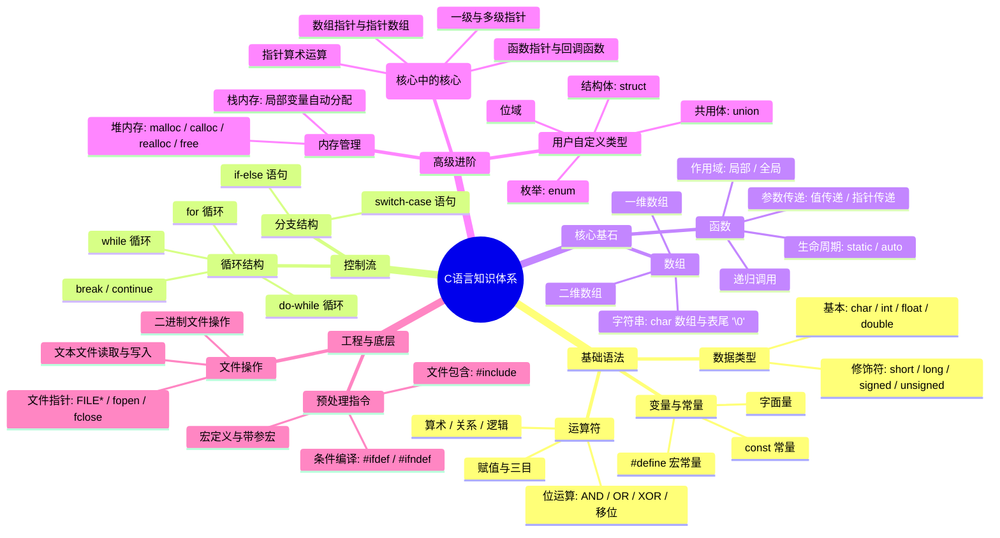
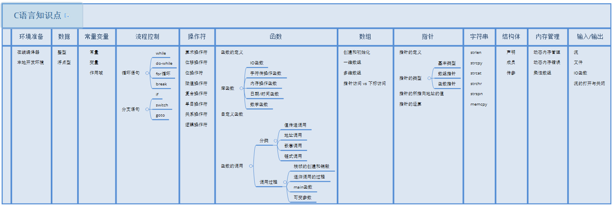

> C语言学习手册

> 文档链接  😀 `www.likui.info/C`
---

- [C语言初级教程](#c语言初级教程)
- [C语言进阶教程](#c语言进阶教程)
- [C语言高级教程](#c语言高级教程)

## C语言初级教程

> 常用网站搜集
>
> * 网站搜集扩充中....

| 网站                                                          |     |     |
| ------------------------------------------------------------- | --- | --- |
| [RUNOOB](https://www.runoob.com/cprogramming/c-tutorial.html) |     |     |
|                                                               |     |     |
|                                                               |     |     |

> GitHub
>
> * 搜集中....

|     |     |     |
| --- | --- | --- |
|     |     |     |
|     |     |     |
|     |     |     |

> 思维导图 [思维导图链接](ABasic/C语言知识点.xmind)

> 学习文档 [学习文档](ABasic\CBasic.html)

> 学习导图 [学习导图](Image/ABasic/Banner.PNG)

| [环境准备](ABasic\CH001\环境准备.md) | 数据类型 | 常量变量  |
| ------------------------------------ | -------- | --------- |
| 流程控制                             | 操作符   | 函数      |
| 数组                                 | 指针     | 字符串    |
| 结构体                               | 内存管理 | 输入/输出 |

## C语言进阶教程

##  C语言高级教程